# Results: Step 1 — data foundation and viability checks

- Plan: [`docs/plans/step-1-plan.md`](../plans/step-1-plan.md) (Approved 2026-11-21)
- Spec: [`docs/05_roadmap/step-1-data-foundation-and-viability.md`](../05_roadmap/step-1-data-foundation-and-viability.md)
- Branch: `step-1-data-foundation`
- Environment: conda env **`gn-next-gen`**, created from `environment.yml` on this machine
  (Python 3.12, JAX 0.12.1 with CUDA on 4× A100, NumPyro 0.22, pandas 3.1.1)
- Decisions taken in session by the PI, 2026-11-21: Step 1 uses RGO/Debrecen/KMAS only;
  Check A's thresholds are advisory on this pass; v1.3_4 supersedes v1.3_3 in place
  ([ADR-010](../06_decisions/ADR-010-in-place-release-supersession.md)); `duplicate_rule`
  defaults to `max`; **K = 41**

> **Every number below is produced by a committed script and read from a committed CSV.**
> Verification in this step is figure-first: each claim names the figure that shows it, and
> **every figure is embedded here with a caption**, so the argument can be read without opening a
> single file. Figures are referred to by their code (`f01`-`f12`), which is also their filename
> under [`figures/step-1/`](figures/step-1/). Each one is rendered in both light and dark and the
> embed picks the variant matching your theme, so a dark-mode reader gets the dark figure.

## Summary

| Question | Answer |
|---|---|
| Is the area distribution stationary across the reference era? | **At matched activity, yes** — RGO and Debrecen describe the same Weibull + log-normal law to within 0.05 in every parameter, a century apart. But the law **moves with the cycle**: within a survey, `μ` spans 0.31–0.42 across activity bins, more than any survey pair differs at matched activity |
| Is there two-population structure in areas? | **Yes — Weibull (small objects) + log-normal (active regions)**, not two log-normals (ADR-011). The log-normal half tracks activity and reproduces the published power laws; the Weibull half does not move, and most of it lies below every survey's completeness threshold |
| Does an immigration–death chain reproduce the reference's daily statistics? | **Partly.** It reproduces the count marginals (zero fraction, count distribution, run lengths) within target, and fails the rotation-dependent measures by 3–5×: the lag-13 trough, the lag-27 recurrence and the lifetime distribution. **Go, with an explicit rotation component required in Step 4** |
| What should Step 4 use? | K = 41; φ is a **visible-residence** parameter, not an intrinsic lifetime; lifetimes need an explicit rotation kernel |
| Is the forward filter affordable at full length? | **Yes, on CPU**: 0.667 s per evaluation at T = 152,000, K = 41. **Not on GPU**: 6.95 s, ten times slower |

## 1. The data foundation

### 1.1 A new release of the observation database

The PI supplied `Revised collection_v1.3_4.xlsx` on 2026-11-21. It fixes most of what this
project reported upstream in [`gn-v13-feedback-report.md`](gn-v13-feedback-report.md):

| | v1.3_3 | **v1.3_4** |
|---|---|---|
| Data rows | 1,156,673 | 1,156,368 |
| Rows with `STATION > 0` | 1,100,144 | 1,099,986 |
| Stations with data | 740 | 740 |
| Observers listed | 775 | 776 |
| **D16** duplicate `(date, station)` keys | 217 (95 conflicting) | **3 (1 conflicting)** |
| **D17** `max(GROUPS)` | 93 | **58** |
| **D18** string `'NA'` sentinel | 33 observers | **none** |
| **D19** sheet flag column | `OBSER` | **`OBSERVER`** |
| **D20** changed-in-v1.3 | green cell fill only | **explicit column** |
| Row order | unsorted | **date-sorted** |

Observer-day diff: **144 new, 78 removed, 351 with changed counts** — see `f02`. Net rows fall
because removing the ~428 duplicate rows outweighs the additions, so this is a
correction-and-deduplication release, not an extension. Coverage still stops at 2010-12-31.

<p align="center">
  <picture>
    <source media="(prefers-color-scheme: dark)" srcset="figures/step-1/f02_v13_release_diff_dark.png">
    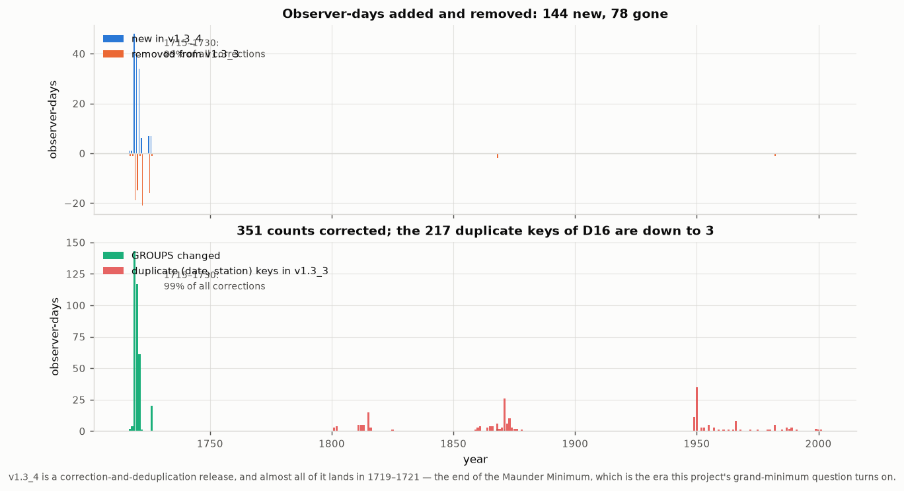
  </picture>
</p>

**Figure f02** — v1.3_3 against v1.3_4, from the committed per-year diff. Almost the whole
correction is one spike at **1719–1721**, the end of the Maunder Minimum and the start of the
recovery — the era this project's grand-minimum question turns on.

**Where the corrections land is the striking part.** 99% of the changed counts, 100% of the new
observer-days and 96% of the removals fall in **1715–1730**, concentrated in **1719–1721**
(143, 117 and 61 changed counts respectively). That is the end of the Maunder Minimum and the
start of the recovery — precisely the era this project's grand-minimum question turns on, and
precisely where ADR-008 says the series must be calibrated rather than merely asserted. Anyone
comparing a Maunder-era result against one computed from v1.3_3 is comparing different data.

Landing it in place contradicted ADR-006, so it carries **ADR-010** rather than a silent
deviation. Both workbooks are retained byte-exact; `convert_gn_database_v13.py --release v1.3_3`
regenerates the superseded tables into `data/interim/` and refuses to write them into
`data/raw/`; and `test_v133_still_reproduces` (slow) checks that they come back with their own
pinned figures, so every number in the renovation report and the feedback report stays
reproducible.

Two things worth knowing that the diff turned up:

- the derived observations parquet is **40% smaller** than the file it replaced, purely because
  `_4`'s rows are date-sorted and sorted `ORDINAL`/`FRACYEAR` columns compress far better;
- `_4`'s explicit changed-in-v1.3 column marks **100** observers against the green fill's **99**,
  disagreeing on exactly one: **station 36 (MOUTON, G., LYON)**, a placeholder with no
  observations. The converter prefers the column and prints the disagreement. Worth passing to
  the v1.3 authors as a loose end rather than a defect.

### 1.2 Loaders

`gn_next_gen.io` reads every raw input in long format — nothing densifies a day × observer
matrix. Cleaned tables cache to git-ignored `data/interim/` under a key built from the inputs'
**manifest checksums** plus the loader options, so a cache built from another release or another
duplicate rule cannot be read by mistake.

Coverage and sentinels are checked against `MANIFEST.csv` itself rather than against constants in
the test file (`f01`). The record's first observation is Harriot on **1610-12-18**; the manifest's
1610-01-01 is the table's calendar start, which is a no-observation sentinel row.

<p align="center">
  <picture>
    <source media="(prefers-color-scheme: dark)" srcset="figures/step-1/f01_coverage_dark.png">
    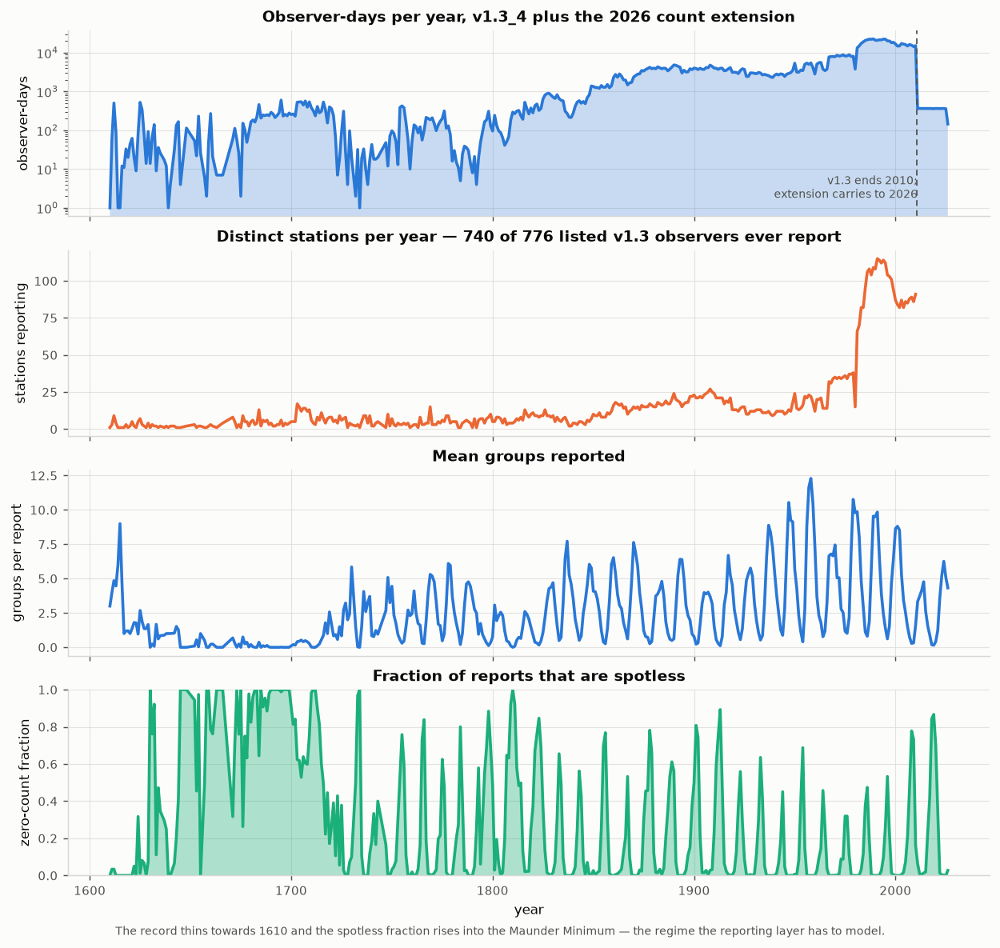
  </picture>
</p>

**Figure f01** — Coverage of the observation database, v1.3_4 plus the 2026 count extension:
observer-days and active stations per year, mean groups reported, and the fraction of reports that
are spotless. The record thins towards 1610 and the spotless fraction rises into the Maunder
Minimum — which is the regime the reporting layer has to model. The Maunder era is not a time of
fewer groups in this record; it is a time of mostly blank reports.

<p align="center">
  <picture>
    <source media="(prefers-color-scheme: dark)" srcset="figures/step-1/f04_leapday_calendar_dark.png">
    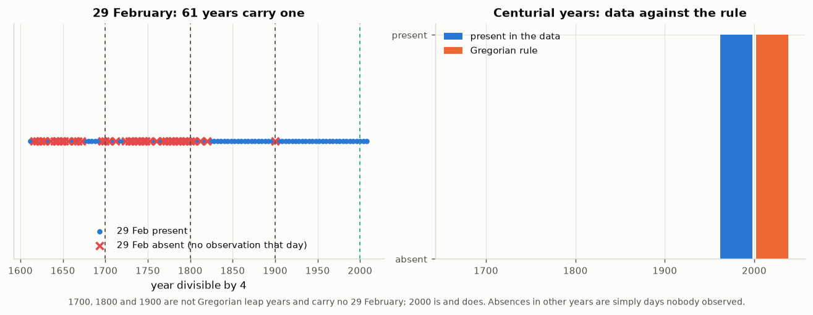
  </picture>
</p>

**Figure f04** — Every 29 February in the record against the Gregorian rule — the figure that shows
the calendar conversion is right. 1700, 1800 and 1900 carry none because they are not Gregorian
leap years; 2000 is and does. Every other absence is simply a day nobody observed, drawn as an
explicit marker so that a correct absence cannot be misread as missing data.

### 1.3 The rules that are now code, not prose

| Rule | Where it was | Where it is now |
|---|---|---|
| **Firewall** (ADR-002) — no SILSO/isotope/aurora/proxy in sunspot-only calibration | documentation | `config.validate_run_config` refuses the run; every run writes `lineage.json` with an explicit statement |
| **KMAS single-use** (ADR-009) — reference areas *or* observer counts | documentation | the config validator *and*, independently, `io.load_observations`, which withholds KMAS counts whenever `kmas_role` is `reference` |
| **D16** duplicate keys | "choose a rule in Step 1" | `io.resolve_duplicate_keys`, four rules, `max` by default |
| **D17** state-space sizing | "use a robust quantile" | a stated rule with both releases' numbers, pinned by a test (`f03`) |
| **D22** KMAS group-id collisions | "exclude them from lifetime work" | dropped by default in group-keyed tables, kept in daily counts, both tested |

<p align="center">
  <picture>
    <source media="(prefers-color-scheme: dark)" srcset="figures/step-1/f03_groups_tail_and_K_dark.png">
    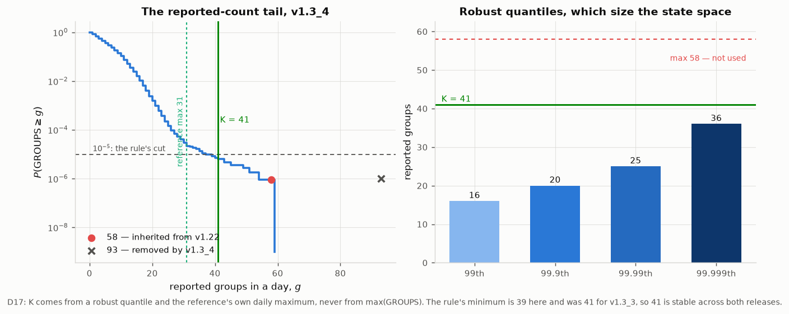
  </picture>
</p>

**Figure f03** — The `GROUPS` tail of v1.3_4 and the robust quantiles that size the state space.
The two implausible outliers sit above a tail that stops at 53, which is why **K** comes from a
quantile plus the reference's own daily maximum and never from `max(GROUPS)` (**D17**). The rule's
minimum is 39 here and was 41 for v1.3_3, so **K = 41** is stable across both releases.

### 1.4 A new issue: D23

**Schwabe and Spörer record no spotless days at all**, and Spörer tracks no group across days.
Measured from the snapshot and shown in `f05`:

| survey | no observation | **spotless** | active | groups | obs_duration |
|---|---|---|---|---|---|
| schwabe | 7,377 | **0** | 8,328 | 6,903 | median 6, max 17 |
| sporer | 8,107 | **0** | 4,311 | 5,421 | **≡ 1 for all** |
| rgo | 561 | 6,709 | 30,350 | 25,611 | median 5, max 22 |
| debrecen | 343 | 2,231 | 13,862 | 11,412 | median 6, max 41 |
| kmas | 1,319 | 3,320 | 22,024 | 22,295 | median 5 (clean) |

<p align="center">
  <picture>
    <source media="(prefers-color-scheme: dark)" srcset="figures/step-1/f05_reference_daystatus_dark.png">
    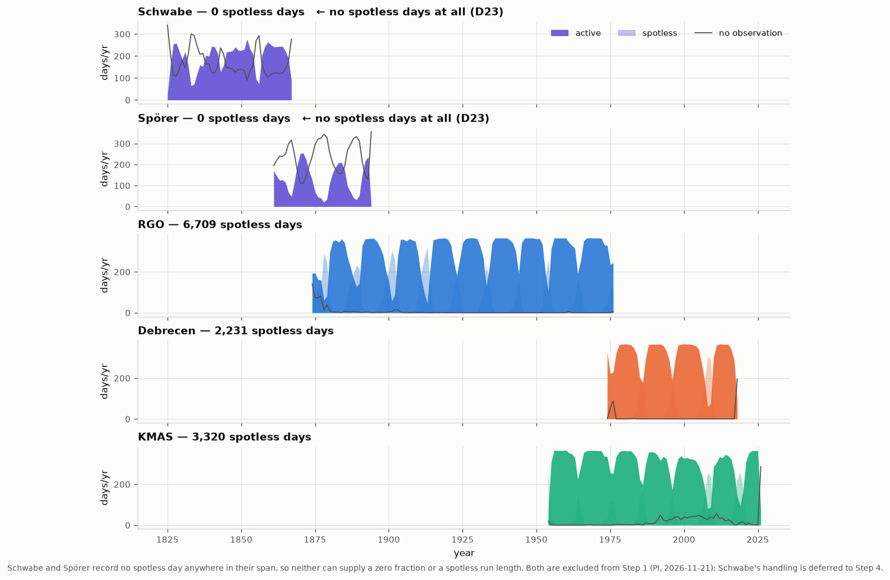
  </picture>
</p>

**Figure f05** — `day_status` per survey through time — the figure that shows **D23**. Schwabe and
Spörer have no spotless band anywhere in their span, so neither can supply a zero fraction or a
spotless run length, and two of Check A's five measures are built on exactly those. Both surveys
are therefore out of Step 1; Schwabe's handling is deferred to Step 4.

Two of Check A's five measures are built on spotless days, and Spörer has no multi-day groups to
give lifetimes, so the PI excluded both surveys from Step 1 on 2026-11-21. **Schwabe's handling is
deferred to Step 4**, where the MNAR reporting layer must face the pre-1874 era anyway. Whether
upstream collapsed their spotless days into no-observation, or never read them, is worth raising
with `sunspot-homogenization`.

**Consequence:** Step 1 produces no pre-1874 reference statistics. Check B spans 1874–2026.

### 1.5 Data refresh

SILSO SN V2.0 refreshed into `data/raw/silso_2026-11/`: daily to **2026-10-31** (was 2018-07-31)
and monthly to **2026-10** (was 2017-10), which resolves **D6** for SILSO. The files are byte-exact
as SILSO serves them — semicolon-separated and headerless, unlike the converted 2018 snapshot — and
the loader reads both. Comparison only, enforced by the config validator.

The published GN comparison series move to **Step 2**, where the benchmark consumes them (PI).

### 1.6 Issue statuses

All of **D1–D23** now carry a status in [`docs/04_data/known_issues.md`](../04_data/known_issues.md).
Resolved in this step or by v1.3_4: D6 (for SILSO), D16, D17, D18, D19 (partly), D20. Newly
registered: **D23**. Open by design: D5, D8, D10–D15, D21. Handled in code: D22, D23, and the
KMAS single-use rule.

## 2. Check B — the group-area law, its activity dependence, and its stationarity

> ### ⚠ Retraction (2026-11-21)
>
> The first version of this section fitted **two log-normal components** by EM and
> reported ΔBIC +965…+4,268 in favour of two populations, plus a percentile/KS
> stationarity battery on group-*days* conditioned on smoothed *counts*. **That result
> is withdrawn.** Two log-normals fold observational effects — resolution, detection
> bias, the convolution of cadence with feature lifetime — into the small-object
> component, so the second "population" was partly the instrument. The grain and the
> conditioning variable were wrong too. The two-population *finding* stands; its
> parameterization did not. See [ADR-011](../06_decisions/ADR-011-group-area-law.md).

**The law.** A **Weibull + log-normal** mixture on log-area `z = ln A`: a Weibull for
small objects (pores and ephemeral regions, a fragmentation regime) and a log-normal for
large ones (bipolar active regions, multiplicative growth). Calibrated per survey by
`sunspot-homogenization` and **not refitted here** (ADR-011); frozen in
`data/raw/area_law_2026-11/`.

That we are using it correctly is settled by one number: upstream fitted **one area per
group**, hard-truncated at each survey's own completeness threshold, and its kept counts
reproduce **exactly** from data already frozen here — RGO 16,880, Debrecen 8,306, KMAS
15,662 — which fixes the grain, the area column and the threshold at once.

**Activity level** is a 182-day Gaussian on daily sunspot area, in mHem (ADR-011),
whole-Sun so that it carries no positional information and may feed Step 4. Two
weightings differ by about six and must not be mixed: the 2015 paper's is
**emergence-weighted** (one peak area per group, on its canonical day) and peaks at
0.50 mHem for RGO, matching its published 0–0.4 axis; summing every group present on
each day instead gives 3.24 mHem.

<p align="center">
  <picture>
    <source media="(prefers-color-scheme: dark)" srcset="figures/step-1/f10_checkB_area_law_dark.png">
    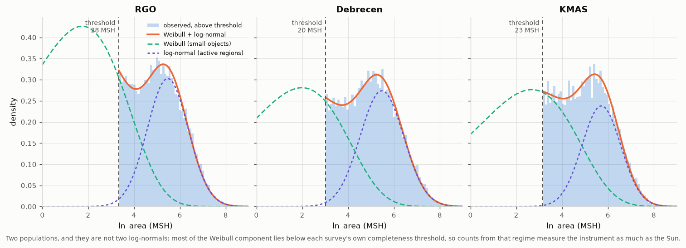
  </picture>
</p>

**Figure f10** — The fitted **Weibull + log-normal** law against the data, per survey, on log-area.
This is the visual form of the retraction above: the small-object component is a left-skewed Gumbel
in log area, **not a second Gaussian**, and most of its mass lies below each survey's own
completeness threshold (marked) — so counts drawn from that regime measure the instrument as much
as the Sun.

### 2.1 The Weibull component does not move with activity

All five parameters free, per activity bin, ten bins per survey (`f11`):

| | RGO | Debrecen | KMAS |
|---|---|---|---|
| `k_W` vs activity | ρ = −0.53 (P = 0.88) | +0.12 (P = 0.25) | +0.31 (P = 0.62) |
| `λ_W` vs activity | ρ = −0.16 (P = 0.34) | +0.21 (P = 0.44) | +0.39 (P = 0.74) |

Nothing reaches the 0.95 confidence the paper uses, and **the signs disagree across
surveys**, which is what noise looks like rather than a trend. The magnetic-baseline
claim of Muñoz-Jaramillo et al. (2015) holds on this data, and that is what licenses
holding `(k, λ)` fixed. The check is a **gate**: the script stops before stage 2 if a
Weibull parameter is ever detected in the same direction in every survey.

One caveat stated plainly: above these truncation thresholds the Weibull component is
only weakly identified — most of its mass is below the cut — so this is "no *detectable*
dependence", not a proof of none.

<p align="center">
  <picture>
    <source media="(prefers-color-scheme: dark)" srcset="figures/step-1/f11_checkB_activity_dark.png">
    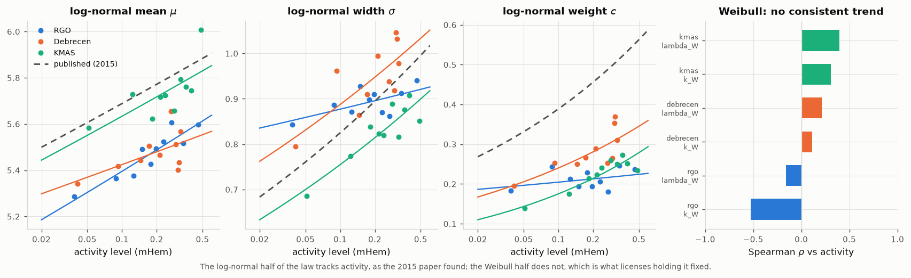
  </picture>
</p>

**Figure f11** — The log-normal parameters `μ`, `σ` and `c` against activity level, with the
**published 2015 power laws overlaid** (dashed), and the Weibull gate in the fourth panel. The
log-normal half of the law tracks activity, as the 2015 paper found; the Weibull half shows no
consistent trend and its signs disagree across surveys — which is what licenses holding `(k, λ)`
fixed. The gate is enforced in code: the script stops before stage 2 if a Weibull parameter ever
moves the same way in every survey.

### 2.2 The log-normal component does, and reproduces the published power laws

`(k, λ)` fixed at upstream's values; `μ`, `σ` and the log-normal weight `c` fitted per
activity bin, then power laws in activity level. **Published** values are
`μ = 5.97·AL^0.021`, `σ = 1.08·AL^0.117`, `c = 0.66·AL^0.230`:

| survey | `μ(AL)` | `σ(AL)` | `c(AL)` |
|---|---|---|---|
| RGO | 5.709·AL^**0.025** (ρ = +0.93) | 0.940·AL^0.030 (ρ = +0.45) | 0.233·AL^0.057 (ρ = +0.21) |
| Debrecen | 5.610·AL^0.015 (ρ = +0.43) | 1.104·AL^**0.095** (ρ = +0.70) | 0.403·AL^**0.225** (ρ = +0.85) |
| **KMAS** | **5.917·AL^0.021** (ρ = +0.79) | **0.970·AL^0.109** (ρ = +0.72) | 0.340·AL^0.289 (ρ = +0.76) |

**KMAS reproduces the published μ exponent to three decimals (0.021) with an amplitude
0.9% low**, and its σ exponent lands at 0.109 against 0.117. Debrecen's `c` exponent is
0.225 against 0.230. That is a real reproduction: different data, a different
cross-calibration, a different fitting method, two independent decades apart. KMAS
agreeing closest is what one would expect, since it is the survey the 2015 paper used.

**The amplitudes sit systematically below the published ones**, most visibly for `c`
(0.23–0.40 against 0.66). That offset was predicted before the fits ran and has two
identifiable causes, neither of them a discrepancy to be tuned away: upstream's weight
convention is on the Weibull (`c = 1 − π_W`), and upstream truncates at 20–28 MSH where
the 2015 paper truncated near 10, which removes most of the Weibull mass and so changes
what the mixing weight means.

### 2.3 Stationarity, in the right parameterization

At **matched activity**, comparing the log-normal parameters across surveys:

| | `μ` | `σ` | `c` |
|---|---|---|---|
| RGO vs Debrecen | 0.052 (max 0.078) | 0.059 (max 0.123) | 0.054 (max 0.095) |
| RGO vs KMAS | **0.252** (max 0.409) | 0.091 (max 0.157) | 0.032 (max 0.080) |

RGO and Debrecen describe the same law — a century apart — to within 0.05 in every
parameter. **KMAS sits 0.25 higher in `μ`**, which tracks its higher truncation
threshold (23.4 MSH) and its much larger Weibull scale (14.5 MSH against RGO's 5.7),
i.e. a survey-calibration difference rather than a solar one.

Within a survey, each parameter moves more across activity than any survey pair differs
at matched activity (`μ` spans 0.31–0.42 across bins, against 0.05 between RGO and
Debrecen). **The cycle moves the area law more than the century does** — which is the
result Step 4 needs.

### 2.4 The grain bridge: per group against per group-day

Step 4 integrates `q_o` over the areas **on the disk on a day**, while the published law
describes **one area per group**. Fitting both the same way:

| survey | `μ` per group | `μ` per group-day | shift |
|---|---|---|---|
| RGO | 5.468 | 5.273 | **−0.194** |
| Debrecen | 5.474 | 5.278 | **−0.197** |
| KMAS | 5.734 | 5.472 | **−0.262** |

**The per-day law is smaller, not larger** — consistently, by about 0.2 in log area, a
factor of 1.2. This overturned the expectation written into the plan, which anticipated
the opposite from size-biasing (large groups live longer, so they appear on more days).
That effect is real but is outweighed by a larger one: the per-group area is each
group's **peak**, while the per-day law sees **instantaneous** areas, including every
small day at the start and end of a group's life.

**Consequence for Step 4: the published per-group law may not be used for `q_o`
unmodified.** Either fit the per-group-day law directly, as done here, or apply this
measured shift.

### 2.5 Model comparison, and where we differ from the paper

AIC over four nested forms, as the paper's Table 2 does:

| model | RGO | Debrecen | KMAS |
|---|---|---|---|
| pooled, no activity dependence | 194.7 | 213.1 | 198.5 |
| free per activity bin | **0.0** | **0.0** | 43.2 |
| `(k, λ)` fixed, free per bin | 106.1 | 169.6 | 23.4 |
| `(k, λ)` fixed, analytic power laws | 86.4 | 142.7 | **0.0** |

Every survey rejects the activity-independent law decisively, which is the main point.
But **only KMAS prefers the analytic power-law form that the paper found best**; RGO and
Debrecen prefer the fully flexible per-bin fit. With ~1,700 groups per bin the extra 42
parameters still pay for themselves, where the paper's bins were thinner. Reported as a
difference from the published result rather than smoothed over: the power-law form is a
good and portable *summary*, not the best available description of these two surveys.

## 3. Check A — do immigration–death dynamics reproduce the reference?

**Design.** Per (survey, threshold, class count): exact-filter maximum penalized likelihood for
(φ, log λ(t)) on the survey's own daily counts, with unobserved days contributing a flat emission so
the real observing calendar is respected. Then 50 simulated paths with that calendar **transplanted
onto them**, scored against five pre-registered measures. 17 cells; **16 converged** (KMAS at
T = 100 hit the 400-iteration cap).

**Fitted parameters are physically sensible.** One class, across all surveys and thresholds:

| | range |
|---|---|
| φ | 0.783 – 0.846 |
| mean visible residence, 1/(1−φ) | 4.6 – 6.5 days |
| observed median `obs_duration` | 5 – 6 days |

φ rises with threshold (RGO 0.783 at T = 0 to 0.836 at T = 60), which is what size-biased detection
predicts: larger groups live longer, so a higher acuity cut selects a longer-lived population.

**Result: three measures of five pass, and the same two fail everywhere** (`f09`). At T = 30:

| measure | RGO | Debrecen | target | |
|---|---|---|---|---|
| ACF lag-1 error | 0.004 | 0.021 | 0.03 | **pass** |
| zero fraction, max over bins | 0.034 | 0.033 | 0.05 | **pass** |
| zero fraction, mean | 0.012 | 0.012 | 0.02 | **pass** |
| count-PMF total variation | 0.020 | 0.025 | 0.05 | **pass** |
| dispersion-index error | 0.084 | 0.141 | 0.15 | **pass** |
| run-length mean error | 0.035 | 0.093 | 0.15 | **pass** |
| run-length KS | 0.048 | 0.077 | 0.05 | pass / marginal |
| **ACF RMSE, lags 1–30** | **0.157** | **0.147** | 0.05 | **3× over** |
| **ACF trough at lag 13** | **0.222** | **0.207** | 0.05 | **4× over** |
| **ACF recurrence at lag 27** | **0.262** | **0.225** | 0.05 | **5× over** |
| **visible-duration KS** | **0.177** | **0.201** | 0.05 | **3.5× over** |
| **≥13-day fraction, relative** | **0.571** | **0.490** | 0.20 | **2.5× over** |

<p align="center">
  <picture>
    <source media="(prefers-color-scheme: dark)" srcset="figures/step-1/f09_checkA_scores_dark.png">
    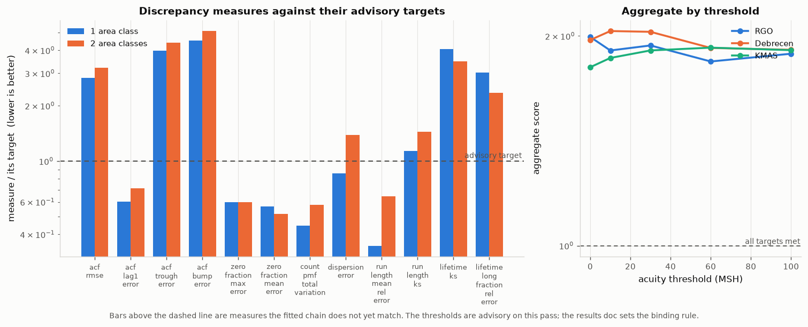
  </picture>
</p>

**Figure f09** — Every discrepancy measure against its advisory target, 1-class against 2-class.
Bars past the dashed line are measures the fitted chain does not yet match: the three
rotation-dependent ones fail in every cell, and nothing else does. The thresholds are **advisory**
on this pass — the binding go/no-go rule is set in this document, from these magnitudes, not in the
figure.

**The pattern is the finding.** Every measure the chain passes is a *marginal* count statistic — how
many groups on a day, how often a day is blank, how blank days cluster. Every measure it fails is
*temporal structure imposed by rotation*: the autocorrelation trough at one disk transit, the
recurrence bump at one synodic rotation, and the disk-passage-censored lifetime distribution. The
chain gets one-day persistence exactly right (lag-1 error 0.004) and then decays monotonically where
the data dips at lag 13 and rises again at lag 27 (`f07`).

<p align="center">
  <picture>
    <source media="(prefers-color-scheme: dark)" srcset="figures/step-1/f07_checkA_acf_dark.png">
    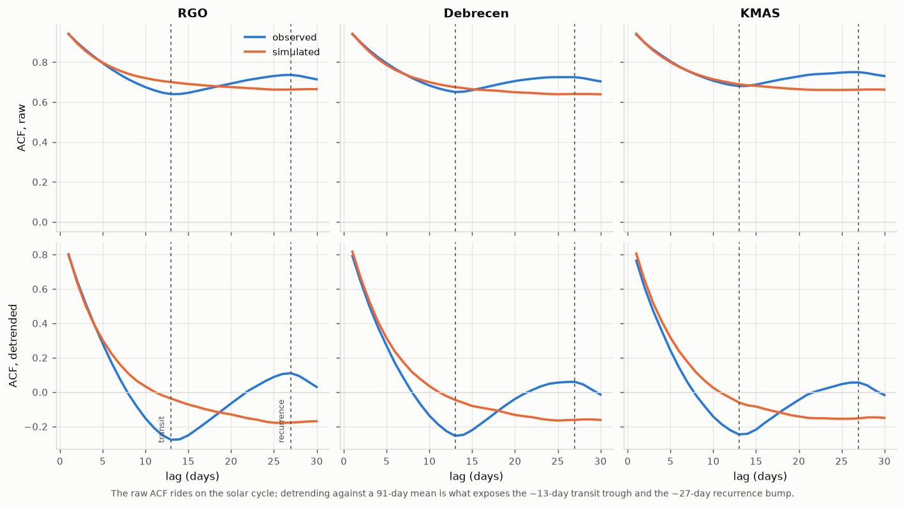
  </picture>
</p>

**Figure f07** — Observed against simulated autocorrelation, raw and detrended, per survey. The raw
ACF rides on the solar cycle; detrending against a 91-day mean is what exposes the **~13-day
transit trough** and the **~27-day recurrence bump**. The fitted chain matches lag 1 to 0.004 and
then decays monotonically straight through both features — this is the shape of the missing
rotation component.

<p align="center">
  <picture>
    <source media="(prefers-color-scheme: dark)" srcset="figures/step-1/f08_checkA_zero_counts_dark.png">
    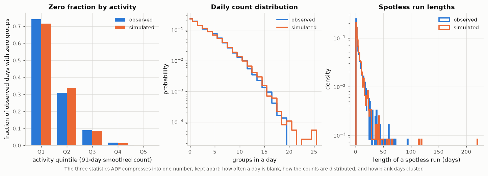
  </picture>
</p>

**Figure f08** — The three statistics ADF compresses into one number, kept apart: how often a day
is blank (by activity bin), how the daily counts are distributed, and how blank days cluster. All
three are reproduced within target. These are the marginals observer calibration is built on, which
is why the verdict is go rather than no-go.

That is not a surprise in hindsight: a memoryless geometric survival has no mechanism that can
produce a 27-day echo. It is the quantitative version of what `f06` already showed about lifetimes.

<p align="center">
  <picture>
    <source media="(prefers-color-scheme: dark)" srcset="figures/step-1/f06_lifetimes_dark.png">
    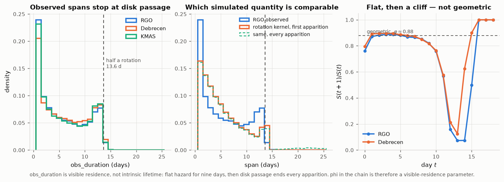
  </picture>
</p>

**Figure f06** — Observed visible spans against the rotation kernel's prediction. The hazard is
flat for about nine days and then falls off a cliff — **not geometric**. `obs_duration` measures
*visible residence*, ended by disk passage, so φ in the chain is a visible-residence parameter and
not an intrinsic lifetime. The middle panel names which simulated quantity is comparable to the
observed one, which is the distinction Check A's lifetime score rests on.

**Two area classes do not help — and why not is the useful part.** The classes are now
*observable*, split at the Weibull/log-normal crossover of the area law (ADR-011): RGO 79 MSH,
Debrecen 74 MSH. Each day's groups are assigned by their own area, so nothing is latent.

The two populations really do have different visible residences, by a factor of four:

| | φ small | mean visible days | φ large | mean visible days |
|---|---|---|---|---|
| RGO | 0.390 | **1.6** | 0.835 | **6.1** |
| Debrecen | 0.369 | **1.6** | 0.849 | **6.6** |

And yet two classes score **worse**: aggregate +39.8% for RGO and +27.8% for Debrecen, against a
bar of −25% to adopt them.

The reason is measurable, not speculative. **54% of RGO's multi-day groups above T = 30 have days
on both sides of the crossover** (53% for Debrecen). An instantaneous-area split does not partition
*groups* into two populations — it partitions *group-days*, and a group crosses the boundary as it
grows and decays. Modelling the two as independent birth–death chains therefore invents an
emergence event every time a group grows across the split, and loses the temporal coherence that
makes the observed series autocorrelated. The fitted φ of 0.39 for the small class is not a
population's lifetime; it is the dwell time of a group's *passage* through the small-area band.

**Decision: one area class** — now for a understood reason rather than a null result. And a
constraint for Step 4: **if two area classes are used, they must exchange members.** Two
independent chains are the wrong structure, whatever the split.

### Verdict: **go, with a required modification**

The latent-population engine is viable for what the detection layer consumes — the count marginals
and the spotless-day structure, which is what observer calibration is built on, are reproduced
within the advisory targets. But **Step 4 must carry an explicit rotation/visibility component**.
A plain Markov chain in `N` alone cannot reproduce the reference's autocorrelation structure or its
lifetimes, and reporting a lifetime or an autocorrelation from such a model would be wrong by
factors of 3–5 on exactly the statistics the research report singled out.

The rotation kernel built for this step (`gn_next_gen.models.visibility`) is the natural starting
point: it already reproduces the 13.6-day cliff (`f06`). Candidate forms for Step 4, in increasing
cost: an age-structured latent state; a visibility-kernel shot-noise formulation with the
closed-form pairwise bivariate-Poisson likelihood of research note Q2(e)1; or particle methods that
track individual groups. **The binding go/no-go rule and the final thresholds are set here, from
these magnitudes, rather than before the fits — a deliberate deviation from the spec's
pre-registration, taken by the PI on 2026-11-21 and recorded in the plan.**

## 4. The forward filter's cost (Step 4, early task 1)

Measured, replacing the research report's unbenchmarked estimates (`f12`):

| states | T | CPU | one A100 |
|---|---|---|---|
| 41 | 10,000 | 0.042 s | 0.451 s |
| 41 | 40,000 | 0.169 s | 1.826 s |
| **41** | **152,000** | **0.667 s** | **6.950 s** |
| 1,681 | 10,000 | 0.272 s | 0.644 s |
| 1,681 | 40,000 | 1.093 s | 2.569 s |

<p align="center">
  <picture>
    <source media="(prefers-color-scheme: dark)" srcset="figures/step-1/f12_filter_benchmark_dark.png">
    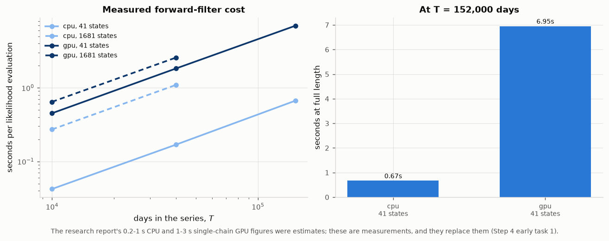
  </picture>
</p>

**Figure f12** — Measured forward-filter cost, CPU against one A100, by state count and series
length. The research report's 0.2–1 s CPU estimate is **confirmed**; its 1–3 s single-chain GPU
estimate is **wrong by 2–7×**. A sequential scan over 41-vector bodies is latency-bound, so
per-step launch overhead dominates and the GPU loses by an order of magnitude at this shape.

The report estimated 0.2–1 s on CPU — **confirmed** — and 1–3 s single-chain on GPU, which is
**wrong by 2–7×**. The report's own reasoning explains it: a sequential scan with 41-vector bodies
is latency-bound, so per-step launch overhead dominates and the GPU loses by an order of magnitude.
It should win for batched chains, which is what Step 4's blocked Gibbs needs, but that is now a
thing to measure rather than assume.

**Acted on in this step:** Check A pins itself to the CPU by default, which is a tenfold saving on
the step's own compute.

## 5. Settings handed to Step 4

| Setting | Value | Why |
|---|---|---|
| Group-area law | **Weibull + log-normal** on log-area, upstream's per-survey calibration, not refitted | ADR-011. Two log-normals fold observational effects into the small-object component |
| Area law's activity dependence | `(k, λ)` fixed; `μ`, `σ`, `c` follow power laws in activity level | Measured here and consistent with the published 2015 coefficients (§2.2). **`q_o` is therefore not a constant per observer** — it moves with the cycle, which is the standing explanation for ADF's activity-dependent k-factors |
| Area law for `q_o` | the **per-group-day** fit, or the per-group law shifted by −0.19 to −0.26 in `μ` | The published law is per group and uses peak areas; `q_o` averages over instantaneous areas on the disk (§2.4) |
| Trustworthy threshold band | **T ≥ 30 MSH** | The surveys' own completeness thresholds are 20.4–28.1 MSH and the Weibull component peaks near 6 MSH, so T = 0 and T = 10 sample a regime that measures the instrument as much as the Sun (D14) |
| Two area classes, if used | split at the **Weibull/log-normal crossover** — RGO 79, Debrecen 74, KMAS 129 MSH | A round number was arbitrary; the crossover is where the two populations actually separate |
| Truncation **K** | **41** | Smallest K with `P(GROUPS ≥ K) < 1e-5` that exceeds the reference's largest daily count (31, KMAS). v1.3_4's rule minimum is 39, v1.3_3's was 41, so 41 is stable across both releases (`f03`) |
| Per-class K, two classes | 21 | 441 joint states; the sum still reaches 40 |
| Lifetime parametrization | geometric survival **times an explicit rotation kernel — now required, not optional** | `obs_duration` is a disk-passage-censored *span* (`f06`), and Check A shows a chain without rotation misses the lag-13 trough, the lag-27 recurrence and the lifetime distribution by 3–5× |
| Fitted φ to expect | 0.78–0.85, rising with acuity threshold | Mean visible residence 4.6–6.5 days against an observed median of 5–6 |
| Area classes | **one**; if two are ever used they must **exchange members** | The two populations do differ in visible residence (1.6 against 6.1 days), but 54% of multi-day groups cross the split, so independent chains invent emergences and score 28–40% worse (§3) |
| Anchors | unchanged (ADR-009) | |
| Device for single-chain filtering | **CPU** | Measured, section 4 |

## 6. Reproducing this

```bash
conda activate gn-next-gen
pytest                      # fast suite
pytest -m slow              # includes the v1.3_3 regeneration and the recovery test
python scripts/diff_gn_releases.py
python scripts/check_a_dynamics.py --config configs/step1_check_a.yaml
python scripts/check_b_stationarity.py --config configs/step1_check_b.yaml
python scripts/benchmark_forward_filter.py
python scripts/make_step1_figures.py
```

Figures are committed under [`figures/step-1/`](figures/step-1/) in light and dark; the CSVs behind
them are in git-ignored `outputs/step1/`, regenerated by the commands above.
