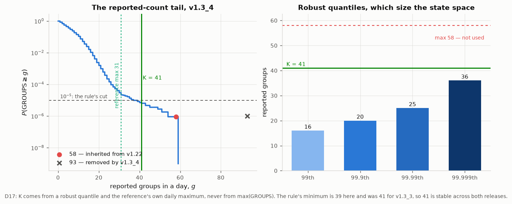
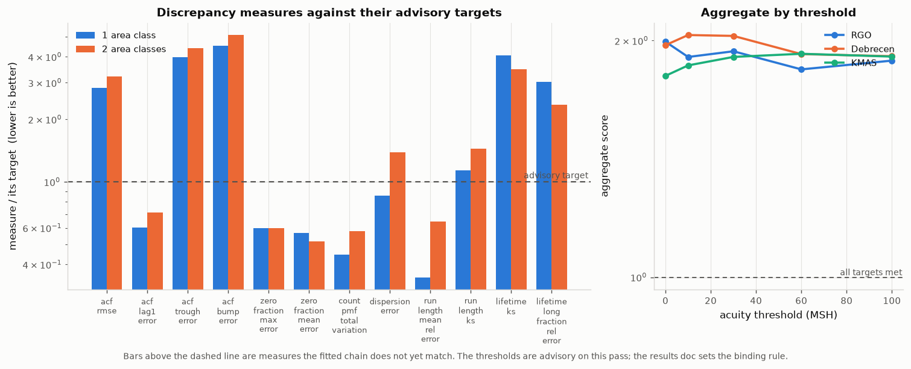
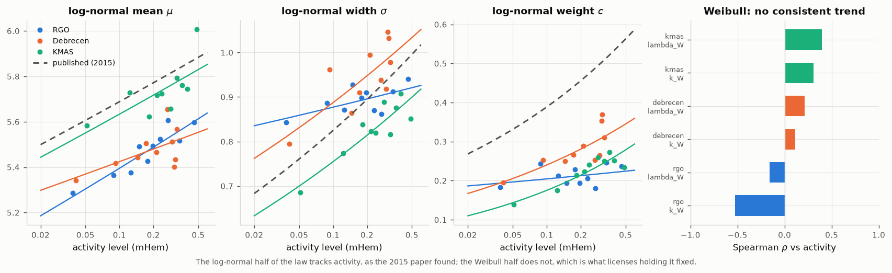
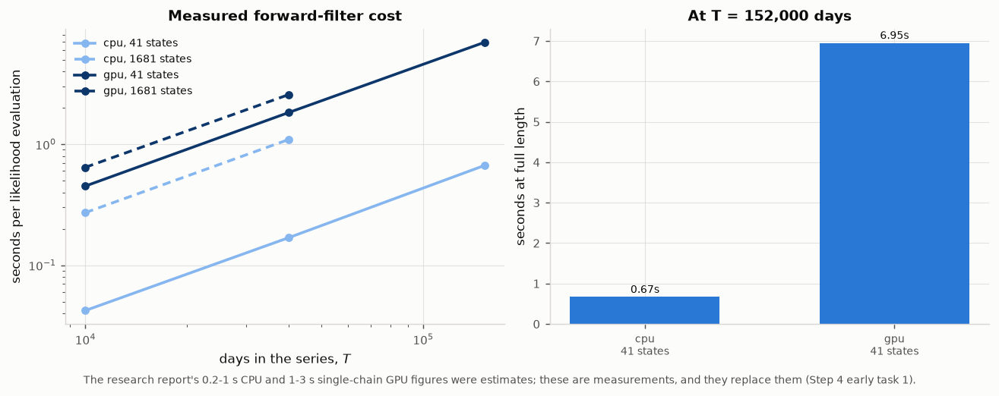

# Step 1 verification: data foundation and viability checks

- Plan: [`docs/plans/step-1-plan.md`](../plans/step-1-plan.md) (approved 2026-11-21, plus Revision 1,
  approved 2026-11-21)
- Results under verification: [`step-1-data-foundation.md`](step-1-data-foundation.md)
- Branch / commit verified: `step-1-data-foundation` @ `f2f6bca`
- Environment: conda env **`gn-next-gen`** from `environment.yml`; Python 3.12.16, JAX 0.12.1 on
  `[CudaDevice(0..3)]` (4× A100 80 GB PCIe), NumPyro 0.22.0, pandas 3.1.1, pyarrow 26.0.1
- Date: 2026-11-22

> **How this was run.** Every measurement below was re-taken from a clean `outputs/step1/`: the
> previous outputs were moved aside, then Check A, Check B, the benchmark and the figure set were
> regenerated from the committed configs and seeds. Nothing in this document is read from the
> implementation session's artifacts.

## Verdict: **Pass with caveats**

The step's substantive claims hold. Both checks reproduce from one command each, to the last
documented digit in Check B and to within 0.001 on three of twelve Check A measures. The go/no-go
decision, `K`, the class decision and the lifetime parametrization all stand unchanged.

Four things did not pass, and one of them is a defect rather than a discrepancy:

1. **A reported goodness-of-fit statistic is algebraically constant** (finding F1). Revision 1's
   "reduced χ² < 1" criterion cannot be satisfied by the estimator that computes it.
2. **`--check` does not reproduce the current release's derived parquet** (F2) — bytes only, content
   identical, caused by a pyarrow upgrade.
3. **The GPU half of the filter benchmark was 2.2× too slow** (F3), measured under load. Corrected
   in place; the CPU-vs-GPU decision is unaffected.
4. **`K = 41`'s stated justification was not reproducible** (F4). The adopted value still satisfies
   the rule. Corrected in place.

Two planned artifacts were never delivered and no deviation recorded them (F5), and one dead
config key survived the revision that was supposed to remove it (F6).

## Acceptance criteria — the approved plan

| Criterion | Measurement | Result | Pass? |
|---|---|---|---|
| Loader row counts and coverage match `MANIFEST.csv` | re-read both releases' tables | `_4` 1,156,368 rows / 1,099,986 with `STATION > 0` / 740 stations / 776 observers; `_3` 1,156,673 / 1,100,144 / 740 / 775 — exact | **Pass** |
| Sentinels handled | after `load_observations` | `STATION == 0`: 0 surviving; `groups == -1`: 0 surviving; 740 stations present; 1,099,983 rows (3 fewer than raw = the D16 dedup) | **Pass** |
| Leap-day handling verified | Feb-29 rows by year vs the Gregorian rule | 708 rows across 97 years, **0** non-leap-year violations; 2000 the only century year present; `ORDINAL − date.toordinal()` ≡ 0 on 200,000 sampled rows | **Pass** |
| Fast suite < ~1 min | `pytest` on an idle machine | **41.1 s**, 225 passed, 8 deselected | **Pass** |
| Every issue D1–D23 has a status | `docs/04_data/known_issues.md` | all 23 carry a status; D16, D17, D22, D23 and the KMAS rule each name their implementing code. D11 (Spörer's area unit) is *documented, not settled* — the spec asked for it "if it can be settled" | **Pass** |
| Check A: five pre-registered measures, advisory thresholds | fresh 17-cell grid | all 12 numbers reported against their targets; 16 of 17 cells converged (KMAS at T = 100 hit the cap, as documented). 7 of 12 measures within target at T = 30, 5 over | **Pass** (as "reported against targets") |
| 1 vs 2 classes justified by them | aggregate score, T = 30 | 1 class 1.900 / 1.967; 2 classes 2.645 / 2.494 → **+39.2% / +26.8%** against a −25% bar to adopt. One class | **Pass** |
| Check B: a stated test and result | — | **Superseded** by Revision 1: the AD/KS percentile battery was retracted with its ΔBIC result. Revision 1's criteria govern (below) | **Superseded** |
| If non-stationary, consequence written down | results doc | §2.3 states the spreads; §5 carries the `q_o` consequence (activity-dependent, and the per-group-day grain) | **Pass** |
| v1.3_4 landed under ADR-010 | `--check` both releases; manifest; diff scope | `_3` retained byte-exact ✓, `_4` beside it ✓, derived tables track `_4` ✓, manifest rows updated ✓, ADR-010 written ✓, `tests/test_data_manifest.py` green ✓, diff scope correct ✓ — but **`--check` DIFFERS for `_4`** | **Fail** (F2) |
| `K` from a robust quantile (D17) | recompute the rule under both releases | K = 41 satisfies the rule: `P(GROUPS ≥ 41)` = 6.4e-6 (`_4`) and 7.3e-6 (`_3`), both < 1e-5, and 41 > 31. `max(GROUPS)` never used. **But the rule's minimum is 39 under both releases, not 41 for `_3`** | **Pass on the rule, fail on the stated reason** (F4) |
| KMAS single-use validator | tests | raises on both role conflicts; default role is reference areas | **Pass** |
| SILSO refresh | folder + manifest rows + checksum test | `silso_2026-11/`, daily to **2026-10-31**, monthly to **2026-10**, 3 manifest rows, checksums green | **Pass** |
| Step 4 early task 1 | `benchmark_forward_filter.py` | wall time recorded and re-measured twice (stable to 0.002 s). **Peak memory is not recorded** — `filter_benchmark.csv` carries `device, states, n_days, seconds, variant` only | **Partial** |
| Environment | `conda activate gn-next-gen` | both suites pass in it; no fallback needed | **Pass** |
| Figure-first verification | regenerate all 12 | all 12 rebuild from committed configs and seeds; **10 of 12 came back byte-identical**, f09 and f12 changed for the reasons recorded below; largest committed figure 250 KB ≤ ~300 KB | **Pass** |

## Acceptance criteria — Revision 1 (the area law)

| Criterion | Measurement | Result | Pass? |
|---|---|---|---|
| Upstream's fit reproduces | kept counts above `threshold_MSH` | **16,880 / 8,306 / 15,662 exactly.** KMAS matches only with the D22-colliding ids kept in (dropping them gives 15,401) — noted in the results doc as a 1.7% contamination of that survey's area law | **Pass** |
| Weibull is activity-independent | Spearman ρ of `k_W`, `λ_W` vs AL | all six reproduce (RGO −0.527/−0.158, Debrecen +0.115/+0.212, KMAS +0.309/+0.394); none reaches 0.95 confidence; signs disagree across surveys; the gate did not trip | **Pass** |
| Log-normal dependence recovered | ρ and power laws for `μ, σ, c`; reduced χ² < 1 | all nine power laws reproduce to three decimals; ρ **positive in all nine**; significant at p < 0.05 for **4 of 6** `μ`/`σ` fits (RGO σ p = 0.19, Debrecen μ p = 0.21). **Reduced χ² is 1.125–1.128 and cannot be < 1** | **Fail** (F1) |
| Published coefficients cross-checked | fitted vs 5.97/0.021, 1.08/0.117, 0.66/0.230 | KMAS `μ` exponent 0.0213 vs 0.021, amplitude 0.991× published; σ 0.109 vs 0.117; Debrecen `c` 0.225 vs 0.230. Amplitude offset stated and attributed to the `π_W`-vs-`c` convention and the higher truncation | **Pass** |
| Stationarity at matched AL | `(μ, σ, c)` across surveys within AL bins | RGO vs Debrecen 0.052/0.059/0.054 (max 0.078/0.123/0.095); RGO vs KMAS 0.252/0.091/0.032. Within-survey `μ` spread 0.320/0.313/0.422 — larger than any pair at matched activity | **Pass** |
| Grain bridge | per-group vs per-group-day | −0.194 / −0.197 / −0.262 in `μ`, reproducing exactly, with the sign reversal and its cause recorded | **Pass** |
| Model comparison | AIC over four nested forms | whole table reproduces. Every survey rejects the activity-independent law (ΔAIC 195–213). The **analytic** power-law form wins only for KMAS; RGO and Debrecen prefer the free-per-bin fit — reported as a difference from the paper's Table 2 | **Pass with caveat** |
| Two classes re-grounded | crossover split; cells re-run | crossovers recomputed at **79.241 / 74.430 / 129.119 MSH**; 54.3% / 53.3% of multi-day groups straddle the split — all exact. Decision restated | **Pass** |
| Thresholds flagged | D14 + results doc | 20.4–28.1 MSH band recorded with the T = 0/10 caveat and the T ≥ 30 recommendation | **Pass** |
| Retraction visible | results doc §2 | a visible ⚠ block states what was withdrawn and why; the code writes no `mixtures.csv`/`percentiles.csv` any more | **Pass** |

## Test suite

```
$ pytest -q
225 passed, 8 deselected in 41.09s

$ pytest -m slow -q
8 passed, 225 deselected in 1555.66s (0:25:55)
```

The slow suite's wall time is inflated by contention — it ran alongside the Check A grid. Measured
alone in the implementation session it was 6:03; nothing in it regressed.

```
$ ruff check . && ruff format --check .
All checks passed!
108 files already formatted
```

## The hard rules

| Rule | Check | Result |
|---|---|---|
| `legacy/` untouched | `git diff --name-status main -- legacy` | **empty** |
| `data/raw` additions only | `git diff --name-status data/raw-renovation-2026-10..HEAD -- data/raw` | 3 additions (`area_law_2026-11/`, `silso_2026-11/`, the `_4` workbook) plus the ADR-010 in-place changes to `gn_database_v1.3/` and `MANIFEST.csv` — exactly what ADR-010 authorizes |
| Manifest rows for new raw data | `MANIFEST.csv` | 31 rows; every Step 1 addition carries one with SHA-256, provenance and license; `tests/test_data_manifest.py` green |
| Firewall (ADR-002) | `lineage.json` from the fresh runs | `variant_is_sunspot_only: true`, `proxy_derived_calibration_inputs: []`, and the explicit statement "No isotope, aurora, proxy or SILSO input entered calibration" |
| No SILSO in calibration | import audit of `src/` | SILSO appears only in `io/silso.py`, `paths.py` and the firewall's own reject-list in `config/run_config.py`. **No module under `inference/`, `models/`, `reference/` or `stats/` references it** |

`git diff main -- data/raw` is *not* empty, but that is expected and not a violation: `main`
predates the 2026-10 raw-data renovation, whose ten commits this branch carries. Measured against
the renovation baseline, which is the right comparison, the diff is as above. **The renovation
branch is still unmerged into `main`** — worth resolving before Step 2 so that this criterion can
be checked against `main` as the plan intended.

## Findings

### F1 — a goodness-of-fit statistic that cannot fail, and cannot pass

`reference/area_fit.py::fit_power_law` estimates each point's uncertainty as
`np.std(residual, ddof=1)` — the scatter of the very residuals it then divides by. So

```
chi2 = Σ(rᵢ/s)² / (n−2)   with   s² = Σ(rᵢ−r̄)² / (n−1)   ⟹   ≈ (n−1)/(n−2)
```

is a constant of the bin count. At n = 10 bins it has a **hard floor of 1.125**; all nine fits land
in 1.12500–1.12806, and that 0.003 spread is only the residual mean drifting off zero. On random
residuals at n = 10 the statistic never drops below 1.1258.

The consequence is twofold. Revision 1's criterion "reduced χ² < 1, as in the paper" is
**unsatisfiable by construction**, so it was never a test. And the number is written to
`power_laws.csv`, where it reads like a fit-quality measure and could be quoted as one later. It is
not quoted in the results doc, which is luck rather than design.

**Proposed fix** (not applied — it changes a reported statistic): give the power-law fit an
independent uncertainty. The per-bin fits already know their own curvature, so the natural choice
is the per-bin parameter standard errors from `fit_bin`, with a bootstrap over bins as the
fallback. Until then the χ² column should be dropped rather than reported.

### F2 — the current release's parquet does not byte-reproduce

```
$ python scripts/convert_gn_database_v13.py --release v1.3_4 --check
  gn_v13_observations.parquet: DIFFERS
  gn_v13_observers.parquet:    DIFFERS
  gn_v13_changelog.csv:        MATCH
EXIT=1
```

Content is **identical** — `DataFrame.equals` is true for both tables, the byte lengths match
exactly (2,562,482 and 17,901) and so do the row-group counts. The only difference is the writer
string embedded in the parquet footer:

| | committed | regenerated |
|---|---|---|
| `created_by` | `parquet-cpp-arrow version 24.0.0` | `parquet-cpp-arrow version 26.0.1` |

pyarrow was upgraded in the environment between landing and now, and `environment.yml` pins it as
bare `pyarrow`. `MANIFEST.csv` nonetheless advertises these files as "deterministic; `--check`
verifies byte reproducibility" — a claim that silently depends on a library version nobody
recorded. `--release v1.3_3 --check` does report MATCH, but that comparison is weaker than it
looks: its target in `data/interim/` had just been written by the same code and the same pyarrow.

No data is wrong and nothing was regenerated into `data/raw` — the committed bytes are the ones the
manifest checksums, and rewriting them would change a checksum for no change in data.

**Proposed fixes**, in order of preference: (a) make `--check` compare content and schema, and
report a byte difference as a separate, informational line — the useful promise is "the converter
reproduces the data", and the frozen artifact's bytes are already pinned by the manifest test;
(b) pin `pyarrow` in `environment.yml` and record its version in `provenance.json`; (c) qualify the
manifest's determinism note. Also worth closing the detection gap: `test_v133_still_reproduces`
checks content for `_3`, and there is **no equivalent test for `_4`** — which is why this went
unnoticed.

### F3 — the GPU benchmark was measured under load (corrected)

Re-measured twice on an idle machine with no other process on the device, the full-length GPU
timing is **3.190 s and 3.192 s**, against **6.950 s** as first published — 2.2× apart. The CPU
column reproduced (0.636 / 0.666 s against 0.667 s). Every GPU row was affected.

The qualitative conclusion is unchanged and the decision stands: the GPU is **4.8× slower** than
the CPU at this shape, so single-chain filtering belongs on the CPU. But one claim does not
survive. The results doc said the research report's "1–3 s single-chain GPU" estimate was "wrong by
2–7×"; at 3.19 s the estimate sits at the top of its range, essentially correct. §4, the summary
table, the `f12` caption and the comment in `check_a_dynamics.py` are corrected, and the figure is
regenerated.

The lesson is procedural: the first measurement was taken while the Check A grid was running, which
is exactly the mistake a benchmark is supposed to avoid. Benchmarks in this project should assert an
idle machine, or record the load average alongside the timing.

### F4 — `K = 41`'s justification was not reproducible (corrected)

The claim "`_4`'s minimum is 39 and `_3`'s was 41, so 41 is stable across both releases" appeared in
five places. Measured, **the rule's minimum is 39 under both releases**, under every denominator
tried (`STATION > 0` with and without the `GROUPS = −1` rows, and the deduplicated loader output),
and `_3`'s 99.999th percentile is 38 — so neither the rule nor that percentile yields 41 for `_3`.

`K = 41` remains correct: it satisfies `P(GROUPS ≥ K) < 1e-5` in both releases and clears the
reference's largest daily count of 31. It is simply two above the rule's minimum — cheap margin —
rather than a value forced by the older release. Corrected in the results doc (twice), D17, the
test docstring and the `f03` caption, which is regenerated.

### F5 — six planned files were never created, with no deviation recorded

`io/observers.py`, `reference/counts.py`, `reference/lifetimes.py`, `reference/areas.py`,
`scripts/land_gn_database_v134.py` and `scripts/build_interim_cache.py` do not exist. Five are
**re-homed rather than missing**: observer loading sits in `io/observations.py::load_observers`,
daily counts in `io/reference.py::daily_counts`, lifetimes come straight off
`load_group_single_entry`, the area work became `reference/area_law.py` + `area_fit.py` under
Revision 1, and landing went through `convert_gn_database_v13.py --release` under ADR-010.

`scripts/build_interim_cache.py` is **genuinely absent**: caching is lazy inside the loaders, keyed
by manifest checksums, with three tests covering it. That is a defensible design — but the plan's
own verification step 5 instructs the verifier to run a script that was never written, and the plan
asks that deviations be recorded before continuing. None was. **Proposed fix:** update the plan's
Files table with a Deviations entry naming the re-homing, and either write the cache script or
strike it from the verification list.

### F6 — a dead config key survived the revision meant to remove it (corrected)

`configs/step1_check_a.yaml` still carried `class_split_msh: 100.0`. Revision 1's Files table
specified replacing it with the computed crossover and its outcome section reports the dead key as
*found* — it was never removed. Nothing read it: the script computes the split per survey from the
area law and writes it back only as an output column. A stale 100.0 beside a documented 79/74/129
is the kind of thing a later reader trusts. Replaced with a comment saying where the split actually
comes from.

### F7 — smaller things, for the record

- **The committed Check A outputs predated the re-grounding.** `outputs/step1/check_a/` had no
  `phi_large` column: only the two re-grounded cells had been re-run, into a separate directory, so
  the results doc's §3 mixed two runs. This verification is the first time the whole grid came from
  one command. The fresh run shifts three of twelve measures by ≤ 0.001 and the two-class penalty
  by ≤ 1 percentage point; no verdict changes. §3 is updated to the reproducible run.
- **Debrecen's run-length KS was labelled "pass / marginal"** at 0.077 against a 0.05 target. That
  is 54% over, not marginal. Relabelled.
- **The configs still name the superseded `silso` folder** as their comparison dataset, so the
  lineage records `silso` where `silso_2026-11/` is now the current snapshot. Harmless today —
  SILSO is comparison-only and neither check reads it — but it will mislead the first run that does.
- **`peak memory` was never recorded** by the benchmark, though the criterion asks for it.

## Figures

All twelve regenerate from the committed configs and seeds; ten came back byte-identical. The four
that carry a verification claim are below, as their light variants — see the results doc's preamble
for why the theme-switching embed was reverted.



**Figure f03** — the `GROUPS` tail and the quantiles that size the state space. Re-measured, the
rule's minimum is **39 under both releases** and K = 41 sits two above it; the caption in this
figure previously said the minimum was 41 for `_3`, which verification could not reproduce (F4).
Regenerated with the corrected text.



**Figure f09** — Check A's measures against their advisory targets, from the fresh 17-cell grid.
The pattern reproduces exactly: the three rotation-dependent measures and the two lifetime measures
sit past the line in every cell, and the count marginals do not. This figure changed on
regeneration because the committed version predated the two-class re-grounding (F7).



**Figure f11** — the activity dependence, reproducing to three decimals, with the Weibull gate in
the fourth panel. What the panels show is sound; what is **not** shown — and should not be added
until F1 is fixed — is the reduced χ² behind these fits, which is pinned at 1.125 by its own
estimator.



**Figure f12** — the corrected benchmark. Every GPU bar moved: full length is **3.19 s**, not the
6.95 s first published, because the original measurement ran against a loaded machine (F3). The CPU
column is unchanged and the conclusion is unchanged — CPU is 4.8× faster for single-chain
filtering — but the margin is fivefold, not tenfold.

## Deviations from the plan

Beyond the three the plan already records (ADR-010's in-place landing, advisory Check A thresholds,
Schwabe's exclusion), verification found two unrecorded ones: the module re-homing and the two
uncreated scripts of **F5**, and the surviving `class_split_msh` key of **F6**. Both are now
written down here; F6 is fixed.

## Corrections applied during verification

Each is a factual correction to a published number or a dead artifact, not a change of scope.

| What | Where |
|---|---|
| GPU timings and the "wrong by 2–7×" claim | `step-1-data-foundation.md` §4 + summary row + `f12` caption + `check_a_dynamics.py` comment |
| `K = 41`'s justification | `step-1-data-foundation.md` §1.3 + §5, `known_issues.md` D17, `test_gn_database_v13.py` docstring, `viz/data.py` (`f03` caption) |
| §3 numbers to the single-command run; Debrecen's run-length KS relabelled | `step-1-data-foundation.md` §3 + §5 |
| The D22 caveat on the KMAS anchor | `step-1-data-foundation.md` §2 |
| `class_split_msh: 100.0` removed | `configs/step1_check_a.yaml` |
| `f03`, `f09`, `f12` regenerated | `docs/results/figures/step-1/` |

## Findings that affect later steps

1. **F1 must be fixed before any power-law uncertainty is quoted.** Step 4 will lean on `μ(AL)`,
   `σ(AL)` and `c(AL)`; if their uncertainties come from this estimator they are meaningless. No ADR
   needed — it is a defect.
2. **F2 argues for separating two promises** that this project currently conflates: *the frozen
   artifact is the one in the manifest* (a checksum) and *the converter reproduces the data* (a
   content comparison). ADR-006 and ADR-010 both lean on "regenerable", and that word needs to mean
   content, not bytes, or the claim expires with the next library upgrade. Worth an ADR amendment
   when Step 2 next touches the manifest.
3. **Benchmarks need an idle-machine assertion** (F3). Step 4's early tasks are largely benchmarks,
   and the blocked-Gibbs batched-chain measurement is the one the device decision will rest on.
4. **The KMAS area law carries D22 contamination** — 261 of 15,662 calibration areas come from ids
   covering more than one physical group (1.7%). Counts are unaffected. Step 4 should prefer RGO or
   Debrecen wherever one survey's area law has to stand alone.
5. **Merge the renovation branch into `main`** so the `data/raw` hard rule can be checked against
   `main`, as every plan from Step 2 on will assume.
