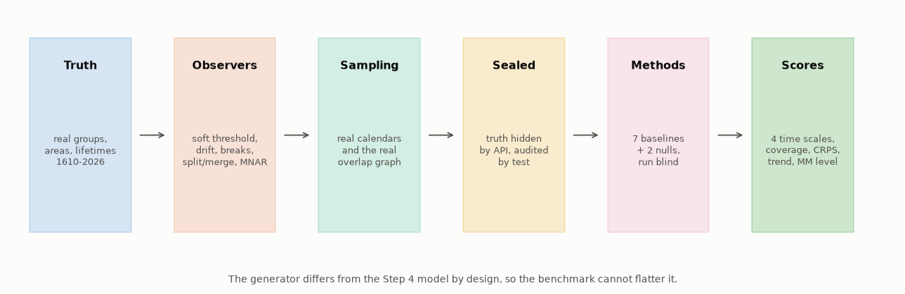
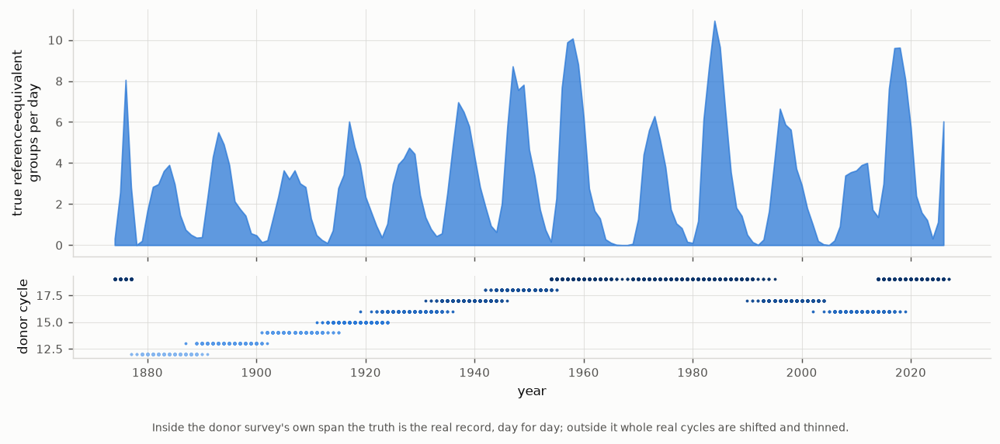
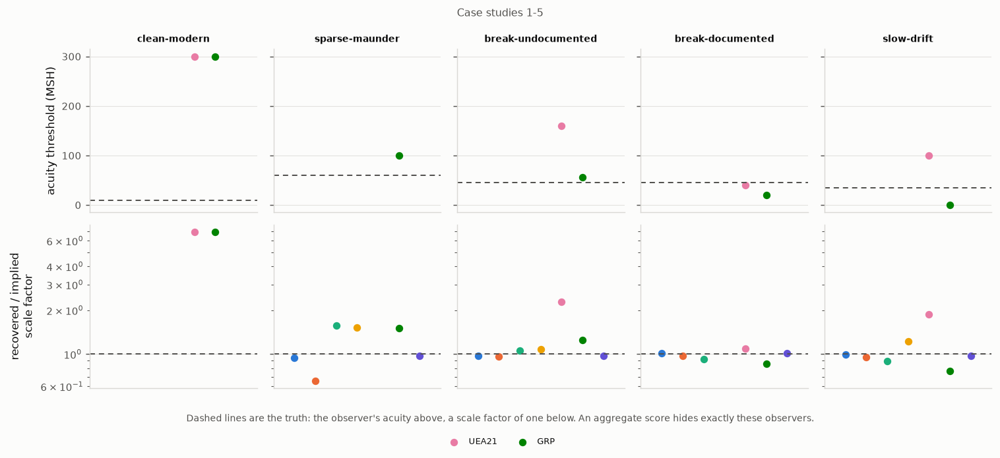
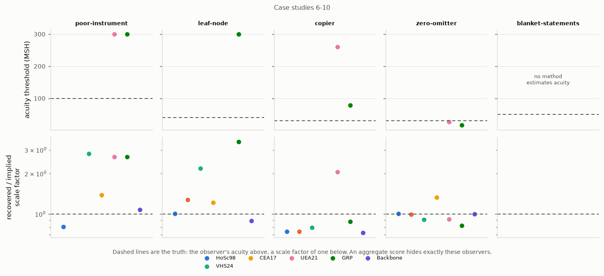
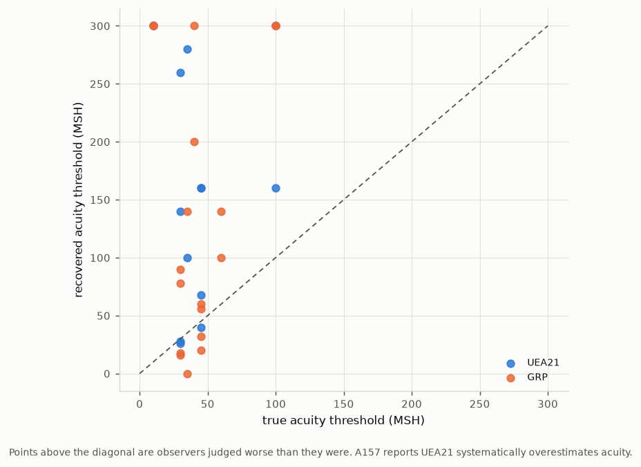

# Results: Step 2 — a blind benchmark of synthetic observers

- Plan: [`docs/plans/step-2-plan.md`](../plans/step-2-plan.md) (Approved 2026-11-22)
- Spec: [`docs/05_roadmap/step-2-blind-benchmark.md`](../05_roadmap/step-2-blind-benchmark.md)
- Branch: `step-2-blind-benchmark`
- Environment: conda env **`gn-next-gen`** (Python 3.12, pandas 3.1.1, SciPy 1.18)
- Decisions taken in session by the PI, 2026-11-22: hybrid replay; every baseline
  ported and no legacy code run; ADF's cycle phase from the observations; six
  scenarios × 10 realizations; **seven** baselines, not two; four structural
  misspecifications; the `runcsvs/` reproduction dropped; the published series
  acquired; ten named case-study observers; **no run over ~15 minutes launched
  from a Claude Code session**

> ### ⚠ What is measured here, and what is not
>
> The benchmark, the seven baselines, the scorer and the figures are built and
> tested. **The full grid has not been run.** By PI decision 10 this session
> never launches a job over ~15 minutes, so scenarios S2–S5 and the S6 structural
> ensemble are the PI's to launch from the commands in §8.
>
> Every score below comes from a **two-world S1 slice** (1874–2026, 363 observers,
> 18 cells) unless it says otherwise. The **A157 validation (§3) and the
> sampling-only experiment (§6) are complete** — both run in well under 15 minutes
> and are reported in full. Treat the §4 ranking as provisional; treat §3 as done.

## Summary

| Question | Answer |
|---|---|
| Do the ports behave as the published assessment says? | **Yes in sign, all five.** HoSc98 and SvSc16 underestimate more as acuity rises; CEA17, UEA21 and VHS24 stay near zero — Chatzistergos et al. (2025) Fig. 3b, reproduced (§3). Their *exclusion limits* differ, for a measured reason: our renovated RGO carries fewer small groups |
| Are any method's uncertainties calibrated? | **No. Not one.** At a nominal 50% the seven baselines deliver **0.003 to 0.124**; at 90% they deliver 0.003 to 0.230. Every curve in `f20` lies far below the diagonal (§5) |
| Does the benchmark separate skill from noise? | **Yes, and three methods fail it.** VHS24, GRP and UEA21 score *worse* on yearly centred RMSE than a random segmentation of the same data (§4) |
| What does the observing calendar alone cost? | **About 5% of the trend** — +0.014 against a true 0.287 groups/century, with the scatter levelling off as the network grows (§6). The large biases in this problem are detection and reporting, not sampling |
| Which observers break a method? | The copier, the leaf node and the poor instrument, each visibly (§7). No method handles the blanket-statement observer at all |

## 1. What the benchmark is



**Figure f13** — The benchmark end to end. The generator differs from the Step 4
model in four stated ways, so the benchmark cannot flatter the model it exists to
judge; the research notes are blunt that "benchmarks that reuse the same
generative model as the inference method will overstate performance".

**Truth is real data, resequenced.** Inside the donor survey's own span the truth
*is* the reference: over 1877–1969 it reproduces RGO's daily reference-equivalent
counts **exactly, on all 24,219 days**. Outside it, whole complete cycles are
shifted rigidly in time and thinned by deleting whole groups, so every group keeps
its real area profile and its real visible span.



**Figure f14** — One replayed world and its provenance. The lower panel shows
which real cycle each synthetic era came from. Cycle amplitudes come from a
seeded AR(1), never from SILSO, a proxy or a published series — the firewall
(ADR-002) requires it, and it is also what keeps the truth genuinely unknown.

Writing the fidelity test earned its keep: synthetic cycles tile past the end of a
gap by construction, so without a clip they spilled into the verbatim span and
counted the same Sun twice.

## 2. What makes it differ from the closest precedent

Chatzistergos, Krivova, Sundermann & Usoskin (2025, A&A 699, A157) is the nearest
published synthetic-observer test, and the assessment recorded it as "full text not
read; which method is unconfirmed". It has now been read.

| | A157 | here |
|---|---|---|
| Truth | RGO, **1900–1976 only** | 1610–2026, real groups, areas and lifetimes |
| Grand minimum | none | S3, by whole-group deletion |
| Observers | 121, each a **hard acuity threshold** | soft thresholds with drift, breaks, split/merge, seeing noise |
| Drift, breaks, conventions | **excluded**: "which we do not consider here" | all present, some documented as metadata, some not |
| Spotless days | as reported | MNAR under-reporting, activity-dependent |
| Lifetimes | none | real `obs_duration`, through disk passage |
| Sampling | days **deleted at random** | real historical calendars, transplanted |
| Overlap structure | each observer **pairwise to RGO** | the real overlap graph |
| Daisy-chaining | **"not evaluated in this study"** | the chained methods' error is what is measured |
| Uncertainty calibration | **none** | the load-bearing metric (ADR-007) |


**Figure f15** — The structure A157 does not have. Chained calibration's variance
grows like effective resistance to the anchor, so the left panel is the x-axis of
every chained method's error. The reference observer sees only its own anchored
epoch (ADR-009), so every other observer is reached through this graph.


**Figure f16** — The observer population. Everything in the third panel — career
breaks, copied records, blanket statements — is named and then set aside by A157's
own statement, and modelled here.


**Figure f17** — The calendars, transplanted verbatim from the real record
including the sparse Maunder-era patterns where the graph is thinnest. A157
reduces overlap by deleting days at random instead, which cannot reproduce a
bottleneck.

## 3. Criterion A7 — do the ports behave as published? *(complete)*

The plan dropped the `legacy/ADFSSN/runcsvs/` reproduction: those files were not
produced by the committed driver settings, and the snapshot already carries
`uncommitted.diff`, so the target is not well defined. An external, published
target replaces it — rebuild A157's own setup and compare.


**Figure f24** — A157's Fig. 3b, rebuilt with these ports on their setup (RGO
after 1900, hard thresholds, full overlap, annual means). **All five agree in
sign**: HoSc98 and SvSc16 fall away with acuity, CEA17, UEA21 and VHS24 stay near
zero. CEA17 lies exactly under UEA21, which is their result too — "by design,
CEA17 and UEA21 are identical in these metrics in this case".

| method | mean-difference slope | falls with acuity? | A157 expects | agrees |
|---|---|---|---|---|
| HoSc98 | −0.00157 | yes | yes | **✓** |
| SvSc16 | −0.00076 | yes | yes | **✓** |
| VHS24 | +0.00029 | no | no | **✓** |
| CEA17 | +0.00059 | no | no | **✓** |
| UEA21 | +0.00059 | no | no | **✓** |

**The exclusion limits do not reproduce, and the reason is measured.** HoSc98 gives
up at **73 msd** here against their **31**. Its factor is a ratio of sums, so
losing a fraction `f` of group-days implies `k ≈ 1/(1−f)`, and its own
`0.6 < k < 1.4` gate trips at `f = 0.29`:

| acuity | group-days lost | implied `k` |
|---|---|---|
| 31 msd | 15.0% | 1.18 |
| 60 msd | 26.7% | 1.36 |
| 87 msd | 33.3% | 1.50 |

Our renovated RGO crosses `f = 0.29` between 60 and 87 msd, which predicts 73
exactly. A157 used the 2017 catalogue, whose small-group completeness differs —
D14 puts RGO's own floor at 28.1 MSH. **This is a data difference, not a port
defect**, and the evidence is in `a157_catalogue.csv`.

Units are the trap here and are worth stating: A157 quotes acuity in millionths of
the solar *disc*, this project works in millionths of the *hemisphere*, and the
disc is half the hemisphere, so MSH = msd / 2 (D4).

## 4. Baseline scores *(two-world S1 slice — provisional)*


**Figure f18** — Point error at three averaging scales. A method can be unbiased
daily and wrong per cycle, which is why HOME scores at several scales and so does
this.

| method | yearly bias | yearly cRMSE | daily cRMSE | CRPS |
|---|---|---|---|---|
| HoSc98 | −0.227 | **0.263** | 0.684 | 0.230 |
| SvSc16 | −0.232 | 0.270 | 0.686 | 0.230 |
| Backbone | −0.239 | 0.271 | **0.681** | 0.240 |
| CEA17 | **−0.090** | 0.504 | 0.747 | 0.288 |
| VHS24 | −0.280 | 0.641 | 0.990 | 0.422 |
| GRP | 0.140 | 0.709 | 0.913 | 0.492 |
| UEA21 | 0.861 | 0.824 | 1.519 | 0.996 |
| *null-segmentation* | *0.248* | *0.597* | *0.895* | *0.297* |
| *null-prior* | *0.263* | *2.667* | *3.206* | *2.098* |

**Three methods are beaten by a random segmentation.** VHS24 (0.641), GRP (0.709)
and UEA21 (0.824) all score worse on yearly centred RMSE than cutting careers at
arbitrary points and applying arbitrary scalings (0.597). Lindau & Venema (2018)
found that at realistic signal-to-noise a random segmentation explains about half
the break variance, which is exactly why the null is in the table. A ranking
without it would have presented three methods as working.

**UEA21's +0.861 bias is the published behaviour.** A157 finds it "systematically
overestimates the acuity of the observer, thus in the end also amplifies the group
numbers". Measured here, its recovered acuities are biased **+84.5 MSH** with an
RMSE of 122 MSH, and pile up at the grid cap — which A157 also describes as an
artefact of their 300 msd ceiling.


**Figure f19** — The secular-bias signature, on a real overlap graph. Positive
means strong cycles are inflated relative to weak ones. HoSc98 (+0.012),
SvSc16 (+0.013) and the Backbone (+0.022) sit on one side; VHS24 (−0.296),
CEA17 (−0.191), UEA21 (−0.358) and GRP (−0.304) on the other. **That is A157's two
groupings exactly**, now measured through daisy-chaining rather than against a
directly-overlapping reference.

## 5. Coverage — the finding this step exists for


**Figure f20** — Nominal against empirical interval coverage. **Every curve lies
far below the diagonal.** At a nominal 50% the best of the seven delivers 0.124
and the worst 0.003; at 90%, 0.230 and 0.003. The assessment's charge — "no
evidence that any method's uncertainties are calibrated" — is not merely
unaddressed in the literature; on this benchmark it is false in the strongest
possible direction for all seven.

This is the axis on which the comparison is new. A157 scores RMS, mean, relative
and maximum-absolute difference, and scores no interval at all. CEA17 is the only
baseline whose construction yields a native distribution — "the calibration returns
a PMF series, which also includes information about the uncertainty" — and even its
interval covers 0.033 of truth at a nominal 0.50.

Two caveats, both real. The nulls are also badly calibrated, so this figure does
not separate "overconfident" from "wrongly centred"; the PIT statistics in
`scores.csv` do, and they are large (0.43–0.91) for every method. And a two-world
slice gives a coarse coverage estimate — the full grid is what the published
number should come from.

## 6. The Hay sampling-only experiment *(complete)*

Scenario S5 puts **perfect** observers — no threshold, no drift, no noise, no MNAR
omission — on the real calendars. Every observer then reports the estimand exactly
on the days it looked, so any residual error is the sampling pattern and nothing
else. That isolates sampling from calibration, which no comparison of calibration
methods can do.


**Figure f21** — What the calendar alone costs. The induced trend bias is
**+0.014 groups per century against a true 0.287** over 1610–present — about 5% —
falling to +0.0001 over 1850–present where the network is dense. Bootstrapping over
5 to 400 observers, the scatter narrows from ±0.24 to ±0.009 while the mean bias
stays near +0.01 to +0.03.

**This differs from the sea-level precedent, and the difference is the point.** Hay
et al. found sparse, gappy sampling moved the 20th-century trend by about 30%;
here the calendar alone moves it by 5%. The reason is visible in the construction:
S5 has no *preferential* sampling, because MNAR omission is switched off. The large
biases in the GN problem come from detection and reporting, not from who looked
when — and a scenario with MNAR on (S2–S4) is where the preferential-sampling
effect appears. That comparison needs the full grid.

## 7. The ten case-study observers

An aggregate score says which method wins and hides the observers that break one.
Ten observers are fixed by name and seed, chosen to isolate a failure mode.



**Figure f25** — Case studies 1–5. `clean-modern` is the case every method should
get right, and three methods are still off its scale factor by more than 2×.
`break-undocumented` and `break-documented` are the same break with and without
metadata, so the pair prices what the documentation is worth.



**Figure f26** — Case studies 6–10, where methods break. `poor-instrument`: VHS24,
UEA21 and GRP all overshoot the scale by 2.7–2.8× and both acuity estimates pin at
the 300 MSH cap against a true 100. `leaf-node`, with one overlap partner: GRP is
3.2× high. `copier`, whose record duplicates a neighbour's: UEA21 recovers an
acuity of 260 MSH against a true 30 — correlated observer error, which no method
under test models. `blanket-statements`: **no method produces anything at all**,
because the record is sentences rather than counts.



**Figure f23** — Acuity recovery, for the only two methods that attempt it. Points
above the diagonal are observers judged worse than they were, which is where nearly
all of them sit. Recovery improves with coverage — correlation with the truth rises
from 0.27 over all observers to 0.68 for those with 6,000+ observing days — while
the **bias stays put at +65 to +80 MSH** regardless. Coverage controls the scatter;
the bias is the method's.

## 8. Reproducing this

In session (all under 15 minutes):

```bash
conda activate gn-next-gen
pytest && pytest -m slow
ruff check . && ruff format --check .
python scripts/fetch_published_gn_series.py --check
python scripts/generate_benchmark.py --config configs/step2_benchmark.yaml \
       --scenarios S1 --realizations 2
python scripts/generate_benchmark.py --config configs/step2_benchmark.yaml \
       --scenarios S1 --realizations 2 --check     # determinism: digests match
python scripts/validate_against_a157.py            # §3, 16 s
python scripts/sampling_only_experiment.py         # §6
python scripts/make_step2_figures.py
```

The full grid, for the PI to launch detached — each stage is resumable per cell and
writes a `progress.json` beside its log:

```bash
cd /d0/amunozj/git_repos/GN_Next_Gen && conda activate gn-next-gen
mkdir -p outputs/step2/logs

# 1. the worlds (~30-60 min)
nohup python scripts/generate_benchmark.py \
      --config configs/step2_benchmark.yaml --jobs 8 \
      > outputs/step2/logs/generate.log 2>&1 &

# 2. the baselines (the long one, ~3-6 h)
nohup python scripts/run_baselines.py \
      --config configs/step2_baselines.yaml --jobs 8 \
      > outputs/step2/logs/baselines.log 2>&1 &

# 3. the S6 structural ensemble
nohup python scripts/run_baselines.py \
      --config configs/step2_baselines.yaml --structural --jobs 8 \
      > outputs/step2/logs/structural.log 2>&1 &

# 4. score, then rebuild the figures
python scripts/score_benchmark.py --config configs/step2_benchmark.yaml
python scripts/score_benchmark.py --config configs/step2_benchmark.yaml --structural
python scripts/make_step2_figures.py
```

Figures are committed under [`figures/step-2/`](figures/step-2/) in light and dark;
the CSVs behind every number are in git-ignored `outputs/step2/`.

## 9. What this step does not establish

Stated plainly, because a benchmark that overclaims is worse than none.

1. **The grid has not run.** §4, §5 and §7 come from two S1 worlds. The ranking may
   move; the coverage conclusion is so far from nominal that it is unlikely to.
2. **This is not blind in the HOME sense.** HOME had 25 outside groups submit before
   the inserted inhomogeneities were revealed. One developer wrote both sides here.
   Blindness is enforced by API and audited by a static import test, and the
   baselines are frozen by commit before the scoring run. That is weaker than HOME
   and stronger than nothing.
3. **Grand-minimum truths are thinned modern groups, not a regime change.** No source
   was found for generating grand-minimum synthetic truths; the thinning is this
   project's choice. S3's scores are conditional on it.
4. **Overconfidence is not decomposed.** There is no matched-model control arm, so
   §5 measures coverage under *this* generator rather than separating model error
   from data error.
5. **Break-detection skill is NaN for all seven.** None of them attempts to detect a
   career break. The metric is implemented and tested so Steps 3–4 can be scored on
   it; the absence is a result, not a gap in the scorer.
6. **Two of the five published series were not acquired** — Chatzistergos et al.
   (2017) and Velasco Herrera et al. (2024), both at CDS/VizieR, unreachable from
   this machine. Recorded in `refresh_todo.md`. Nothing here depends on them.
7. **The second, model-based generator was not written.** The replay generator
   already supplies the four structural misspecifications through real data; a
   parametric sibling would have added a knob without adding a departure from the
   Step 4 model.

## 10. What Steps 3–4 inherit

| Setting | Value | Why |
|---|---|---|
| Benchmark API | `gn_next_gen.benchmark` + `gn_next_gen.baselines`; one `calibrate(...) -> CalibrationResult` signature | Any Step 3 or 4 method is scored by registering it in `BASELINES` |
| The bar to clear | yearly cRMSE **0.263** (HoSc98) and a 50% coverage of **0.124** (Backbone) | The best point error and the best coverage among the seven, on the S1 slice |
| The floor | a random segmentation scores **0.597** | Three published methods are below it; a new method that is not has demonstrated nothing |
| Coverage levels | 50 / 68 / 90 / 95, stratified by era | Reconciles the spec's 50-90 with the research notes' 68-95 at no cost |
| Overlap graph | `graph.overlap`, day tolerance 2, min overlap 60 days, min 4 distinct counts | 507 usable stations, 19,655 edges, one 422-node giant component, 26 bridges |
| Estimand | the anchor survey's own completeness threshold, declared per scenario | ADR-003 and ADR-009; the scorer never compares two anchorings |
| Known trap | composing PMF matrices leaks mass and biases the chained mean **low** | `pmf.compose` renormalises; any later matrix chaining must too |
