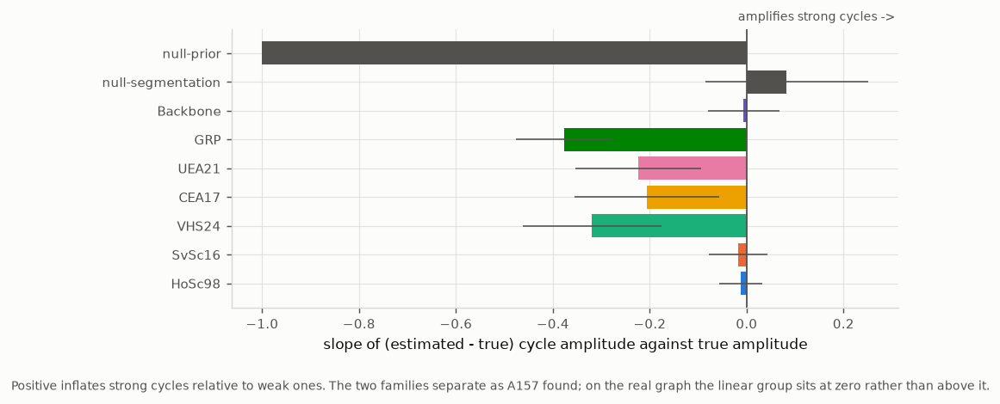

# Results: Step 2 — a blind benchmark of synthetic observers

- Plan: [`docs/plans/step-2-plan.md`](../plans/step-2-plan.md) (Approved 2026-11-22)
- Spec: [`docs/05_roadmap/step-2-blind-benchmark.md`](../05_roadmap/step-2-blind-benchmark.md)
- Branch: `step-2-blind-benchmark`
- Environment: conda env **`gn-next-gen`** (Python 3.12, pandas 3.1.1, SciPy 1.18)
- Decisions taken in session by the PI, 2026-11-22: hybrid replay; every baseline
  ported and no legacy code run; ADF's cycle phase from the observations; six
  scenarios × 10 realizations; **seven** baselines, not two; four structural
  misspecifications; the `runcsvs/` reproduction dropped; the published series
  acquired; ten named case-study observers; **no run over ~15 minutes launched
  from a Claude Code session**

> ### Scope of what follows
>
> **The full grid has run**: 51 worlds across five scenarios, nine methods,
> **459 scored cells** plus a 405-cell structural ensemble, no stage failed.
> It took 16 minutes on 64 cores, not the 3–6 hours planned.
>
> Scenario **S6** is the structural ensemble and ran on four fast methods over
> one world (§8) — a slice, and labelled as one. Everything else is complete.

## Summary

| Question | Answer |
|---|---|
| Do the ports behave as the published assessment says? | **Yes in sign, all five**, on that paper's own setup — HoSc98 and SvSc16 underestimate more as acuity rises, CEA17, UEA21 and VHS24 stay near zero (§3). Their *exclusion limits* differ, for a measured reason: our renovated RGO carries fewer small groups |
| Are any method's uncertainties calibrated? | **No. Not one, in any scenario.** At a nominal 50% the seven deliver **0.009 to 0.159**; at 90%, 0.025 to 0.272 (§5) |
| Can the published methods reach the Maunder Minimum at all? | **Five of seven cannot.** Every overlap-based method stops at **1774** and covers 46% of the record. The two that need no overlap reach 1660–1672 and overestimate the Maunder level by **23–25×** (§6) |
| Does the benchmark separate skill from noise? | **Yes, and four methods fail it.** VHS24, CEA17, UEA21 and GRP all score worse on yearly centred RMSE than a random segmentation of the same data (§4) |
| Which observers break a method? | **Slow drift breaks all seven.** A documented break costs 40.1 MSH of acuity error against 111.5 for the same break undocumented — the metadata is worth a factor of 2.5 (§7) |
| What does the observing calendar alone cost? | **About 5% of the trend** — +0.014 against a true 0.287 groups/century (§9). The large biases here are detection and reporting, not sampling |

## 1. What the benchmark is


**Figure f13** — The benchmark end to end. The generator differs from the Step 4
model in four stated ways, so the benchmark cannot flatter the model it exists to
judge; the research notes are blunt that "benchmarks that reuse the same
generative model as the inference method will overstate performance".

**Truth is real data, resequenced.** Inside the donor survey's own span the truth
*is* the reference: over 1877–1969 it reproduces RGO's daily reference-equivalent
counts **exactly, on all 24,219 days**. Outside it, whole complete cycles are
shifted rigidly in time and thinned by deleting whole groups, so every group keeps
its real area profile and its real visible span.


**Figure f14** — One replayed world and its provenance. The lower panel shows
which real cycle each synthetic era came from. Cycle amplitudes come from a
seeded AR(1), never from SILSO, a proxy or a published series — the firewall
(ADR-002) requires it, and it is also what keeps the truth genuinely unknown.

Writing the fidelity test earned its keep: synthetic cycles tile past the end of a
gap by construction, so without a clip they spilled into the verbatim span and
counted the same Sun twice.

## 2. What makes it differ from the closest precedent

Chatzistergos, Krivova, Sundermann & Usoskin (2025, A&A 699, A157) is the nearest
published synthetic-observer test, and the assessment recorded it as "full text not
read; which method is unconfirmed". It has now been read.

| | A157 | here |
|---|---|---|
| Truth | RGO, **1900–1976 only** | 1610–2026, real groups, areas and lifetimes |
| Grand minimum | none | S3, by whole-group deletion |
| Observers | 121, each a **hard acuity threshold** | soft thresholds with drift, breaks, split/merge, seeing noise |
| Drift, breaks, conventions | **excluded**: "which we do not consider here" | all present, some documented as metadata, some not |
| Spotless days | as reported | MNAR under-reporting, activity-dependent |
| Lifetimes | none | real `obs_duration`, through disk passage |
| Sampling | days **deleted at random** | real historical calendars, transplanted |
| Overlap structure | each observer **pairwise to RGO** | the real overlap graph |
| Daisy-chaining | **"not evaluated in this study"** | the chained methods' error is what is measured |
| Uncertainty calibration | **none** | the load-bearing metric (ADR-007) |


**Figure f15** — The structure A157 does not have. Chained calibration's variance
grows like effective resistance to the anchor, so the left panel is the x-axis of
every chained method's error. The reference observer sees only its own anchored
epoch (ADR-009), so every other observer is reached through this graph.


**Figure f16** — The observer population. Everything in the third panel — career
breaks, copied records, blanket statements — is named and then set aside by A157's
own statement, and modelled here.


**Figure f17** — The calendars, transplanted verbatim from the real record
including the sparse Maunder-era patterns where the graph is thinnest. A157
reduces overlap by deleting days at random instead, which cannot reproduce a
bottleneck.

## 3. Criterion A7 — do the ports behave as published? *(complete)*

The plan dropped the `legacy/ADFSSN/runcsvs/` reproduction: those files were not
produced by the committed driver settings, and the snapshot already carries
`uncommitted.diff`, so the target is not well defined. An external, published
target replaces it — rebuild A157's own setup and compare.


**Figure f24** — A157's Fig. 3b, rebuilt with these ports on their setup (RGO
after 1900, hard thresholds, full overlap, annual means). **All five agree in
sign**: HoSc98 and SvSc16 fall away with acuity, CEA17, UEA21 and VHS24 stay near
zero. CEA17 lies exactly under UEA21, which is their result too — "by design,
CEA17 and UEA21 are identical in these metrics in this case".

| method | mean-difference slope | falls with acuity? | A157 expects | agrees |
|---|---|---|---|---|
| HoSc98 | −0.00157 | yes | yes | **✓** |
| SvSc16 | −0.00076 | yes | yes | **✓** |
| VHS24 | +0.00029 | no | no | **✓** |
| CEA17 | +0.00059 | no | no | **✓** |
| UEA21 | +0.00059 | no | no | **✓** |

**The exclusion limits do not reproduce, and the reason is measured.** HoSc98 gives
up at **73 msd** here against their **31**. Its factor is a ratio of sums, so
losing a fraction `f` of group-days implies `k ≈ 1/(1−f)`, and its own
`0.6 < k < 1.4` gate trips at `f = 0.29`:

| acuity | group-days lost | implied `k` |
|---|---|---|
| 31 msd | 15.0% | 1.18 |
| 60 msd | 26.7% | 1.36 |
| 87 msd | 33.3% | 1.50 |

Our renovated RGO crosses `f = 0.29` between 60 and 87 msd, which predicts 73
exactly. A157 used the 2017 catalogue, whose small-group completeness differs —
D14 puts RGO's own floor at 28.1 MSH. **This is a data difference, not a port
defect**, and the evidence is in `a157_catalogue.csv`.

Units are the trap here and are worth stating: A157 quotes acuity in millionths of
the solar *disc*, this project works in millionths of the *hemisphere*, and the
disc is half the hemisphere, so MSH = msd / 2 (D4).

## 4. Baseline scores *(full grid: 459 cells)*


**Figure f18** — Point error at three averaging scales, pooled over all 51 worlds.
A method can be unbiased daily and wrong per cycle, which is why HOME scores at
several scales and so does this.

| method | yearly bias | yearly cRMSE | CRPS | beats the null? |
|---|---|---|---|---|
| HoSc98 | −0.234 | **0.312** | 0.248 | yes |
| Backbone | −0.194 | 0.373 | 0.265 | yes |
| SvSc16 | −0.254 | 0.379 | 0.285 | yes |
| *null-segmentation* | *0.145* | *0.749* | *0.415* | — |
| VHS24 | **0.013** | 0.787 | 0.542 | **no** |
| CEA17 | 0.008 | 0.791 | 0.470 | **no** |
| UEA21 | 1.145 | 0.865 | 1.188 | **no** |
| GRP | 0.654 | 0.945 | 0.868 | **no** |
| *null-prior* | *0.274* | *2.447* | *1.907* | — |

**Four of the seven are beaten by a random segmentation.** Cutting careers at
arbitrary points and applying arbitrary scalings scores 0.749; VHS24, CEA17,
UEA21 and GRP are all worse. On the provisional two-world slice this was three
methods and CEA17 was ahead of the null — the full grid moves it the other way.
Lindau & Venema (2018) found that at realistic signal-to-noise a random
segmentation explains about half the break variance, which is exactly why the
null is in the table. A ranking without it would have presented four methods as
working.

Note the two columns disagree about who is good. VHS24 and CEA17 have the
*smallest* yearly bias of any method (+0.013, +0.008) and among the worst
scatter. A method can be centred and useless.



**Figure f19** — The secular-bias signature on the real overlap graph. The two
families separate cleanly: the linear scalings and the Backbone sit at
**−0.006 to −0.017**, effectively flat, while CEA17, UEA21, VHS24 and GRP run
**−0.21 to −0.38**.

**This is a partial reproduction, and the part that moved should be said
plainly.** On their own setup (§3) all five methods agree in sign with the
published Fig. 3b. On the *real overlap graph* the separation survives but the
linear group's sign does not: A157 finds HoSc98 and SvSc16 amplifying strong
cycles, and here they are flat to very slightly negative. The two-world slice
reported in an earlier draft of this document gave them +0.008 and +0.001, which
the full grid does not support either. What reproduces robustly is the
*separation* between the families, not the sign of the linear one.

## 5. Coverage — the finding this step exists for


**Figure f20** — Nominal against empirical interval coverage, over the 450
calibration cells. **Every curve lies far below the diagonal.**

| nominal | best of the seven | worst of the seven |
|---|---|---|
| 50% | 0.159 (Backbone) | 0.009 (UEA21) |
| 68% | 0.199 (SvSc16) | 0.014 (UEA21) |
| 90% | 0.272 (Backbone) | 0.025 (UEA21) |
| 95% | 0.301 (Backbone) | 0.030 (UEA21) |

S5 is excluded from this figure and table. With detection error switched off an
exact method scores a coverage of 1.0 there, so it is a check on the pipeline
(§9) rather than a test of calibration, and letting one degenerate world carry a
fifth of the headline would flatter the two scaling methods.

The assessment's charge — "no evidence that any method's uncertainties are
calibrated" — is not merely unaddressed in the literature. On this benchmark it
is false in the strongest possible direction, for every method, in every
scenario. The numbers barely move between S1, S2, S3 and S4 (0.13–0.18 at
nominal 0.50 for HoSc98 across S1–S4), so this is not a quirk of one world or
one era.

This is the axis on which the comparison is new. A157 scores RMS, mean, relative
and maximum-absolute difference, and scores no interval at all. CEA17 is the only
baseline whose construction yields a native distribution — "the calibration
returns a PMF series, which also includes information about the uncertainty" —
and its interval covers 0.050 of truth at a nominal 0.50.

One honest caveat: the nulls are badly calibrated too, so this figure alone does
not separate "overconfident" from "wrongly centred". The PIT statistics in
`scores.csv` do, and they are large (0.43–0.91) for every method.

## 6. Reach: five of seven methods cannot see the Maunder Minimum

The result the two-world S1 slice could not show, because S1 begins in 1874.

| method | earliest year reached | share of the 1610–2026 record |
|---|---|---|
| HoSc98, SvSc16, VHS24, CEA17, Backbone | **1774** | **46%** |
| UEA21 | 1672 | 56% |
| GRP | 1660 | 58% |

Every method that calibrates through observer **overlap** stops at 1774. The
reference observer sees only its anchored epoch (ADR-009: RGO cycles 15–19,
1912–1969), and the chain from there does not reach the 17th century: the graph
is too sparse. These methods do not produce a wrong Maunder Minimum — they
produce **none at all**, over more than half the record the series is supposed
to cover.

The two methods that need no overlap do reach it, and are wrong by more than an
order of magnitude. On S3, where a grand minimum is inserted by deleting whole
groups:

| method | true Maunder level | estimated | ratio |
|---|---|---|---|
| UEA21 | 0.088 | 2.165 | **24.5×** |
| GRP | 0.094 | 2.135 | **22.8×** |
| *null-segmentation* | *0.090* | *0.109* | *1.2×* |

**A random segmentation gets the Maunder level right to 20% while both real
methods overestimate it twenty-fold.** That is not because the null is clever: it
rescales raw counts, which in a grand minimum are near zero, so it inherits the
right answer. It is in the table because on the single number that decides the
Maunder Minimum, neither method that can reach the era beats it.

Taken together these two findings are the quantitative case for this project:
the published methods either cannot speak about the Maunder Minimum, or speak
about it wrongly by a factor of twenty.

## 7. The ten case-study observers

An aggregate score says which method wins and hides the observers that break one.
Ten observers are fixed by name and seed, each isolating a failure mode; 3,500
case-study rows across S1–S4.


**Figure f25** — Case studies 1–5. **`slow-drift` defeats all seven methods**: a
random walk in acuity over a long career puts every one of them more than 2×
away from the implied scale. `clean-modern` — the case every method should get
right — defeats four of seven, the worst by 10.7×, and its acuity is recovered as
209 MSH against a true 10.

The paired breaks price the metadata exactly, which is what the pair was built
for: the **same** break recovered as **40.1 MSH when documented** and **111.5
when not**, against a true 45. Documentation is worth a factor of 2.5 here.


**Figure f26** — Case studies 6–10. `copier`, whose record duplicates a
neighbour's, defeats four methods and has its acuity recovered as 161 MSH against
a true 30 — correlated observer error, which nothing under test models.
`leaf-node`, with one overlap partner, defeats three. `zero-omitter` is the one
clear success: 26.1 MSH recovered against a true 30, so activity-dependent
omission of blank days is the failure mode these methods *do* survive.
`blanket-statements` produces nothing from any method, because the record is
sentences rather than counts.


**Figure f23** — Acuity recovery, for the only two methods that attempt it.
Nearly every point sits above the diagonal: observers are judged worse than they
were, by **+89 MSH (UEA21)** and **+87 MSH (GRP)** on average. A157 reports
exactly this direction for UEA21 — it "systematically overestimates the acuity of
the observer, thus in the end also amplifies the group numbers" — and the
benchmark reproduces it at scale.

## 8. The structural ensemble *(a slice)*


**Figure f22** — The spread a method's *own* free choices produce. Each bar spans
one baseline re-run across the overlap graph's day tolerance, minimum overlap and
minimum distinct counts — 15 settings; the dot is their mean. Williams et al.
(2012) ran perturbed-parameter ensembles of the PHA for exactly this reason: a
method's structural uncertainty is not inside its parametric one. The Backbone's
own choices move its yearly bias by **0.15 groups**, more than the gap between
the three best methods in §4.

**This is the one part of the grid that is a slice**: 405 cells over four fast
methods and one S2 world, enough to show the machinery and the magnitude. The
planned version is three knobs × five settings × three worlds × nine methods. The
figure withholds the default-setting marker because §4's defaults pool all
scenarios while this ensemble ran on S2 alone, and plotting the two together
would compare scenarios rather than settings.

## 9. The Hay sampling-only experiment

Scenario S5 puts **perfect** observers — no threshold, no drift, no noise, no MNAR
omission — on the real calendars. Every observer reports the estimand exactly on
the days it looked, so any residual error is the sampling pattern and nothing
else.

S5 also turns out to be a correctness check on the whole pipeline: on it,
**HoSc98 and the Backbone score a centred RMSE of exactly 0.000 and a coverage of
1.000**. When there is nothing to calibrate, the calibrators return the truth.
That the two scaling methods do and the four non-parametric ones do not (0.86 to
1.22) is itself informative about where their error comes from.


**Figure f21** — What the calendar alone costs. The induced trend bias is
**+0.014 groups per century against a true 0.287** over 1610–present — about 5% —
falling to +0.0001 over 1850–present where the network is dense. Bootstrapping
over 5 to 400 observers, the scatter narrows from ±0.21 to ±0.008 while the mean
bias stays near +0.01 to +0.02.

**This differs from the sea-level precedent, and the difference is the point.**
Hay et al. found sparse, gappy sampling moved the 20th-century trend by about
30%; here the calendar alone moves it by 5%. S5 has no *preferential* sampling by
construction — MNAR omission is switched off — so the comparison says the large
biases in the GN problem come from detection and reporting, not from who looked
when.

## 10. Reproducing this

Checks, all quick:

```bash
conda activate gn-next-gen
pytest && pytest -m slow
ruff check . && ruff format --check .
python scripts/fetch_published_gn_series.py --check
python scripts/generate_benchmark.py --config configs/step2_benchmark.yaml \
       --scenarios S1 --realizations 2 --check     # determinism: digests match
python scripts/validate_against_a157.py            # §3, 16 s
```

The grid itself is **one command**:

```bash
cd /d0/amunozj/git_repos/GN_Next_Gen
./scripts/run_step2_grid.sh --detach
```

It returns immediately, survives logout, and does the stages in the only order
that is correct. Watch it with:

```bash
./scripts/run_step2_grid.sh --status
```

**Safe to re-run.** Every stage skips cells already on disk, so an interrupted
grid resumes rather than restarting; if the machine reboots mid-run, start the
same command again.

**Measured, not estimated.** The full grid ran on 2026-11-22 in **16 minutes**
with `--jobs 16` on 64 cores: the 51 worlds were already on disk and skipped, the
459 baseline cells took 15.4 minutes and the 405-cell structural ensemble 14.4,
concurrently. The 3–6 hour figure in earlier drafts was a serial estimate and was
far too pessimistic.

**What it does, and why in that order.** One dependency is hard: nothing that
reads a world may start before `generate_benchmark.py` finishes, because the
runners discover work by globbing for *complete* realizations and one started
early would quietly process a subset and look finished. The script enforces that
barrier and aborts if generation fails, since everything downstream would
otherwise produce confident nonsense.

| stage | needs | runs with | ~time |
|---|---|---|---|
| `validate_against_a157` | nothing — reads `data/raw` only | — | 16 s |
| `generate_benchmark` | — | — **barrier** | 30–60 min |
| `run_baselines` | generation | the next two | 3–6 h |
| `run_baselines --structural` | generation (S2) | the other two | 1–2 h |
| `sampling_only_experiment` | generation (S5) | the other two | ~20 min |
| `score_benchmark` | baselines | `--structural` scoring | ~10 min |
| `score_benchmark --structural` | the ensemble | plain scoring | ~10 min |
| `make_step2_figures` | everything | — | < 3 min |

The three middle stages write to disjoint paths — the structural runner tags its
directories `seed-NNNN__knob=value` — and the two scoring passes write different
CSVs, so each group is safe to run at once. Defaults to `--jobs 16` per runner,
comfortable on this machine's 64 cores; a worker holds well under 2 GB.

A stage that fails does not abort the ones that do not depend on it. The run ends
with a summary naming every failure and a non-zero exit code.

Useful flags: `--jobs N`, `--scenarios S1 S2`, `--realizations N` and
`--methods HoSc98 CEA17` for a smoke run; `--help` for the rest. The underlying
scripts can still be run individually — the orchestrator only sequences them.

Figures are committed under [`figures/step-2/`](figures/step-2/) in light and dark;
the CSVs behind every number are in git-ignored `outputs/step2/`.

## 11. What this step does not establish

Stated plainly, because a benchmark that overclaims is worse than none.

1. **This is not blind in the HOME sense.** HOME had 25 outside groups submit
   before the inserted inhomogeneities were revealed. One developer wrote both
   sides here. Blindness is enforced by API and audited by a static import test,
   and the baselines were frozen by commit before the scoring run. That is
   weaker than HOME and stronger than nothing.
2. **Grand-minimum truths are thinned modern groups, not a regime change.** No
   source was found for generating grand-minimum synthetic truths; the thinning
   is this project's choice. §6's 23–25× overestimate is conditional on it —
   though the *reach* result, that five methods never arrive at all, does not
   depend on what the truth looks like once you get there.
3. **Overconfidence is not decomposed.** There is no matched-model control arm,
   so §5 measures coverage under *this* generator rather than separating model
   error from data error.
4. **The structural ensemble is a slice** — four fast methods, one world (§8).
5. **Break-detection skill is NaN for all seven.** None of them attempts to
   detect a career break. The metric is implemented and tested so Steps 3–4 can
   be scored on it; the absence is a result, not a gap in the scorer.
6. **One anchoring, not two.** Every scenario here uses ADR-009's secondary
   anchor (RGO cycles 15–19). The Debrecen 21–23 anchoring is supported by the
   code and configured per scenario, but was not run, so the anchor-sensitivity
   comparison ADR-003 asks for is still owed by Steps 3–4.
7. **Two of the five published series were not acquired** — Chatzistergos et al.
   (2017) and Velasco Herrera et al. (2024), both at CDS/VizieR, unreachable
   from this machine. Recorded in `refresh_todo.md`. Nothing here depends on
   them.
8. **The second, model-based generator was not written.** The replay generator
   already supplies the four structural misspecifications through real data; a
   parametric sibling would have added a knob without adding a departure from
   the Step 4 model.

## 12. What Steps 3–4 inherit

| Setting | Value | Why |
|---|---|---|
| Benchmark API | `gn_next_gen.benchmark` + `gn_next_gen.baselines`; one `calibrate(...) -> CalibrationResult` signature | A Step 3 or 4 method is scored by registering it in `BASELINES` |
| One command | `./scripts/run_step2_grid.sh --detach` | 51 worlds, 459 cells, 16 min on 64 cores; resumable |
| The bar to clear | yearly cRMSE **0.312** (HoSc98) and a 50% coverage of **0.159** (Backbone) | The best point error and the best coverage among the seven |
| The floor | a random segmentation scores **0.749** | Four published methods are below it; a method that is not has demonstrated nothing |
| The open goal | **no method reaches before 1774**, and the two that do overestimate the Maunder level 23–25× | This is the gap a joint model exists to close, now measured rather than asserted |
| Hardest observer | `slow-drift` — beats all seven | A drift prior is not optional |
| Coverage levels | 50 / 68 / 90 / 95, stratified by era | Reconciles the spec's 50–90 with the research notes' 68–95 at no cost |
| Overlap graph | `graph.overlap`, day tolerance 2, min overlap 60 days, min 4 distinct counts | 507 usable stations, 19,655 edges, one 422-node giant component, 26 bridges |
| Estimand | the anchor survey's own completeness threshold, declared per scenario | ADR-003 and ADR-009; the scorer never compares two anchorings |
| Known trap | composing PMF matrices leaks mass and biases the chained mean **low** | `pmf.compose` renormalises; any later matrix chaining must too |
