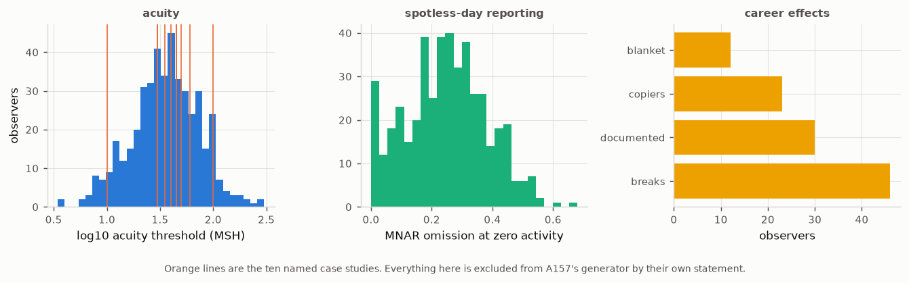
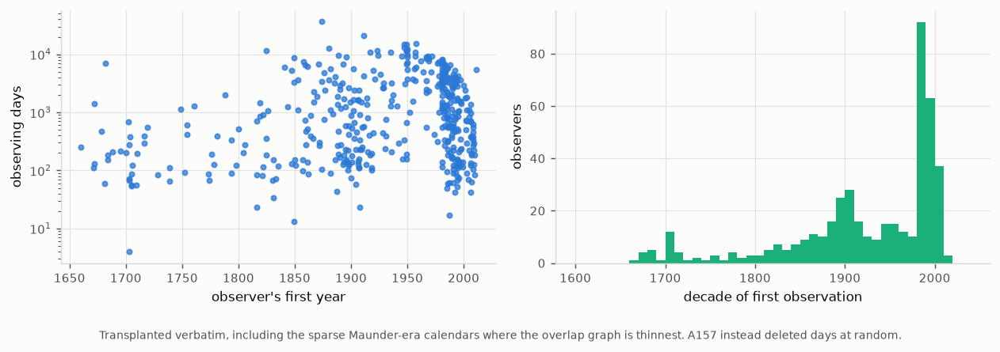
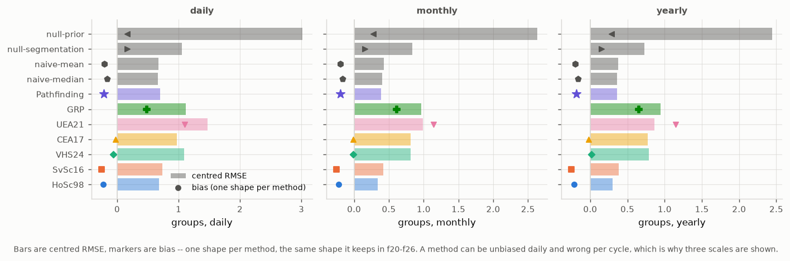
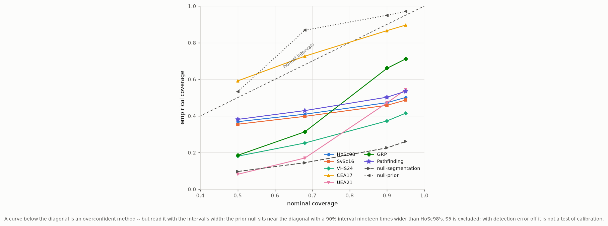
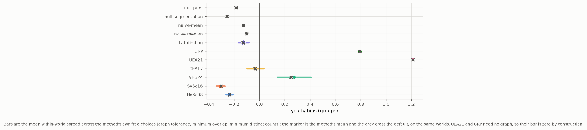
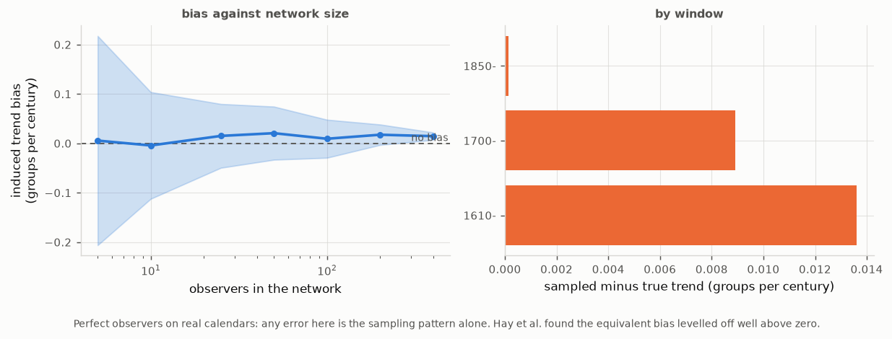

# Results: Step 2 — a blind benchmark of synthetic observers

- Plan: [`docs/plans/step-2-plan.md`](../plans/step-2-plan.md) (Approved 2026-11-22)
- Spec: [`docs/05_roadmap/step-2-blind-benchmark.md`](../05_roadmap/step-2-blind-benchmark.md)
- Branch: `step-2-blind-benchmark`
- Environment: conda env **`gn-next-gen`** (Python 3.12, pandas 3.1.1, SciPy 1.18)
- Decisions taken in session by the PI, 2026-11-22: hybrid replay; every baseline
  ported and no legacy code run; ADF's cycle phase from the observations; six
  scenarios × 10 realizations; **seven** baselines, not two; four structural
  misspecifications; the `runcsvs/` reproduction dropped; the published series
  acquired; ten named case-study observers; **no run over ~15 minutes launched
  from a Claude Code session**

> ### Scope of what follows
>
> **The full grid has run**: 51 worlds across five scenarios, eleven methods —
> the seven baselines and four floors — **561 scored cells** plus a 495-cell
> structural ensemble, no stage failed. It took 18 minutes on 64 cores, not the
> 3–6 hours planned.
>
> That includes scenario **S6**, the structural ensemble: 495 cells, three knobs
> × five settings × three worlds × eleven methods, the full planned version.

> ### Status, 2026-11-24 — re-run complete, numbers below are current
>
> Three defects found while answering questions about this document were fixed and
> the grid re-run from scratch: 51 worlds regenerated, **561 scored cells** (11
> methods now, the seven plus four floors) and a **495-cell** structural ensemble,
> no stage failed, 18 minutes on 64 cores. What moved:
>
> | | before | after |
> |---|---|---|
> | §5 coverage at nominal 50% | 0.009–0.159, "not one calibrated" | 0.076–0.591; **CEA17 is close to calibrated** and the return-the-prior null passes |
> | §4 floor | 4 of 7 lose to a random segmentation | **6 of 7 lose to the median of the raw counts**, paired per world |
> | §7 `clean-modern` | 4 of 7 over 2× off, SvSc16 silent in all 50 | **2 of 7**, and every method answers |
> | §8 structural spread | pooled worlds and settings | within-world; UEA21 and GRP are **exactly zero**, since neither uses the graph |
>
> §3, §6, §9 and §10 are materially unchanged. A fourth change — the published
> series comparison — needed no run. The plan is
> [`docs/plans/step-2-scorer-followups.md`](../plans/step-2-scorer-followups.md);
> §§12.7–12.10 record what each defect was, including a fourth found while
> checking the third: f22 was measuring worlds as well as settings.

## Summary

| Question | Answer |
|---|---|
| Do the ports behave as the published assessment says? | **Yes in sign, all five**, on that paper's own setup — HoSc98 and SvSc16 underestimate more as acuity rises, CEA17, UEA21 and VHS24 stay near zero (§3). Their *exclusion limits* differ, for a measured reason: our renovated RGO carries fewer small groups |
| Are any method's uncertainties calibrated? | **One of seven.** CEA17 covers 0.59 and 0.86 against a nominal 0.50 and 0.90. The rest are overconfident — the three chains by about 1.4×, UEA21 by 6.6× — and the *return-the-prior null passes the same test* with an interval 19× wider, which is why coverage alone cannot be the metric (§5) |
| Can the published methods reach the Maunder Minimum at all? | **Five of seven cannot.** Every overlap-based method stops at **1774** and covers 46% of the record. The two that need no overlap reach 1660–1672 and overestimate the Maunder level by **23–25×** (§6) |
| Does the benchmark separate skill from noise? | **Yes, and six methods fail it.** Only HoSc98 beats the daily **median of the uncalibrated counts** in most worlds (35 of 51); CEA17, VHS24, UEA21 and GRP beat it in 2–3 worlds out of 51, and also lose to a random segmentation (§4) |
| Which observers break a method? | **Slow drift breaks all seven** — no median past 2×, but six of the seven have a replicate that is. The paired breaks price the metadata: UEA21 recovers the *same* break at 50 MSH documented and 160 undocumented, against a true 45 (§7) |
| What does the observing calendar alone cost? | **About 5% of the trend** — +0.014 against a true 0.287 groups/century (§9). The large biases here are detection and reporting, not sampling |

## 1. What the benchmark is


**Figure f13** — The benchmark end to end. The generator differs from the Step 4
model in four stated ways, so the benchmark cannot flatter the model it exists to
judge; the research notes are blunt that "benchmarks that reuse the same
generative model as the inference method will overstate performance".

**Truth is real data, resequenced.** Inside the donor survey's own span the truth
*is* the reference: over 1877–1969 it reproduces RGO's daily reference-equivalent
counts **exactly, on all 24,219 days**. Outside it, whole complete cycles are
shifted rigidly in time and thinned by deleting whole groups, so every group keeps
its real area profile and its real visible span.


**Figure f14** — One replayed world and its provenance. The lower panel shows
which real cycle each synthetic era came from. Cycle amplitudes come from a
seeded AR(1), never from SILSO, a proxy or a published series — the firewall
(ADR-002) requires it, and it is also what keeps the truth genuinely unknown.

Writing the fidelity test earned its keep: synthetic cycles tile past the end of a
gap by construction, so without a clip they spilled into the verbatim span and
counted the same Sun twice.

## 2. What makes it differ from the closest precedent

Chatzistergos, Krivova, Sundermann & Usoskin (2025, A&A 699, A157) is the nearest
published synthetic-observer test, and the assessment recorded it as "full text not
read; which method is unconfirmed". It has now been read.

| | A157 | here |
|---|---|---|
| Truth | RGO, **1900–1976 only** | 1610–2026, real groups, areas and lifetimes |
| Grand minimum | none | S3, by whole-group deletion |
| Observers | 121, each a **hard acuity threshold** | soft thresholds with drift, breaks, split/merge, seeing noise |
| Drift, breaks, conventions | **excluded**: "which we do not consider here" | all present, some documented as metadata, some not |
| Spotless days | as reported | MNAR under-reporting, activity-dependent |
| Lifetimes | none | real `obs_duration`, through disk passage |
| Sampling | days **deleted at random** | real historical calendars, transplanted |
| Overlap structure | each observer **pairwise to RGO** | the real overlap graph |
| Daisy-chaining | **"not evaluated in this study"** | the chained methods' error is what is measured |
| Uncertainty calibration | **none** | the load-bearing metric (ADR-007) |


**Figure f15** — The structure A157 does not have. Chained calibration's variance
grows like effective resistance to the anchor, so the left panel is the x-axis of
every chained method's error. The reference observer sees only its own anchored
epoch (ADR-009), so every other observer is reached through this graph. **39 of the
422 observers never reach it**: the graph is not one connected whole. These panels
summarise the full-record network (**S2**); f28 draws it.


**Figure f28** — The graph f15 summarises, drawn in full (**S2**, 1610–2026). Left:
every one of the 16,675 edges, each observer placed at its mid-career year and its
resistance to the anchor, so the chain is visible as the thing a method has to walk.
Median resistance rises from 1.4e-5 for observers centred after 1980 to 2.7e-3 before
1830; **20 edges are bridges** (orange — cut one and everything behind it loses the
anchor); **39 of 422 observers have no path to the anchor at all**. Right: how much of
the chain crosses each year, splitting the observers by career midpoint (the ends of
the record, where one side holds fewer than ten observers, are trivially empty and
left out). **In 1727–1745 and 1777–1798 nothing crosses at all** — 41 years where the
graph is severed, not merely thin — and across 1727–1801 the cut never exceeds five
edges and holds one or none in 57 of those 75 years. That is the structural reason
five of seven methods stop at 1774 (§6): a property of the real overlap pattern, not
of any method. Numbers from
[`data/step2_overlap_graph_cut.csv`](data/step2_overlap_graph_cut.csv).



**Figure f16** — The observer population. Everything in the third panel — career
breaks, copied records, blanket statements — is named and then set aside by A157's
own statement, and modelled here.



**Figure f17** — The calendars, transplanted verbatim from the real record
including the sparse 17th- and 18th-century patterns where the graph is thinnest:
**44 observers before 1800**, a median of 2.5 per decade, two-thirds of them with
fewer than 300 observing days in total. A157
reduces overlap by deleting days at random instead, which cannot reproduce a
bottleneck.

## 3. Criterion A7 — do the ports behave as published? *(complete)*

The plan dropped the `legacy/ADFSSN/runcsvs/` reproduction: those files were not
produced by the committed driver settings, and the snapshot already carries
`uncommitted.diff`, so the target is not well defined. An external, published
target replaces it — rebuild A157's own setup and compare.


**Figure f24** — A157's Fig. 3b, rebuilt with these ports on their setup (RGO
after 1900, hard thresholds, full overlap, annual means). **All five agree in
sign**: HoSc98 and SvSc16 fall away with acuity, CEA17, UEA21 and VHS24 stay near
zero. CEA17 lies exactly under UEA21, which is their result too — "by design,
CEA17 and UEA21 are identical in these metrics in this case".

| method | mean-difference slope | falls with acuity? | A157 expects | agrees |
|---|---|---|---|---|
| HoSc98 | −0.00157 | yes | yes | **✓** |
| SvSc16 | −0.00076 | yes | yes | **✓** |
| VHS24 | +0.00029 | no | no | **✓** |
| CEA17 | +0.00059 | no | no | **✓** |
| UEA21 | +0.00059 | no | no | **✓** |

**The exclusion limits do not reproduce, and the reason is measured.** HoSc98 gives
up at **73 msd** here against their **31**. Its factor is a ratio of sums, so
losing a fraction `f` of group-days implies `k ≈ 1/(1−f)`, and its own
`0.6 < k < 1.4` gate trips at `f = 0.29`:

| acuity | group-days lost | implied `k` |
|---|---|---|
| 31 msd | 15.0% | 1.18 |
| 60 msd | 26.7% | 1.36 |
| 87 msd | 33.3% | 1.50 |

Our renovated RGO crosses `f = 0.29` between 60 and 87 msd, which predicts 73
exactly. A157 used the 2017 catalogue, whose small-group completeness differs —
D14 puts RGO's own floor at 28.1 MSH. **This is a data difference, not a port
defect**, and the evidence is in `a157_catalogue.csv`.

Units are the trap here and are worth stating: A157 quotes acuity in millionths of
the solar *disc*, this project works in millionths of the *hemisphere*, and the
disc is half the hemisphere, so MSH = msd / 2 (D4).

## 4. Baseline scores *(full grid: 561 cells)*

> **Naming, 2026-11-24.** The port of the 2017 MATLAB multipath method is called
> **Pathfinding** here and everywhere in the code; it was called `Backbone` through
> 2026-11-23. The old name collided with **SvSc16**, which *is* Svalgaard &
> Schatten's backbone and is a separate baseline in the same table, so "the backbone
> method" named two of the seven. Nothing about the method, its inputs or its scores
> changed — the figures and CSVs carry the new label.



**Figure f18** — Point error at three averaging scales, pooled over all 51 worlds.
A method can be unbiased daily and wrong per cycle, which is why HOME scores at
several scales and so does this. Each method keeps one colour **and** one marker
shape across f18–f26, so a mark says which method it belongs to without the
legend, and the four floors stay apart in the grey they share.

| method | yearly bias | yearly cRMSE | CRPS | beats the median of the raw counts? |
|---|---|---|---|---|
| HoSc98 | −0.220 | **0.301** | 0.242 | **yes, in 35 of 51 worlds** |
| *naive-median* | *−0.166* | *0.360* | — | — |
| Pathfinding | −0.183 | 0.363 | 0.255 | in 21 of 51 |
| *naive-mean* | *−0.201* | *0.378* | — | — |
| SvSc16 | −0.253 | 0.385 | 0.289 | in 17 of 51 |
| *null-segmentation* | *0.152* | *0.731* | *0.417* | — |
| CEA17 | **−0.023** | 0.773 | 0.361 | in **3** of 51 |
| VHS24 | **0.014** | 0.786 | 0.514 | in **2** of 51 |
| UEA21 | 1.149 | 0.861 | 0.890 | in **2** of 51 |
| GRP | 0.653 | 0.946 | 0.641 | in **2** of 51 |
| *null-prior* | *0.283* | *2.447* | *1.422* | — |

**Six of the seven are beaten by the median of the counts they were meant to
calibrate.** Not pooled-mean-against-pooled-mean: the last column is a paired test
over the same 51 worlds, in [`floors.csv`](../../outputs/step2/scores/floors.csv).
Only HoSc98 wins more often than it loses, and its median margin is 0.034 groups.
CEA17, VHS24, UEA21 and GRP win in two or three worlds out of fifty-one — against
an estimator with **no graph, no reference observer and no calibration at all**.
A chained method exists to turn an observer's four groups into the reference's ten;
if it cannot beat leaving the counts alone, its factors inject more error than they
remove.

**The weaker floor says the same thing less sharply.** Against `null-segmentation`
— careers cut at arbitrary points and scaled by arbitrary factors — HoSc98 wins
51 of 51, SvSc16 50, Pathfinding 49, while CEA17 wins 25, VHS24 19, UEA21 14 and
GRP 10. Lindau & Venema (2018) found that at realistic signal-to-noise a random
segmentation explains about half the break variance, which is why the null is in
the table; the naive median is the harder bar, because the random factors average
out over 450 observers and a year of days, leaving the naive mean plus noise.

Note the two columns disagree about who is good. CEA17 and VHS24 have the
*smallest* yearly bias of any method (−0.023, +0.014) and are two of the four
worst on scatter. A method can be centred and useless.


**Figure f19** — The secular-bias signature on the real overlap graph. The two
families separate cleanly: the linear scalings and Pathfinding sit at
**−0.018 to 0.000**, effectively flat, while CEA17, UEA21, VHS24 and GRP run
**−0.20 to −0.37**. The two naive floors sit at −0.06 and −0.08, between the two
families and much closer to flat than any of the four.

**This is a partial reproduction, and the part that moved should be said
plainly.** On their own setup (§3) all five methods agree in sign with the
published Fig. 3b. On the *real overlap graph* the separation survives but the
linear group's sign does not: A157 finds HoSc98 and SvSc16 amplifying strong
cycles, and here they are flat to very slightly negative. The two-world slice
reported in an earlier draft of this document gave them +0.008 and +0.001, which
the full grid does not support either. What reproduces robustly is the
*separation* between the families, not the sign of the linear one.

## 5. Coverage — the finding this step exists for



**Figure f20** — Nominal against empirical interval coverage, over the 450
calibration cells. One method tracks the diagonal; the rest sit below it, and how
far below is the result.

| method | 50% | 68% | 90% | 95% | PIT KS | mean 90% width |
|---|---|---|---|---|---|---|
| **CEA17** | **0.591** | **0.720** | **0.862** | **0.892** | **0.132** | 1.92 |
| *null-prior* | *0.533* | *0.864* | *0.947* | *0.969* | *0.195* | *9.99* |
| Pathfinding | 0.367 | 0.413 | 0.485 | 0.517 | 0.460 | 0.62 |
| HoSc98 | 0.357 | 0.398 | 0.459 | 0.488 | 0.492 | 0.52 |
| SvSc16 | 0.345 | 0.386 | 0.446 | 0.476 | 0.494 | 0.57 |
| GRP | 0.196 | 0.323 | 0.634 | 0.686 | 0.421 | 2.12 |
| VHS24 | 0.186 | 0.260 | 0.380 | 0.421 | 0.381 | 0.59 |
| *null-segmentation* | *0.104* | *0.155* | *0.240* | *0.276* | *0.594* | *0.22* |
| UEA21 | 0.076 | 0.157 | 0.428 | 0.501 | 0.674 | 2.46 |

**One of seven is close to calibrated, and it is the only one that was built to
be.** CEA17 covers 0.591 and 0.862 against a nominal 0.50 and 0.90, with a PIT
distance of 0.132 — three to five times smaller than anyone else's. It is the only
baseline whose construction yields a native predictive distribution: "the
calibration returns a PMF series, which also includes information about the
uncertainty". That is a real result, and the earlier draft of this document got it
exactly backwards, reporting CEA17 at 0.050 against a nominal 0.50. The error was
in the scorer, not the method (§12.7).

**The rest are overconfident, and by very different amounts.** The three chained
scalings land near 0.35 at nominal 0.50 — too narrow by about 1.4×, which is a
real failure but a recoverable one. UEA21 at 0.076 is too narrow by 6.6×, and its
PIT distance of 0.674 says the interval is not merely tight but wrongly placed.

**And the return-the-prior null passes.** It covers 0.533 and 0.947 against 0.50
and 0.90 — better than five of the seven — with a mean 90% interval of **9.99
groups against HoSc98's 0.52**, a factor of 19. This is the TARP warning made
concrete rather than quoted: a coverage test that cannot reject an estimator which
ignores the data is not testing anything, and the width column is what separates
the two. A method is only well calibrated if it is *also* sharp, which is why
CEA17's 1.92 beside its 0.86 is the row that matters and the null's 9.99 beside
its 0.95 is not.

The levels barely move across scenarios, so none of this is a quirk of one era:
CEA17 runs 0.584–0.601 at nominal 0.50 across S1–S4, UEA21 0.056–0.099.

S5 is excluded from this figure and table. With detection error switched off an
exact method scores a coverage of 1.0 there, so it is a check on the pipeline
(§9) rather than a test of calibration, and letting one degenerate world carry a
fifth of the headline would flatter the two scaling methods.

This is still the axis on which the comparison is new: A157 scores RMS, mean,
relative and maximum-absolute difference, and scores no interval at all. What the
benchmark now says is narrower and more useful than "nobody is calibrated" — it is
that **the one method with a generative uncertainty model gets its intervals
roughly right while scoring near the bottom on point error** (§4), and the methods
that score well on point error report intervals about 1.4× too narrow.

## 6. Reach: five of seven methods cannot see the Maunder Minimum

The result the two-world S1 slice could not show, because S1 begins in 1874.

| method | earliest year reached | share of the 1610–2026 record |
|---|---|---|
| HoSc98, SvSc16, VHS24, CEA17, Pathfinding | **1774** | **46%** |
| UEA21 | 1672 | 57% |
| GRP | 1660 | 59% |
| *the four floors* | *1660* | *59%* |

Every method that calibrates through observer **overlap** stops at 1774. The
reference observer sees only its anchored epoch (ADR-009: RGO cycles 15–19,
1912–1969), and the chain from there does not reach the 17th century: the graph
is too sparse. These methods do not produce a wrong Maunder Minimum — they
produce **none at all**, over more than half the record the series is supposed
to cover.

The two methods that need no overlap do reach it, and are wrong by more than an
order of magnitude. On S3, where a grand minimum is inserted by deleting whole
groups:

| method | true Maunder level | estimated | ratio |
|---|---|---|---|
| UEA21 | 0.088 | 2.165 | **24.6×** |
| GRP | 0.094 | 2.135 | **22.7×** |
| *null-segmentation* | *0.090* | *0.110* | *1.2×* |
| *naive-median* | *0.090* | *0.087* | *0.97×* |
| *naive-mean* | *0.090* | *0.087* | *0.97×* |

**The median of the raw counts gets the Maunder level right to 3% while both real
methods overestimate it more than twentyfold.** That is not because the floors are
clever: raw counts in a grand minimum are near zero, so anything that does not
inflate them inherits the right answer. They are in the table because on the single
number that decides the Maunder Minimum, neither method that can reach the era
beats *doing nothing at all* — and the gap is not 20%, as the weaker floor
suggested, but a factor of twenty-five.

Taken together these two findings are the quantitative case for this project:
the published methods either cannot speak about the Maunder Minimum, or speak
about it wrongly by a factor of twenty.

## 7. The ten case-study observers

An aggregate score says which method wins and hides the observers that break one.
Ten observers are fixed by name and seed, each isolating a failure mode; 3,500
case-study rows across S1–S4, which is **fifty replicates** — scenario × seed —
behind every observer and method. The medians, quartiles and ranges below are in
[`data/step2_case_study_observers.csv`](data/step2_case_study_observers.csv), the
same table `f25` and `f26` are drawn from.

Fifty replicates make two different questions available, and they give different
answers. A method is **typically** off when its *median* scale factor sits more
than 2× from the truth; it is **sometimes** off when its *worst* replicate does.
Reading only one of the two is how a case study gets misread:

| Observer | typically >2× off | sometimes >2× off | never answered |
|---|---|---|---|
| `clean-modern` | 2 | 4 | — |
| `sparse-maunder` | 0 | 1 | UEA21 |
| `break-undocumented` | 1 | 2 | — |
| `break-documented` | 0 | 1 | — |
| `slow-drift` | 0 | **6** | — |
| `poor-instrument` | **3** | 4 | SvSc16 |
| `leaf-node` | 1 | 3 | UEA21 |
| `copier` | 2 | 5 | SvSc16 |
| `zero-omitter` | 0 | 1 | — |
| `blanket-statements` | — | — | all seven |


**Figure f25** — Case studies 1–5. **`clean-modern` is now what it was meant to
be: the case most methods get right.** Five of seven sit within 1.2× in the median
(SvSc16 1.04, HoSc98 1.06, Pathfinding 1.09, GRP 1.18, VHS24 1.19), every method
answers in all fifty replicates, and only CEA17 (2.12×) and UEA21 (2.75×) are
typically past 2×. An earlier version of this document reported the opposite —
four of seven past 2× and SvSc16 silent in all fifty — and that was an artifact of
the case study, not a property of the methods: `clean-modern` had been selected on
calendar density alone and landed on a 517-day career. §12.9 has the diagnosis.
The acuity row still fails: UEA21 returns a median **150 MSH against a true 10**,
though GRP now returns 26.

**`slow-drift` is the opposite shape, and the ranges are what tell them apart.**
Every median sits within 1.9× of the truth, so on a median-only reading a random
walk in acuity defeats nobody; but six of the seven have at least one replicate
past 2×, Pathfinding by 4.3× and HoSc98 by 4.0×. Drift does not bias these
methods, it makes them unreliable — a claim no single replicate, and no median,
can carry on its own.

The paired breaks still price the metadata, in acuity rather than scale: the
**same** break is recovered at a median **50 MSH when documented** and **160 MSH
when not** by UEA21, against a true 45, and at 28 against 58 by GRP. Documentation
is worth a factor of 2–3 here, unchanged by the re-run.


**Figure f26** — Case studies 6–10. **`poor-instrument` is now the hardest case in
the benchmark**: three of seven are typically past 2× (GRP 2.33, UEA21 2.09, VHS24
2.02), **SvSc16 returns nothing in any of the fifty replicates**, and three more
answer in only 32 of 50. Both acuity methods pin it at the **300 MSH grid ceiling**
against a true 100. `leaf-node` shows the other kind of failure — **UEA21 returns
nothing at all, in all fifty replicates** — while the methods that do answer it are
fine (Pathfinding 1.04, SvSc16 1.04, HoSc98 1.11). A method that cannot answer is
not the same as one that answers badly, and an aggregate score drops the first
silently.

`copier`, whose record duplicates a neighbour's, now has two medians past 2× (GRP
2.72, VHS24 2.29) and five methods with replicates that are, SvSc16 again silent in
all fifty, and GRP's acuity sits at a median 280 MSH against a true 30: correlated
observer error, which nothing under test models, shows up as both bias and spread.
`zero-omitter` remains the one clear success — UEA21 recovers a median **26 MSH
against a true 30**, every method answers all fifty replicates and only CEA17 ever
strays past 2× — so activity-dependent omission of blank days is the failure mode
these methods *do* survive. `blanket-statements` produces nothing from any method
in any replicate, the zero under every slot, because the record is sentences rather
than counts.


**Figure f23** — Acuity recovery, for the only two methods that attempt it. Left:
nearly every point sits above the diagonal — observers are judged worse than they
were, by **+89 MSH (UEA21)** and **+69 MSH (GRP)** on average. A157 reports exactly
this direction for UEA21 — it "systematically overestimates the acuity of the
observer, thus in the end also amplifies the group numbers" — and the benchmark
reproduces it at scale.

**Right is the diagnosis, and it is the panel to read.** The recovered acuity
tracks how active the Sun truly was over that observer's own career: Spearman
**ρ = −0.62 for UEA21 and −0.73 for GRP** across 350 and 411 case-study fits. The
cause is structural and published. Both methods match an observer's statistic
against a library built **once** over the anchor epoch, with no conditioning on
activity or cycle phase, and a quiet era and a blind observer produce the same
fingerprint: fewer active days. An observer whose era is quieter than cycles 15–19
therefore has a statistic below *every* library entry, the fit runs monotonically
to the top of the grid, and it pins at the 300 MSH cap A157 documents. That is why
`poor-instrument` and `copier` both return 280–300 MSH, and it is a sharper
statement of the published bias than the left panel alone: the overestimate is not
a per-observer error, it is a missing covariate.

## 8. The structural ensemble



**Figure f22** — The spread a method's *own* free choices produce: the overlap
graph's day tolerance, minimum overlap and minimum distinct counts, three knobs ×
five settings over three S2 worlds and all eleven methods, **495 cells**. Williams
et al. (2012) ran perturbed-parameter ensembles of the PHA for exactly this reason.

**The bar is the within-world range**, averaged over worlds, and that is a change
from the previous version of this figure, which pooled worlds and settings into one
min–max bar. The difference is not cosmetic: pooling measures world-to-world
variation and labels it structural. **For UEA21 and GRP it was the entire bar.**
Neither method touches the overlap graph — both calibrate each observer from its
own statistics against the reference catalogue — so their within-world spread is
**exactly zero**, and the 0.21 and 0.31 the pooled version reported were worlds,
not knobs.

**The ensemble is narrower than the uncertainty the methods already report**, for
every one of them:

| method | structural spread | mean reported sd | wider? |
|---|---|---|---|
| HoSc98 | 0.056 | 0.659 | no |
| SvSc16 | 0.066 | 0.679 | no |
| Pathfinding | 0.081 | 0.694 | no |
| CEA17 | 0.134 | 0.582 | no |
| VHS24 | 0.267 | 1.103 | no |
| UEA21 | **0.000** | 0.698 | no |
| GRP | **0.000** | 0.524 | no |

That is a sharper statement of §5 than coverage alone. These intervals are not
too narrow because the methods ignored their own free choices — the choices move
the answer by a tenth to a quarter of what the interval already allows, and for
two methods by nothing at all. They are too narrow because what the interval is a
width *of* does not include the error that actually dominates. Widening an interval
to admit structural choices would not fix the coverage; the error is elsewhere.

It also sharpens the one calibrated row. CEA17's interval is the only one that
covers near nominal (§5), and its structural spread is 0.134 against a reported
0.582 — so its intervals are not wide by accident of a sloppy graph choice.

The figure withholds the default-setting marker where §4's defaults pool all
scenarios while this ensemble ran on S2 alone, because plotting the two together
would compare scenarios rather than settings.

## 9. The Hay sampling-only experiment

Scenario S5 puts **perfect** observers — no threshold, no drift, no noise, no MNAR
omission — on the real calendars. Every observer reports the estimand exactly on
the days it looked, so any residual error is the sampling pattern and nothing
else.

S5 also turns out to be a correctness check on the whole pipeline: on it,
**HoSc98 and Pathfinding score a centred RMSE of exactly 0.000 and a coverage of
1.000**, and so do `naive-mean` and `naive-median` — with perfect observers the
mean of the reported counts *is* the estimand, so the floors landing on 0.000 too
is the check that the scorer and the floors agree about what truth means. When
there is nothing to calibrate, the calibrators return the truth. That SvSc16 is
near it (0.209) while the four non-parametric methods are not (0.86 to 1.22) is
itself informative about where their error comes from: it is not the calendar.



**Figure f21** — What the calendar alone costs. The induced trend bias is
**+0.014 groups per century against a true 0.287** over 1610–present — about 5% —
falling to +0.0001 over 1850–present where the network is dense. Bootstrapping
over 5 to 400 observers, the scatter narrows from ±0.21 to ±0.008 while the mean
bias stays near +0.01 to +0.02.

**This differs from the sea-level precedent, and the difference is the point.**
Hay et al. found sparse, gappy sampling moved the 20th-century trend by about
30%; here the calendar alone moves it by 5%. S5 has no *preferential* sampling by
construction — MNAR omission is switched off — so the comparison says the large
biases in the GN problem come from detection and reporting, not from who looked
when.

## 10. The eight published series, compared

![Top: eight published group-number series over 1610-2022, smoothed over one solar cycle and drawn on a log axis, converging after 1750 and fanning out across two decades of magnitude inside the shaded Maunder Minimum. Middle: each series' mean group count in the Maunder window as a filled marker and in the modern overlap as an open one, on a log axis, the Maunder markers spanning 0.05 to 3.28. Bottom: the difference between the 2024 Hoyt and Schatten update divided by 12.08 and the 1998 series it updates, within a thousandth of a group.](figures/step-2/f27_published_series_light.png)

**Figure f27** — Every published group-number series this project holds, on one
axis. Panel (a) is smoothed over one cycle and drawn on a log axis deliberately:
at annual resolution eight cycle-resolved series are a hairball that hides the slow
disagreement, which is the only thing worth comparing. Panel (b) is the comparison
itself; panel (c) is the check that licenses the single scale (**D24**) — the
supplement publishes its Hoyt & Schatten update in 12.08-scaled units while its own
reconstruction is in counts, and dividing by 12.08 reproduces the 1998 series on all
386 overlapping years to within 9×10⁻⁴. A series left unscaled would sit twelve
times too high and still look like a plausible solar cycle.

**Where they agree, they agree well.** Over **1749–1995**, where all six full-record
series overlap, the mean daily group count runs from **3.83 to 4.80** — a spread of
**25%**, and most of that is one series:

| series | 1749–1995 | 1645–1715 |
|---|---|---|
| Velasco Herrera 2024 (H&S update) | 3.83 | **0.055** |
| Hoyt & Schatten 1998 | 3.83 | **0.055** |
| Usoskin et al. (ADF family) | 4.18 | — |
| Svalgaard & Schatten 2016 | 4.45 | **1.01** |
| Chatzistergos et al. 2017 | 4.51 | — |
| Velasco Herrera et al. 2024 | 4.80 | **0.10** |
| Vaquero et al. *(window only)* | — | **0.20** |
| Zolotova & Ponyavin *(window only)* | — | **3.28** |

**Where they disagree, they disagree by sixty.** Over the Maunder Minimum
**1645–1715** the same quantity runs from **0.055 to 3.28 groups per day**, a factor
of **60**. Two of the eight are window studies rather than reconstructions, and
including them is the point: the disagreement is not a tail of one method's error
bar, it is two incompatible pictures of the same seventy years. Note also what is
*missing* from that column: the Usoskin and Chatzistergos series begin in 1749 and
1739, so neither says anything about the window at all. Four series, two of them
window studies, are the entire published basis for the Maunder Minimum's level.

**This benchmark explains the size of that gap.** Five of the eight series were
produced by methods scored here — HoSc98, SvSc16, CEA17, UEA21 and VHS24 — so the
scores in §§4–7 are statements about these series' provenance, not about
look-alikes. And the disagreement sits exactly where the benchmark finds no skill:
§6 measures that five of seven methods never reach the era at all, and that the two
that do overestimate the Maunder level by **23–25×** on a known truth (that figure
is from the 2026-11-23 grid; see the status box). A published spread of 60× across
methods whose Maunder-era error is of that order is not a puzzle; it
is the expected consequence, and it is the strongest argument in this document for
why the series needs rebuilding rather than re-weighting.

**One correction to the frozen table, recorded here because it changed numbers.**
The 2017 MATLAB snapshot's yearly files use `gn = -1` with `n_observations = 0` for
a year with no data, and the first export carried it through as a negative group
count: six years of Hoyt & Schatten and one of the Usoskin file. They are null now
(**D25**). Comparison-only data, so no score moves.

**A documented rule was not actually enforced, and now is.** That folder's
README claimed the validator refuses these as a calibration input. It did
not: `FIREWALLED_KINDS` is `silso`, `isotope`, `aurora`, `proxy`, and a GN
series would have been declared `kind: sunspot` and passed. This mattered
more than it had before, because what arrived with the supplement includes a
**daily** reconstruction over the same observers — the one shape that could
enter a likelihood looking like data. `validate_run_config` now refuses a
`kind: published_series` dataset in role `calibration`, and every
`lineage.json` carries the matching evidence.

It is a **separate rule from the ADR-002 firewall**, not another entry in
`FIREWALLED_KINDS`, for two reasons. It binds *both* variants — the
proxy-informed variant may calibrate on isotopes, but neither variant may
calibrate on someone else's recalibration of these observers. And a published
GN series *is* sunspot data: listing it as proxy-derived would have made each
run's own firewall statement false. The lineage record therefore gained
`published_series_calibration_inputs` and a `circularity_statement` beside
the existing firewall fields, and `tests/test_config.py` pins that the two
stay apart. If you want this recorded as a decision rather than as
enforcement of ADR-003, an ADR amendment is the place — it is not
relitigating anything, since the project had already claimed the rule in
three documents.

The supplement also carries a corrected raw observation database, 1610–**2022**,
in the v1.22 shape. It is not adopted: ADR-010 makes `gn_database_v1.3` release
`_4` the database of record, and those corrections are an author's judgement to
be compared against v1.3's changelog rather than merged. It is noted because it
is the only thing in hand that runs past v1.3's 2010 end.

## 11. Reproducing this

Checks, all quick:

```bash
conda activate gn-next-gen
pytest && pytest -m slow
ruff check . && ruff format --check .
python scripts/fetch_published_gn_series.py --check
python scripts/generate_benchmark.py --config configs/step2_benchmark.yaml \
       --scenarios S1 --realizations 2 --check     # determinism: digests match
python scripts/validate_against_a157.py            # §3, 16 s
```

The grid itself is **one command**:

```bash
cd /d0/amunozj/git_repos/GN_Next_Gen
./scripts/run_step2_grid.sh --detach
```

It returns immediately, survives logout, and does the stages in the only order
that is correct. Watch it with:

```bash
./scripts/run_step2_grid.sh --status
```

Each stage stamps its progress file with the invocation's run id, so `--status`
marks rows left by a different invocation as `other run` instead of mixing them
into this one's. Without that, a leftover 18-cell slice read as if it were the
whole grid.

**Safe to re-run, and it will not reuse work it should not.** Every stage skips
cells already on disk, so an interrupted grid resumes rather than restarting. But
"the file is there" is not the same as "the file is what this code would write", so
two staleness checks sit underneath: `config.json` carries a `generator_version`
and `is_complete` refuses a world written by an older generator, while `cell_done`
refuses a fit whose parquet lacks the uncertainty-decomposition columns. A change
to the generator therefore regenerates rather than silently mixing two generations
of worlds into one score table, and no `--force` is needed.

**Measured, not estimated.** The full grid was re-run from scratch on 2026-11-24 in
**18 minutes** with `--jobs 16` on 64 cores: 51 worlds regenerated in 0.2 min, the
561 baseline cells took 16.6 minutes and the 495-cell structural ensemble 15.2,
concurrently, then scoring 1.1 and figures 0.3. The 3–6 hour figure in earlier
drafts was a serial estimate and was far too pessimistic.

**What it does, and why in that order.** One dependency is hard: nothing that
reads a world may start before `generate_benchmark.py` finishes, because the
runners discover work by globbing for *complete* realizations and one started
early would quietly process a subset and look finished. The script enforces that
barrier and aborts if generation fails, since everything downstream would
otherwise produce confident nonsense.

| stage | needs | runs with | ~time |
|---|---|---|---|
| `validate_against_a157` | nothing — reads `data/raw` only | — | 16 s |
| `generate_benchmark` | — | — **barrier** | 30–60 min |
| `run_baselines` | generation | the next two | 3–6 h |
| `run_baselines --structural` | generation (S2) | the other two | 1–2 h |
| `sampling_only_experiment` | generation (S5) | the other two | ~20 min |
| `score_benchmark` | baselines | `--structural` scoring | ~10 min |
| `score_benchmark --structural` | the ensemble | plain scoring | ~10 min |
| `make_step2_figures` | everything | — | < 3 min |

The three middle stages write to disjoint paths — the structural runner tags its
directories `seed-NNNN__knob=value` — and the two scoring passes write different
CSVs, so each group is safe to run at once. Defaults to `--jobs 16` per runner,
comfortable on this machine's 64 cores; a worker holds well under 2 GB.

A stage that fails does not abort the ones that do not depend on it. The run ends
with a summary naming every failure and a non-zero exit code.

Useful flags: `--jobs N`, `--scenarios S1 S2`, `--realizations N` and
`--methods HoSc98 CEA17` for a smoke run; `--help` for the rest. The underlying
scripts can still be run individually — the orchestrator only sequences them.

Figures are committed under [`figures/step-2/`](figures/step-2/) in light and dark, and
the per-observer summary behind §7 under
[`data/step2_case_study_observers.csv`](data/step2_case_study_observers.csv); the rest of
the CSVs are in git-ignored `outputs/step2/`.
## 12. What this step does not establish

Stated plainly, because a benchmark that overclaims is worse than none.

1. **This is not blind in the HOME sense.** HOME had 25 outside groups submit
   before the inserted inhomogeneities were revealed. One developer wrote both
   sides here. Blindness is enforced by API and audited by a static import test,
   and the baselines were frozen by commit before the scoring run. That is
   weaker than HOME and stronger than nothing.
2. **Grand-minimum truths are thinned modern groups, not a regime change.** No
   source was found for generating grand-minimum synthetic truths; the thinning
   is this project's choice. §6's 23–25× overestimate is conditional on it —
   though the *reach* result, that five methods never arrive at all, does not
   depend on what the truth looks like once you get there.
3. **Overconfidence is not decomposed.** There is no matched-model control arm,
   so §5 measures coverage under *this* generator rather than separating model
   error from data error. This matters more now that one method covers near
   nominal: CEA17's 0.591 is a statement about CEA17 *on this generator*, not a
   general claim that its intervals are honest.
4. **Break-detection skill is NaN for all seven.** None of them attempts to
   detect a career break. The metric is implemented and tested so Steps 3–4 can
   be scored on it; the absence is a result, not a gap in the scorer.
5. **One anchoring, not two.** Every scenario here uses ADR-009's secondary
   anchor (RGO cycles 15–19). The Debrecen 21–23 anchoring is supported by the
   code and configured per scenario, but was not run, so the anchor-sensitivity
   comparison ADR-003 asks for is still owed by Steps 3–4.
6. **The second, model-based generator was not written.** The replay generator
   already supplies the four structural misspecifications through real data; a
   parametric sibling would have added a knob without adding a departure from
   the Step 4 model.
7. **The yearly coverage was aggregated wrongly until 2026-11-24, and §5 said the
   opposite of what it now says.** `uncertainty_scores` pooled a method's daily
   `gn_sd` to the year as `sqrt(mean(sd^2) / n_days)` — the independent-days rule.
   The dominant term in a chained method's `sd` is the observer's calibration factor
   error, *identical on every day of that career*, so the rule shrank every yearly
   interval by up to `sqrt(365) ≈ 19` and reported an overconfidence no method had
   claimed. The published version of this document said "no method's uncertainties
   are calibrated, in any scenario, 0.009–0.159 at nominal 0.50". After the fix
   CEA17 covers **0.591**, and it was the worst-reported method before at 0.064.
   Every baseline now returns `gn_sd_factor` and `gn_sd_spread` beside an unchanged
   `gn_sd`, and the scorer pools them as
   `sqrt(mean(sd_factor)^2 + mean(sd_spread^2) / n_days)`. The guard that should
   have caught this could not: it used one day per year, so the division was a
   no-op. Two tests with 200-day years now pin both halves — a correlated error
   keeping nominal coverage, and a day-level one still averaging down. **The
   direction of the original claim survives for UEA21, VHS24, GRP and the two
   nulls; it was wrong for CEA17 and overstated for the three chains.**
8. **The floor §4 compared against was the weak one.** `null-segmentation`'s random
   `exp(N(0, 0.3))` factors average out over ~450 observers and a year of days, so
   it is the naive mean plus noise. The daily **median of the raw, uncalibrated
   counts** is the harder floor, and §4 now reports it: six of seven methods lose to
   it in most of the 51 worlds. `naive-mean` and `naive-median` are registered
   floors — shape comparators only, with no anchoring and no uncertainty, so they
   appear on centred RMSE and nowhere else — and "beats the null?" is a per-world
   paired test in `floors.csv` rather than a comparison of two pooled means.
   **What remains a limitation**: the floors are still not a significance test. A
   win fraction of 35/51 is reported as it stands, without a confidence interval.
9. **`clean-modern` was testing a short record, not a clean one.** It was selected
   as the densest post-1959 calendar, which is station 722: a **517-day career,
   1992-01 to 1993-05**, about 17 of the fixed months UEA21's statistic is defined
   on against its own floor of 12. All fifty replicates reused that one window and
   the replay dropped a different synthetic Sun into it each time, so what the
   acuity methods recovered was the window: across the ten S2 worlds the recovered
   acuity tracked the window's true mean count at **Spearman ρ = −0.93**, and in the
   one world whose window was more active than the anchor epoch UEA21 returned
   **12 MSH against a true 10**. Selection now requires **≥ 3,000 observing days**
   (station 459, 6,922 days, 1977–1995), and `clean-modern` went from four of seven
   past 2× with SvSc16 silent, to two of seven with every method answering.
   **What remains**: the underlying confound is the methods' own and is not fixed by
   reselecting an observer. Over all case studies the correlation between era
   activity and recovered acuity is still **ρ = −0.62 (UEA21)** and **−0.73 (GRP)**,
   which f23's right panel now reports rather than hides.
10. **The structural ensemble measured worlds as well as settings until 2026-11-24.**
    f22 pooled three worlds and fifteen settings into one min–max bar. For UEA21 and
    GRP, which never touch the overlap graph, that bar was *entirely* world
    variation — reported as 0.21 and 0.31 when their true structural spread is
    exactly zero. The bar is now the within-world range averaged over worlds. The
    section's conclusion is unchanged and slightly stronger: the ensemble is
    narrower than every method's own reported uncertainty.

## 13. What Steps 3–4 inherit

| Setting | Value | Why |
|---|---|---|
| Benchmark API | `gn_next_gen.benchmark` + `gn_next_gen.baselines`; one `calibrate(...) -> CalibrationResult` signature | A Step 3 or 4 method is scored by registering it in `BASELINES` |
| One command | `./scripts/run_step2_grid.sh --detach` | 51 worlds, 561 cells, 18 min on 64 cores; resumable, and it refuses stale worlds and fits rather than skipping them |
| The bar to clear | yearly cRMSE **0.301** (HoSc98) and a 50% coverage of **0.591** at a 90% width of 1.92 groups (CEA17) | The best point error and the only near-nominal coverage among the seven. They are different methods, which is the opening |
| The floor | the daily **median of the raw counts** scores **0.360**, and beats six of the seven in most worlds | A method that cannot beat leaving the counts uncalibrated has demonstrated nothing. The weaker floor, a random segmentation, scores 0.731 |
| The open goal | **no method reaches before 1774**, and the two that do overestimate the Maunder level 23–25× | This is the gap a joint model exists to close, now measured rather than asserted |
| Hardest observer | `poor-instrument` — three methods typically past 2×, SvSc16 silent in all fifty replicates, both acuity methods pinned at the grid ceiling; `slow-drift` breaks all seven occasionally | A drift prior is not optional, and neither is an acuity model that works at the low-signal end |
| Coverage levels | 50 / 68 / 90 / 95, stratified by era | Reconciles the spec's 50–90 with the research notes' 68–95 at no cost |
| Overlap graph | `graph.overlap`, day tolerance 2, min overlap 60 days, min 4 distinct counts | 507 usable stations, 19,655 edges, one 422-node giant component, 26 bridges |
| Uncertainty contract | a method returns `gn_sd` **and** its split into `gn_sd_factor` (correlated along a career) and `gn_sd_spread` (day-level) | Without the split a yearly interval cannot be formed correctly, and the scorer's coverage measures the aggregation instead of the method (§12.7) |
| Estimand | the anchor survey's own completeness threshold, declared per scenario | ADR-003 and ADR-009; the scorer never compares two anchorings |
| Known trap | composing PMF matrices leaks mass and biases the chained mean **low** | `pmf.compose` renormalises; any later matrix chaining must too |
