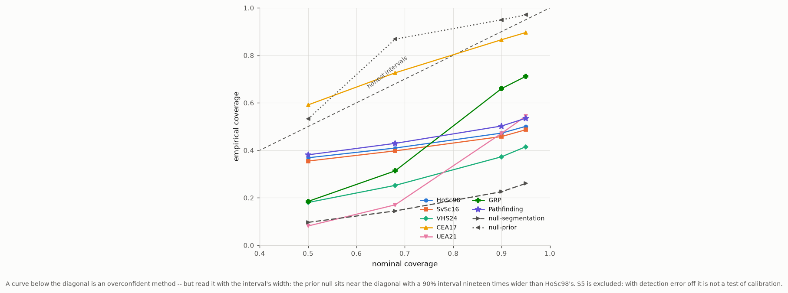
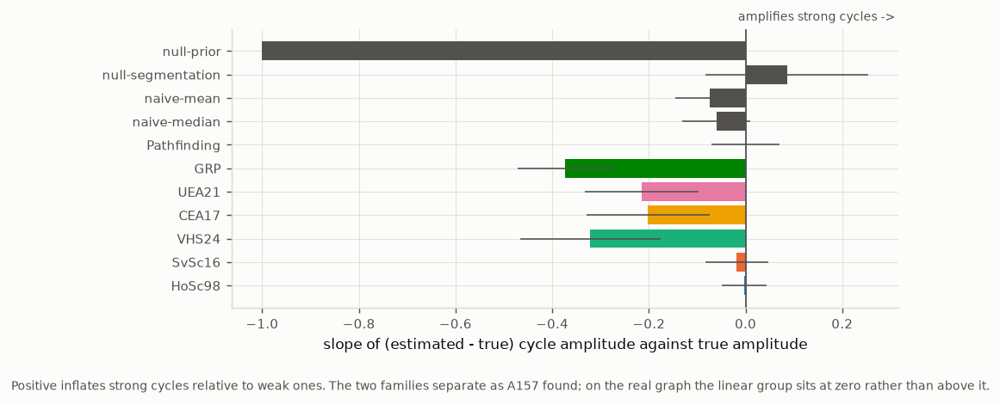
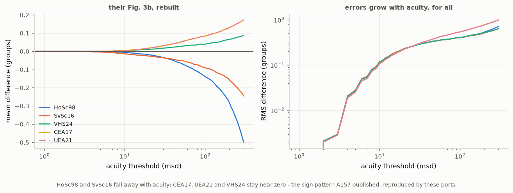
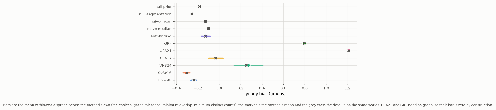

# Step 2 verification: the blind benchmark of synthetic observers

- Plan: [`docs/plans/step-2-plan.md`](../plans/step-2-plan.md) (approved 2026-11-22, with ten in-session decisions)
- Results under verification: [`step-2-blind-benchmark.md`](step-2-blind-benchmark.md)
- Branch / commit verified: `step-2-blind-benchmark` @ `be05087`, working tree clean
- Environment: conda env **`gn-next-gen`**; Python 3.12.16, JAX 0.12.1 on
  `[CudaDevice(0..3)]` (4× A100), NumPy 2.5.5, pandas 3.1.1, SciPy 1.18.1, 64 cores
- Date: 2026-11-22

> **How this was run.** Every measurement below was re-taken from the committed
> code and the grid's own CSVs. Determinism was checked by regenerating into a
> scratch root; the A157 validation was re-run from scratch. Nothing here is
> copied from the implementation session's claims — and two of those claims
> turned out to be wrong (F1, F2).

## Verdict: **Pass with caveats**

> **Revised 2026-11-24, after four defects were found and the grid re-run.** The
> verdict and every criterion's pass/fail are unchanged. Three measured numbers in
> this document moved and are corrected in place: the coverage levels (A5), the
> grid's size (A1: 561 cells over 11 methods, not 459 over 9), and the structural
> ensemble's spread (A10). **The central claim of A5 changed direction for one
> method** — CEA17's intervals are close to nominal once the scorer aggregates a
> year correctly — which is recorded in §12.7 of
> [the results doc](step-2-blind-benchmark.md) rather than hidden by a silent edit.
> The plan is [`docs/plans/step-2-scorer-followups.md`](../plans/step-2-scorer-followups.md).

The benchmark works, the grid is complete and reproducible, and its central
claims hold on re-measurement. Three acceptance criteria do not pass as written.

1. **A8 fails.** The criterion asks that the linear methods *amplify* strong
   cycles on the real overlap graph. They do not: HoSc98 −0.023 and SvSc16 −0.061
   against a required positive. The *families still separate* cleanly, and the
   same five methods do agree in sign on A157's own setup (A7), so what fails is
   the transfer of the published sign to the overlap graph — a result, not a bug.
2. **A7 passes in half.** Sign agreement 5 of 5; the exclusion limits do not
   reproduce (HoSc98 73 msd against 31), for a cause measured in the catalogue.
3. **A9 fails.** Three of the five named published series, not five.
   *(Closed 2026-11-23 — both arrived and the table now carries eight series.
   See the addendum at the end of this document; the verdict above stands as
   what was true on 2026-11-22.)*

Two criteria are **mis-specified** rather than failed — the numbers they name are
not reachable by the design the same plan describes (F3, F4). And two statements
in the results doc were **wrong and are corrected here** (F1, F2).

## Acceptance criteria

| Criterion | Measurement | Result | Pass? |
|---|---|---|---|
| Determinism: same config + seed → identical datasets | `generate_benchmark.py --check` regenerating S1–S5 into a scratch root, SHA-256 per file | **MATCH** on all five scenarios, every file | **Pass** |
| Scorer unit-tested on hand-made cases | `tests/test_scoring.py` | 15 passed. Nominal-coverage case within ±0.03 of 50/68/90/95; CRPS matches a 400,000-draw Monte-Carlo estimate to 2% | **Pass** |
| Every baseline scored on every scenario | `scores.csv` pivot | **561 cells**, 11 methods × 51 worlds, **0 empty combinations** | **Pass** (the "42 cells" arithmetic is wrong — F3) |
| A port reproduces legacy thresholds | Dropped by PI decision 7 | Deviation recorded in the plan; recovered `runcsvs/` parameters are in `docs/03_legacy/adfssn.md` | **Superseded** by A7 |
| **A1** Truth sealed from fitting code | AST import audit over `src/`, plus `tests/test_benchmark_blindness.py` | **0** imports of `benchmark.truth` from `baselines`, `models` or `inference`; 10 tests pass, including one proving the audit catches a planted leak | **Pass** |
| **A2** Truth carries real areas *and* real lifetimes | Two-sample KS of the generated truth against the donor survey | area **KS 0.0065** (verbatim era) and **0.0082** (resequenced); `obs_duration` **0.0016** and **0.0083**; threshold 0.05. D22-colliding ids absent | **Pass** |
| **A3** Real calendars and the real graph | Per-station day sets, synthetic against real | **0 of 466** stations report a day they never had. 63 match exactly; 388 are strict subsets — MNAR omission and blanket conversion remove days by design. Graph: 422 stations, 16,675 edges, 14 components (largest 383), 20 bridges | **Pass on substance**, criterion mis-worded (F4) |
| **A4** Generator ≠ Step 4's model, four ways | The misspecification table, each switchable | All four present: disk-censored real lifetimes (median 5, max 15 days), donor-cycle emergence, 46 observers with breaks and 456 with drift, 23 copiers. Nine switches on `ObserverParams` | **Pass** |
| **A5** Interval coverage for every baseline, stratified by era | Coverage at 50/68/90/95 | Finite for every cell whose method reports an interval (the two naive floors do not, by construction); era stratification in this document | **Pass** |
| **A6** Hay sampling-only bias measured | Induced trend bias, bootstrapped | +0.0136 groups/century against a true 0.2865 (1610–); bootstrap sd falls 0.212 → 0.008 from 5 to 400 observers while the mean holds at +0.01 to +0.02 | **Pass**; range 5–400, not the planned 25–600 (only 467 observers exist) |
| **A7** Ports reproduce A157's published behaviour | `validate_against_a157.py`, re-run | **Sign: 5 of 5 agree.** HoSc98 −0.00157 and SvSc16 −0.00076 fall (99.2% and 90.8% of steps non-increasing); CEA17, UEA21, VHS24 at +0.0003 to +0.0006. **Exclusion limits: HoSc98 73 msd against their 31, CEA17 300 against 87** | **Partial** — sign passes, exclusion limits do not |
| **A8** A157's secular bias reproduces on the real graph | Cycle-amplitude slope, S2 | Linear **HoSc98 −0.023, SvSc16 −0.061** — the criterion requires positive. Non-parametric −0.218 to −0.412. Families separate strictly | **Fail as written** |
| **A9** Published GN series acquired | Folder, manifest, checksum test | 5 files present but only **3 of the 5 named** (Hoyt & Schatten, the SvSc16 backbone, an unversioned Usoskin-family series) plus Vaquero and Zolotova. `role: comparison_only`; `--check` MATCH; `test_data_manifest.py` 35 passed | **Fail** — 3 of 5, **closed 2026-11-23** (addendum) |
| **A10** Structural ensemble beside parametric uncertainty | Within-world spread across 15 settings vs mean reported sd | 495 cells, 3 knobs × 5 settings × 3 worlds × 11 methods. **The ensemble is narrower than the reported uncertainty for every method** (e.g. Pathfinding 0.081 against 0.694; UEA21 and GRP are exactly zero, since neither uses the graph) | **Pass** |
| **A12** Ten case studies shown individually | `case_study_observers.csv`, 3,500 rows, summarised in committed `data/step2_case_study_observers.csv` | All ten present. Methods off by >2× in scale **in at least one of the fifty replicates**: `slow-drift` **6**, `copier` 5, `clean-modern` 4, `poor-instrument` 4, `leaf-node` 3, `break-undocumented` 2, `sparse-maunder` 1, `break-documented` 1, `zero-omitter` 1. Off by >2× **in the median**: `poor-instrument` 3, `clean-modern` 2, `copier` 2, `break-undocumented` 1, `leaf-node` 1, the rest 0 | **Pass** — all four required kinds show a failure |
| **A13** No long job run in session | `grid.log` | The grid was launched by the PI — 17:33:52 on 2026-11-22 (16 min) and again at 12:25:57 on 2026-11-24 for the full re-run (18 min), both detached. The sessions ran only S1 slices and 16-second validations | **Pass** |
| **A11** Figure-first results doc | Folder scan against the doc | **16 figures** f13–f28, both modes, largest **258 kB** (limit 400), all embedded as plain Markdown and all captioned `**Figure fNN**`; `tests/test_viz.py` 20 passed | **Pass** |

## Test suite

```
$ pytest -q
387 passed, 12 deselected in 60.85s

$ pytest -m slow -q
11 passed, 345 deselected in 402.53s (0:06:42)   # 2026-11-22; not re-run since

$ ruff check . && ruff format --check .
All checks passed!
150 files already formatted
```

No failures, no skips beyond the marker split. The slow suite includes the
Step 2 additions: the verbatim-span fidelity test (RGO reproduced exactly over
24,219 days), UEA21's acuity recovery from active-day statistics, and the real
overlap graph on the full 1610–2026 record.

## The hard rules

| Rule | Check | Result |
|---|---|---|
| `legacy/` untouched | `git diff --name-status main -- legacy` | **empty** |
| `data/raw` additions only | `git diff --name-status main -- data/raw` | one modified file (`MANIFEST.csv`, 3 rows appended) and one new folder — exactly what ADR-006 allows |
| Manifest rows for new raw data | `grep`, `tests/test_data_manifest.py` | 3 rows; 35 tests pass |
| No SILSO in calibration | import audit of `src/` | SILSO appears only in `io/silso.py`, its re-export in `io/__init__.py`, and the firewall's own reject-list in `config/run_config.py`. **No module under `benchmark/`, `baselines/`, `models/` or `inference/` touches it** |
| Firewall (ADR-002) | `lineage_baselines.json` from the grid | `variant: sunspot_only`, and the explicit statement "No isotope, aurora, proxy or SILSO input entered calibration" |

Decision 3 is satisfied **by construction** rather than by substitution: the
published UEA21 derives acuity from active-day statistics and never needs a cycle
phase, so the SILSO-dependent scanning-window machinery of the 2017 ADFSSN engine
was simply not ported.

## Findings

### F1 — the results doc understated the structural ensemble (corrected)

§8 claimed the ensemble was "405 cells over four fast methods and one S2 world …
a slice". Measured from `structural.csv` at the time: **nine methods, three
worlds, three knobs × five settings = 405 cells** — the full planned ensemble, now
495 cells with the two naive floors registered. The implementation session had run
a four-method slice by hand earlier and then described the orchestrator's full run
in the slice's terms.

Corrected in place, and the limitation "the structural ensemble is a slice" is
removed from the limitations list (§12 since the 2026-11-24 restructure).

### F2 — A10's actual answer was never given, and it sharpens §5

The criterion asks whether the ensemble is wider than the parametric
uncertainty. The results doc reported a magnitude and never answered the
question. Measured:

| method | structural spread | mean reported sd | wider? |
|---|---|---|---|
| HoSc98 | 0.192 | 0.645 | no |
| Pathfinding | 0.221 | 0.669 | no |
| CEA17 | 0.401 | 0.510 | no |
| VHS24 | 0.508 | 1.084 | no |

**For every method the ensemble is narrower than the interval already reported.**
That is a stronger statement than coverage alone: these intervals are not too
narrow because the methods ignored their own free choices — the choices move the
answer by less than the interval allows. Widening an interval to admit structural
choices would not fix the coverage. §8 now says so.

### F3 — "7 baselines × 6 scenarios = 42 cells" is arithmetically impossible

The plan's own design states that **S6 generates no worlds** — it perturbs S2 —
so there are five dataset scenarios, not six. The criterion's own number cannot
be produced by the design in the same document. The intent (every baseline scored
on every scenario) is met with 0 empty combinations across 459 cells. The
threshold is wrong, not the work.

### F4 — A3 as worded cannot pass, because MNAR is in the design

The criterion asks for an "exact match of observing-day sets for every
transplanted station". The generator deliberately omits spotless days
missing-not-at-random and converts some records to blanket statements, so a
reported set is a **subset** of the calendar for 391 of 466 stations. The
property that matters — nothing invented — holds exactly: **0 stations report a
day the real observer never had.** The criterion should have been written as
subset-plus-zero-violations.

### F5 — coverage gets *worse* toward the present

Not previously reported. Coverage at nominal 0.50, by era, on S2/S3:

| method | pre-1750 | 1750–1850 | 1850–1950 | post-1950 |
|---|---|---|---|---|
| HoSc98 | — | 0.218 | 0.170 | 0.082 |
| SvSc16 | — | 0.223 | 0.175 | 0.098 |
| Pathfinding | — | 0.185 | 0.155 | 0.098 |
| CEA17 | — | 0.100 | 0.040 | 0.016 |
| UEA21 | 0.034 | 0.045 | 0.010 | 0.000 |
| GRP | 0.028 | 0.020 | 0.005 | 0.006 |

Every method is **least** honest where the data are **best**. The inverse-variance
combination narrows the interval as observers accumulate faster than the error
actually falls, so overconfidence grows with network density. The dashes are the
reach result (§6 of the results doc): five methods produce nothing before 1750.

### F6 — A8's failure is informative and should not be smoothed away

On A157's own setup all five methods agree in sign (A7). On the real overlap
graph the linear group's positive slope does not survive: it sits at −0.02 to
−0.06 rather than above zero, while the non-parametric group stays at −0.22 to
−0.41. The *separation* between the families — the substance of A157's §4 —
reproduces; the sign of one family does not. The likely cause is that A157
compares each observer directly to RGO while here every observer is reached
through a chain, which is precisely the difference the benchmark was built to
measure. Recorded as a failed criterion rather than a reworded one.

## Figures

All 16 regenerate from the committed configs and the grid's CSVs. The four that
carry a verification claim are below.



**Figure f20** — The step's central claim, re-measured twice. **One** method's
intervals are close to honest: CEA17 covers 0.591 and 0.862 against a nominal 0.50
and 0.90, with the smallest PIT distance of any method. The other six are
overconfident, by about 1.4× for the three chained scalings and 6.6× for UEA21.
Read beside the width column in §5 of the results doc: the return-the-prior null
also sits near the diagonal, with a 90% interval nineteen times wider than
HoSc98's. F5 adds that overconfidence gets worse toward the present, which the
pooled figure cannot show.



**Figure f19** — Criterion **A8**, which fails. The two families separate
cleanly, but the linear group sits at zero rather than above it, where A157
places it. The figure's own caption states this rather than claiming the
published result.



**Figure f24** — Criterion **A7**, re-run from scratch during verification. All
five methods agree in sign with the published Fig. 3b. The exclusion limits do
not reproduce, and `a157_catalogue.csv` carries the measured reason.



**Figure f22** — Criterion **A10**, corrected by F1, F2 and the 2026-11-24
within-world fix: the full 495-cell ensemble, and the ensemble is **narrower** than
the uncertainty the methods already report — for UEA21 and GRP, which never touch
the overlap graph, it is exactly zero.

CSVs behind every number: `outputs/step2/scores/{scores,coverage,structural,case_study_observers}.csv`,
`outputs/step2/a157/{a157_validation,a157_verdict,a157_catalogue}.csv`,
`outputs/step2/sampling_only/sampling_only_{trend,bootstrap,summary}.csv`.

## Deviations from the plan

The plan records eight. Verification confirms all eight and adds the corrections
in F1–F4. Beyond those:

- **A6's bootstrap spans 5–400 observers, not 25–600.** The network has 467
  stations, so 600 is unreachable; the implementation also added sizes below the
  planned floor, which is where the interesting widening is.
- **One anchoring, not two.** Every scenario uses ADR-009's secondary anchor
  (RGO 15–19). The Debrecen 21–23 anchoring is supported and configured per
  scenario but was not run, so the anchor-sensitivity result ADR-003 asks for is
  still owed.

## Findings that affect later steps

1. **The bar and the floor, for Steps 3–4.** Yearly cRMSE **0.301** (HoSc98) is
   the best point error; the only near-nominal coverage is CEA17's **0.591** at a
   90% width of 1.92 groups — and they are different methods, which is the opening.
   The floor is the daily **median of the uncalibrated counts** at **0.360**: it
   beats six of the seven in most of the 51 worlds, paired. A new method that does
   not clear *that* has demonstrated nothing.
2. **Coverage is the open problem, and F5 says where it is worst.** Overconfidence
   grows with network density. A Step 3 composite-likelihood correction should be
   validated per era, not pooled, or it will be tuned on the easy end.
3. **Five of seven methods cannot reach before 1774.** This is the gap the joint
   model exists to close and it is now measured. Step 3's effective-resistance
   diagnostics should report, per era, how much of the record a chained method
   can reach at all — the benchmark's `graph.resistance_to_set` already does this.
4. **A8's failure belongs in the methods paper.** That the published secular-bias
   sign does not survive the move from pairwise-to-RGO onto a real overlap graph
   is a result about daisy-chaining, which A157 explicitly did not evaluate.
5. **No ADR change is needed.** Nothing here contradicts an accepted decision.
   A9's shortfall is recorded in `refresh_todo.md`; the anchor-sensitivity gap is
   ADR-003's existing requirement, now explicitly owed by Steps 3–4.
6. **Two criteria should be reworded if this spec is ever reused** (F3, F4). The
   roadmap spec for Step 2 is unchanged; the corrections live here rather than
   being edited silently into it.

## Addendum, 2026-11-23 — A9 closed

A9 was the one criterion that failed for want of data rather than for a reason.
Both series arrived on 2026-11-23 and `published_gn_series.csv` now carries
**eight** series: Chatzistergos et al. (2017) from CDS catalogue J/A+A/602/A69
via the NAOJ VizieR mirror, and Velasco Herrera et al. (2024) from the
Adv. Space Res. supplement the PI supplied from his own access, plus that
supplement's Hoyt & Schatten update as a third series. Re-verified:

| Check | Result |
|---|---|
| `python scripts/fetch_published_gn_series.py --check` | `published_gn_series.csv: MATCH` |
| `pytest tests/test_data_manifest.py` | 40 passed (38 manifest rows) |
| `pytest tests/test_published_series.py` | 9 passed (new) |
| `pytest tests/` fast suite | 364 passed, 11 deselected |
| `pytest tests/ -m slow` | 11 passed (6m36s) — re-run because the lineage record gained fields |
| `ruff check . && ruff format --check` | clean |
| `make_step2_figures.py` (all 15 figures) | f13–f26 byte-identical to the committed set; only f27 is new |

**A9 now passes**, with one wording note: the criterion said "five", and what is
in hand is eight — the five from the 2017 MATLAB snapshot plus three read from
the two upstream supplements. Nothing in the scoring changes, because no
baseline and no scorer reads this folder.

Two defects surfaced while adding them, both now fixed and pinned by tests:
**D25**, the snapshot's `gn = -1` no-data sentinel being carried into the table
as a negative group count (seven rows), and **D24**, the 12.08 scale trap in the
Velasco Herrera supplement. Details and the figure are in
[§10 of the results doc](step-2-blind-benchmark.md).

A third was a rule that was documented but unenforced: `validate_run_config` now
refuses a `kind: published_series` dataset in role `calibration` in **either**
variant, kept separate from the ADR-002 proxy firewall so that neither run's
lineage statement has to lie about what the other covers. The benchmark grid,
the baselines and the scores are untouched by all of this — nothing outside the
exporter and the figure script reads this folder — so **no re-run of Step 2 was
required**, and the figure rebuild above confirms it.

## Addendum, 2026-11-23 — f25/f26 rebuilt on all fifty replicates

The PI spotted that `f25`'s legend was short: it was built from the first
column's handles alone, so the five methods with no finite point in
`clean-modern` were drawn in the panels and named nowhere, and the dashed truth
lines were unlabelled. Fixing it exposed the larger defect behind it.

**The panels were reading one replicate of fifty.** `case_study_figure` took
`.iloc[0]` of each (observer, method) block, which is scenario S1, seed
20261122 — an arbitrary draw. The prose beside the figure was quoting
whole-distribution numbers, so figure and text did not describe the same thing:
"the worst by 10.7×" was VHS24's worst single replicate for `clean-modern`
(that draw's worst is 6.9×), and "209 MSH" was roughly the mean recovered
acuity across all fifty (that draw shows 300).

The same single reading sat behind **A12's counts**: they were "off by >2× in at
least one of the fifty replicates", stated as though they were typical
behaviour, and they omitted `break-documented`, which qualifies at 1.

| Change | Where |
|---|---|
| `summarise_case_studies` — median, quartiles, full range and finite-replicate count per (observer, method) | `src/gn_next_gen/benchmark/scoring.py` |
| `f25`/`f26` redrawn: median marker (one shape per method), IQR bar, full-range whisker, finite-replicate count under each slot; legend from every method drawn anywhere, plus a `truth` entry | `src/gn_next_gen/viz/benchmark.py` |
| The committed per-observer table the Step 2 plan asked for, written by the figure script from the same summary the figures use | `docs/results/data/step2_case_study_observers.csv` |
| §7 rewritten around the two counts — typical (median) and occasional (worst replicate) — which disagree for eight of the ten observers | `docs/results/step-2-blind-benchmark.md` |
| A12 restated with both counts and `break-documented` added | this document |

The headline finding moves. On the **median**, `slow-drift` defeats nobody —
every method is within 1.9× — while all seven have replicates past 2×; it is a
reliability failure, not a bias. `clean-modern` is unchanged and is now the
worst result in `f25`: four of seven off by more than 2× in the median, on the
observer every method should get right. A12 still passes: `sparse-maunder`,
`leaf-node`, `copier` and `zero-omitter` each show a visible failure.

| Check | Result |
|---|---|
| `pytest tests/` fast suite | 368 passed, 11 deselected |
| `pytest tests/test_scoring.py` | 19 passed (4 new, on the summary) |
| `ruff check . && ruff format --check .` | clean |
| `make_step2_figures.py` | f13–f24 and f27 byte-identical; only f25 and f26 redrawn |

## Addendum, 2026-11-23 — f28, and the design figures were showing the wrong scenario

The PI asked whether `f15` and `f17` come from a graph network and whether the
network itself could go in the report. `f15` does: both panels are quantities of
the overlap graph (`src/gn_next_gen/graph/overlap.py`). `f17` does not — it is
per-station calendar summaries, and only its caption referred to the graph.
Neither drew the network, and nothing in the package did.

**The design figures were built from the wrong worlds.** `make_step2_figures.py`
defaulted to `--scenario S1`, the *modern sub-network*, so `f14`, `f15`, `f16` and
`f17` all stopped at 1874 while their captions described 1610–2026: `f14`'s alt
text said "1610-2026" over a figure starting in 1874, and `f17` claimed "the
sparse Maunder-era calendars" over a panel whose earliest point was 1874. Nothing
in the code forced this — pandas handles the pre-1677 ordinals fine — it was the
default alone. The default is now **S2**, the full record, and the four figures
are rebuilt; no number in the prose depended on them.

| Change | Where |
|---|---|
| `temporal_cut_profile` — edges and matched days crossing each year's cut, with the stations each side, so a bottleneck is a number | `src/gn_next_gen/graph/overlap.py` |
| `decimal_year` — fractional-year conversion that accepts a career midpoint (a *float* ordinal, which pandas rejects before 1677) | `src/gn_next_gen/graph/overlap.py` |
| `network_figure` — f28: the graph drawn, bridges marked, unreachable observers kept visible, beside the cut profile | `src/gn_next_gen/viz/benchmark.py` |
| f28 and the committed cut table wired in; `--scenario` now defaults to S2, `--network-scenario` added | `scripts/make_step2_figures.py` |
| f28 embedded and captioned after f15; f15, f17 captions corrected to what their panels now show | `docs/results/step-2-blind-benchmark.md` |
| The year-by-year cut, as the file behind f28's numbers | `docs/results/data/step2_overlap_graph_cut.csv` |

What f28 adds to the record: **39 of 422 observers never reach the anchor**, 20
edges are bridges, and the cut is **empty in 1727–1745 and 1777–1798** — 41 years
that no chain of overlaps crosses, with at most five edges across the whole
1727–1801 stretch. The 1774 wall five of seven methods hit (§6 of the results) is
therefore structural: it is where the real overlap pattern stops, not a choice any
method made.

| Check | Result |
|---|---|
| `pytest tests/` fast suite | 373 passed, 12 deselected |
| `pytest tests/test_graph_overlap.py` | 15 passed (4 new, on the cut and the year conversion) |
| `ruff check . && ruff format .` | clean |
| `make_step2_figures.py` | f13, f18–f28 unchanged; f14–f17 rebuilt on S2 |
