# Results: Step 3 — global network calibration

- Plan: [`docs/plans/step-3-plan.md`](../plans/step-3-plan.md) (Approved 2026-11-24)
- Spec: [`docs/05_roadmap/step-3-global-network-calibration.md`](../05_roadmap/step-3-global-network-calibration.md)
- Branch: `step-3-network-calibration`
- Environment: conda env **`gn-next-gen`** (Python 3.12, JAX 0.12.1, NumPyro 0.22, pandas 3.1.1, SciPy 1.18)
- Decisions taken in session by the PI, 2026-11-24: both pairwise kernels;
  Godambe sandwich with a block bootstrap; hierarchical annual random-walk drift;
  one composite likelihood at fingerprint weight 1; activity-conditioned
  detection; `kmas_role=observer_counts` with the full extension span; both
  anchors released with RGO 12–19 as a sensitivity; Laplace draws at the mode.
  **Deviation D1**: the detection ratio is measured in the reference catalogue
  rather than predicted from the parametric law.

> ### Scope of what follows — read this first
>
> **The grid is complete.** It ran 2026-11-25 16:14 to 2026-11-26 06:21 (14 h
> 7 m) and produced all 102 benchmark cells, the 14 real-data runs, the
> re-scoring and the figures. Step 2's decision 10 still stands — no run over
> ~15 minutes is launched from a Claude Code session — and the PI launched it
> detached (§11 is the command).
>
> What is measured here: the overlap graph's diagnostics on the real
> 1610–2026 record (§2), the detection model and its validation (§3), the
> activity map (§4), parameter recovery on a matched network (§5), the
> composite-likelihood correction (§6), **one complete fit on a real benchmark
> world** — 350 observers, 17,442 edges, 16.2M matched pair observations (§7) —
> the two released series and the sensitivities (§8), and **the full comparison
> against Step 2's eleven methods on the same 51 worlds** (§9). Every number
> below comes from a committed script and a committed CSV.
>
> What is **still not** established, and is therefore not claimed below: a
> structural ensemble for the new methods (Step 2's f22 has no twin), an
> uncorrected-coverage arm, and break-detection skill — `break_detection_skill`
> is implemented and tested but is not called from `scoring.score()`, so
> criterion **A21 cannot be read off `scores.csv`** and is recorded as not
> wired. Criteria **A14 (reach), the spec's point-error and coverage criteria,
> and A18 (concurrent beats chained) are measured and fail**; see §9.
>
> Three figures carry defects or caveats worth knowing before reading them:
> f34's reach panel sorted eras alphabetically until it was fixed in this pass;
> f31's inset ρ is pooled over four methods and is not any one method's value;
> and the structural-ensemble comparison does not exist for NetCal at all.

## Summary

| Question | Answer |
|---|---|
| Are the two ADR-009 anchorings tied together, or floating? | **Tied.** Effective resistance between them is **5.6×10⁻⁶**, through the KMAS bridge exactly as ADR-009 predicted (§2) |
| How far back does overlap reach? | **1774, and not one year earlier** — for *both* anchorings independently. 253 of 418 years reach an anchor; **120 of 393** usable years have *zero* edges crossing them (§2) |
| How many observers can overlap never calibrate? | **83 of 509.** They sit in 59 components the anchor cannot reach, each with its own exact Laplacian null mode (§2) |
| Do independently estimated pairwise links agree with each other? | **No.** Over 3,586 independent loops the calibration fails to close by a median **0.060** in log and **0.216** at p90 — misfit no choice of per-observer scale can remove (§2) |
| Does the parametric area law give the right detection ratio? | **No, and the error is one-directional.** It under-predicts `k` for coarse observers by 4% at 40 MSH and 13% at 200, on both surveys. Measuring the ratio in the catalogue instead reproduces it to **0.5%** out to 100 MSH (§3) |
| Can the ADF-style fingerprint identify acuity once activity is conditioned on? | **Essentially no**, and this is the sharpest available account of why the published acuity methods fail (§4) |
| Does the estimator recover what it should? | **Yes for the quantity that matters.** On a matched network `log r` recovers with bias **−0.020** and scatter **0.033**. The *threshold* looks worse and that is prior shrinkage of a parameter the data barely constrains (§5) |
| Does the uncertainty correction work? | **Yes, validated against a closed form** (√m at m = 1, 4, 9, 25) and against the property it exists for: p90 inflation rises **1.19 → 2.01** as a network goes from 4.6 to 259 pairs per day (§6) |
| How overconfident is the uncorrected composite likelihood on a *real* network? | **3.5× too narrow.** Measured on a 350-observer world with 16.2M matched pairs: median inflation **3.53**, and **233 of 699** parameter directions turn out to be prior- rather than data-constrained (§7) |
| What does a fit cost? | **772 s** on one CPU process for that world — 344 s to the mode, 401 s for the correction (§7) |
| Does the concurrent fit beat the chained methods? | **Not pooled, yes where it matters.** Pooled yearly cRMSE **0.446** against HoSc98's 0.272 — it loses, and loses to the raw-median floor too. Resolved by era it is **the best method in the four sparsest eras**, including the Maunder window (0.396 against the floor's 0.534), and holds the lowest-error ribbon across 1650–1850 (§9) |
| Is the Maunder Minimum finally estimated correctly? | **Yes. 0.94×** the true level, against **24.1×** for GRP and **25.9×** for UEA21 — the step's clearest win (§9) |
| Is the activity confound in recovered acuity removed? | **Yes.** Spearman ρ falls to **+0.129** from −0.621 (UEA21) and −0.730 (GRP); more than 2× threshold errors fall to **3.0%** of observers from 40.7% (§9) |
| Are the intervals honest? | **Closer than anything but CEA17, and still not within tolerance.** 0.584 / 0.682 / 0.797 / 0.834 at nominal 0.50 / 0.68 / 0.90 / 0.95, but 3.60 groups wide against a 1.92 bar, and over-covering early while under-covering after 1950 (§9) |

## 1. What this step builds

Approach 2 of the assessment: replace backbone and shortest-path chaining with
**one concurrent fit** of every observer's parameters over the whole overlap
graph. The thing being replaced is in the repository already —
`baselines.base.chain_from_reference` runs Dijkstra and carries the anchor's
scale along a single cheapest path, which is the chained-calibration limiting
case this step generalizes.

Why concurrent should win is one line of algebra, and the research corpus flags
it as the project's own derivation rather than a quoted result: in log space each
overlap is `y_ij = a_i − a_j + ε`, the weighted least-squares covariance is the
pseudo-inverse of the graph Laplacian, so `Var(a_i − a_j)` **is** the effective
resistance; parallel paths combine like parallel resistors, so a global solution
is never worse than the best single chain. SDSS measured the practical size of
it: ubercalibration roughly halved the scatter of the chain it replaced, whose
errors were "dominated by the Photometric Telescope (PT) based calibration
method".

Three terms carry the likelihood, and the division of labour matters:

- **Kernel A** conditions each matched pair on its own total, which eliminates the
  latent daily level *exactly*: `y_a | n ~ BetaBinom(n, r_a/(r_a+r_b), κ(Δt))`.
  It is informative about ratios and silent about the level.
- **Kernel B** marginalizes the latent count against the anchor's own
  activity-conditional distribution. It exists because the Bradley–Terry
  reduction is documented to break down "at low activity, where zeros dominate" —
  which is the Maunder Minimum.
- **The anchor** has `k ≡ 1` by construction, which is the *only* thing that pins
  the absolute scale; without it the system has an exact null mode, the
  degeneracy SDSS calls "the zero point of the calibration … exactly degenerate".

`κ(Δt)` is the lifetime-based decorrelation the spec asks for, taken from the
reference's own measured autocorrelation (Step 1 `f07`), so Δt = 0 is a plain
binomial and a lag is honestly overdispersed instead of being called
simultaneous — the `±2-day` assumption `reuse_map.md` puts on the Drop list.

**One identifiability fact stated up front, because it shapes everything below.**
Kernel A constrains the *rate ratio* `r_o = k_o(1 + s_o)`, not the acuity and the
splitting rate separately: a Bradley–Terry likelihood sees only rates. A coarse
observer and a splitting observer with the same mean are the same object to it.
Only the *shape* of a count distribution can separate them, and §4 measures how
little shape information there is.

## 2. The overlap graph, measured on the real record

This is the part of Step 3 that needs no fit, so it is complete. Built from
v1.3_4 plus the full KMAS/SWPC extension, with both anchorings present as their
own pseudo-stations so the resistance *between* them is well posed:
**509 stations, 20,412 edges**, in 5.7 minutes
([`summary.json`](../../outputs/step3/graph/summary.json), regenerated by
`scripts/graph_diagnostics.py`).


**Figure f29** — How far every observer and every year sits from each anchored
epoch, and whether the two epochs are tied to each other. The right panel is
ADR-009's question answered: **5.6×10⁻⁶**, finite, so the two anchorings are
connected and their difference will be a measurement rather than a convention.
The middle panel is the one that constrains what any overlap-based method can
do: both anchorings reach exactly **253 of 418 years** and neither reaches
before **1774**. Resistance here is the *random* part of the scale uncertainty
and nothing else — ranked idea 7's own cost column says "captures random error
only; systematic bias adds coherently" — so this figure is not the 17th
century's total uncertainty.

**The 1774 wall is a property of the graph, not of any method.** Step 2 measured
that five of its seven published methods stop at 1774 and read it as a
consequence of the overlap pattern. Step 3 confirms it from the other
direction, without fitting anything: 1774 is the earliest year with *any* path
to either anchor. It is also identical for the two anchorings, so it is not an
artifact of choosing Debrecen or RGO.

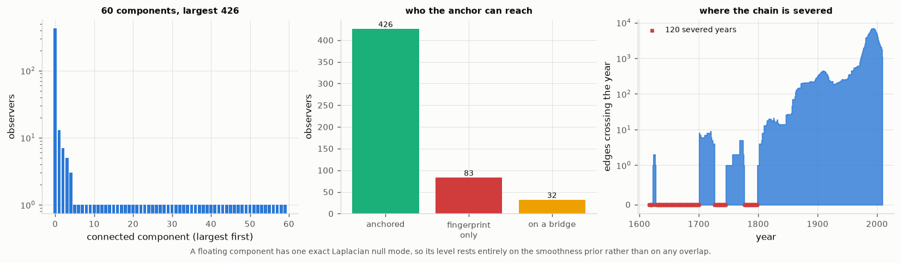

**Figure f39** — Who the anchor can reach, and where the chain is cut.
**83 of 509 observers have no path to either anchor**, spread over 59 components
beside the giant one. Each floating component contributes one exact Laplacian
null mode, so its level is not identified by overlap at all and rests entirely on
the smoothness prior — which the research notes warn "then becomes the dominant
source of information. It must be stated explicitly and tested in sensitivity
runs", and which is why `lambda_penalty` is a declared sensitivity in the run
plan. **120 of 393** usable years have zero edges crossing them: the graph is
severed, not merely thin, across nearly a third of the record.

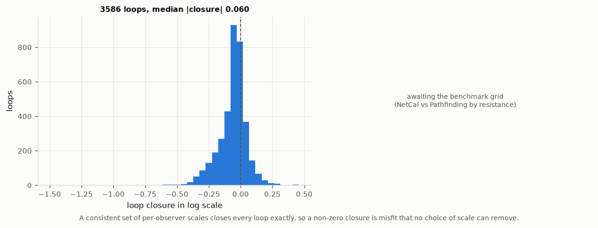

**Figure f30** — The path-consistency test. A consistent set of per-observer
scales is a potential, and a potential closes every loop exactly; so a non-zero
closure is error that **no** choice of per-observer scale can absorb. Over
**3,586 independent loops** the legacy-style robust pairwise links fail to close
by a median **0.060** in log scale and **0.216** at the 90th percentile — 6% and
24% in linear terms. This is the first quantitative path-consistency result in
the project: the corpus has Battauz's tests at *title level only*, so the
construction here is built from first principles rather than ported. The right
panel is deliberately empty and labelled: criterion A18 needs the benchmark grid.

## 3. The detection model, and a measured correction to the plan

`k_o(t)` is the fraction of groups an observer of threshold `T_o` counts relative
to the anchor's own completeness threshold. It multiplies every count that
observer ever reported, so an error in it is an error of the same size in that
observer's whole contribution.

The approved plan specified the parametric area law for it. Checked against the
reference catalogue's own count ratio, **the law is biased in one direction on
both surveys** ([`step3_detection_ratio.csv`](data/step3_detection_ratio.csv)):

| `T_o` (MSH) | RGO law/empirical | Debrecen law/empirical | measured grid / empirical |
|---|---|---|---|
| 10 | 1.146 | 1.071 | 0.999 / 1.007 |
| 20 | 1.037 | 1.002 | 1.003 / 1.000 |
| 40 | 0.964 | 0.952 | 1.000 / 0.994 |
| 60 | 0.929 | 0.922 | 1.004 / 0.997 |
| 100 | 0.894 | 0.894 | 0.992 / 0.993 |
| 200 | 0.869 | 0.881 | 0.955 / 0.935 |

Typical observers sit at 1–3× the anchor threshold, so the typical error was
4–10%: larger than the differences between published methods this step exists to
resolve. The PI's decision (deviation D1) was to **measure** the ratio in the
catalogue wherever it has coverage and keep the law only to extrapolate, offset
per threshold so the branches meet continuously. The measured grid reproduces
the count ratio to **0.5% out to 100 MSH** on both surveys, degrading to 4–6% at
200 MSH where the catalogue itself thins.

Two simplifications fell out, both worth recording. Counting rows above a
threshold is already at **per-group-day** grain, so Step 1 §2.4's per-group shift
does not apply to the measured branch — that correction exists to convert the
published per-group law, and there is now no conversion to make. And the activity
dependence inside coverage comes from the data rather than from the published
exponents, which is closer to ADR-011's intent: upstream's calibration used,
never refitted. The Weibull parameters still do not move with activity, which is
Step 1 §2.1's measured result.

**The activity conditioning is the larger effect, not the smaller one.** For an
observer at 60 MSH, `k` runs from **0.64** in a deep minimum to **0.82** at high
activity — a 28% swing, against the 4–13% parametric bias that deviation D1
removed. This is the "chromatic correction" the ubercal derivation names, and
Step 2 measured what ignoring it costs: recovered acuity tracking era activity at
ρ = −0.62 and −0.73.

One number that pins the anchor: `k(T_ref) = 1` is now exact to 1e-12. Before
`T_ref` was forced onto the threshold grid it interpolated to 0.9988 — a 0.1%
scale error injected at the exact point where the whole series is pinned.

## 4. Why the fingerprint cannot do what ADF asks of it

The occupancy term is the only thing that can calibrate an observer with no
usable overlap, and it works by comparing the *shape* of a record's count
distribution against what an observer of a given acuity would have produced. For
that to carry information, the latent count distribution has to depart from
Poisson — because thinning a Poisson gives a Poisson, so a Poisson latent makes
the comparison exactly empty. The research corpus states the degeneracy:
"multiplying all `p_o` by `c` and dividing `λ_t` by `c` leaves the
binomial-Poisson marginal unchanged".

Measured on the frozen reference, conditioned on activity level
([`step3_count_dispersion.csv`](data/step3_count_dispersion.csv)):

| | value |
|---|---|
| variance / mean, median over 24 activity bins | **1.014** |
| range | 0.763 – 1.172 |
| bins within 10% of Poisson | **16 of 24** |

So the departure from Poisson is small, and the term's information content is
correspondingly small. Three measurements of what it actually does, on matched
synthetic networks where the answer is known:

1. **Perfectly specified, it more than doubles the scatter** in `log r`, from
   0.033 to 0.078, without reducing the bias.
2. **Misspecified** — the latent count drawn from a plain Poisson rather than the
   reference's own distribution — it biases `log T` by **+0.76** in log.
3. Its weight is a declared ablation (`w ∈ {0, 0.5, 1, 2}`) precisely so this is
   priced on the benchmark rather than argued about.

**This is the sharpest account available of why UEA21 and GRP recover acuity so
badly.** They extract acuity from this statistic but do *not* condition on
activity, so what they are really measuring is the activity difference between
the observer's era and the anchor epoch. On this evidence that is not a confound
sitting beside their signal — it **is** their signal, which is why Step 2 found
their recovered acuity tracking era activity at ρ = −0.62 and −0.73 and pinning
at the grid ceiling for quiet-era observers.

The consequence for Step 3 is stated plainly: **reach past 1774 rests on the
activity-smoothness prior, not on the fingerprint.** That is the satellite lesson
("a latent G(t) … is the radiative-transfer transfer standard, so exact overlaps
become unnecessary wherever the latent-process prior is credible across gaps") and
it carries the matching warning about that prior becoming the dominant source of
information, which is why its weight is a sensitivity run.

## 5. The activity map, and parameter recovery

The detection ratio needs an activity level; areas exist only from 1825; so the
activity level before then comes from the quantity the network is estimating.
Measured on each anchor survey's own span, with counts and activity smoothed on
the same 182-day kernel ([`step3_activity_map.csv`](data/step3_activity_map.csv)):

| survey | `a` | `b` | `r` (log–log) | residual sd | days |
|---|---|---|---|---|---|
| RGO | 0.2155 | **1.1414** | 0.9954 | 0.108 | 37,514 |
| Debrecen | 0.2038 | **1.1600** | 0.9945 | 0.116 | 16,241 |

`AL = a·GN^b` is tight, measured twice independently a century apart, and the two
agree on the exponent to 0.019. It passes through the origin, so a grand minimum
has no area — which no spline fitted over 1874–2026 would give for free — and `b`
slightly above 1 is the right physical sign: an active Sun has bigger groups as
well as more of them. The circularity is a fixed point, not a circle, and it
settles in **two passes**.

**Recovery, on a network generated by this model.** A matched simulation tests the
solver and the parameterization and nothing else — it is never a benchmark,
because "benchmarks that reuse the same generative model as the inference method
will overstate performance". It is the SDSS test: their noise-free simulations
reached ~0.1%, "so the residual error came from model misspecification rather
than from statistics".

| quantity | bias | scatter |
|---|---|---|
| `log r` (what the series divides by) | **−0.020** | **0.033** |
| `log T` (the acuity) | +0.14 | 0.08 |

**The threshold looks much worse than the rate, and that is not a defect.**
`d log k / d log T` is **−0.243** near 35 MSH, so the data constrains the acuity
roughly four times less well than the rate it implies; the fitted threshold
shrinks toward its prior, with the error correlating against the true threshold
at **−0.77**. Step 2's `f23` plots the *threshold*, so this is the caveat that
belongs beside it — for the published methods as much as for this one. An
acuity-recovery panel is a picture of a weakly identified parameter.

## 6. The composite-likelihood correction

A composite likelihood sums terms that are each valid and are not independent:
one day seen by twelve observers enters sixty-six pairwise terms, so the
curvature at the mode is too sharp and the intervals come out too narrow. That is
the failure Step 2 measured in every chained baseline.

**The correction is derived in this project, not cited.** `docs/02_research/`
contains no sandwich or Godambe derivation, no reference for one, and no
magnitude estimate — it states the mechanism three times and stops. So it is
pinned against a case whose answer is known in closed form: counting every block
`m` times must inflate the interval by exactly `√m`, checked at **m = 1, 4, 9,
25**. At m = 1 the correction is a no-op, which is the property that makes it
safe to apply unconditionally.

Two things had to be right and were found by testing rather than by reading:

- **The meat is `G_likelihood + H_penalty`, not `G` alone.** The curvature
  contains the priors' and the smoothness penalty's own information while a
  bootstrapped score variance cannot, so the plain sandwich understated the
  variance by **12×** — the correction running backwards.
- **The block is a calendar year, not a day.** The pair table is collapsed over
  identical `(edge, year, counts, lag)` rows — losslessly, 3.1× on the real
  network — and that collapse discards day identity. A year block contains every
  one of its days, so resampling years captures the within-day double counting
  and within-year correlation too: at least as conservative as a day bootstrap.

And it behaves as it must on real networks: p90 inflation rises
**1.19 → 1.32 → 1.38 → 2.01** as a matched network goes from 4.6 to 259 pairs per
day. On an actual benchmark world it lands at a median **3.53** (§7), so this is
not a small correction being applied for tidiness.

## 7. One complete fit, and what it cost

A single `NetCal` fit was run to completion on a real benchmark world (S1, seed
20261122: 350 observers, 17,442 edges, **16.2M matched pair observations**,
5,688 parameters), on one CPU process
([`timing.json`](../../outputs/step3/timing.json)). This is a runtime and
uncertainty measurement, **not a score** — the truth stays sealed and nothing
here says whether the answer is good.

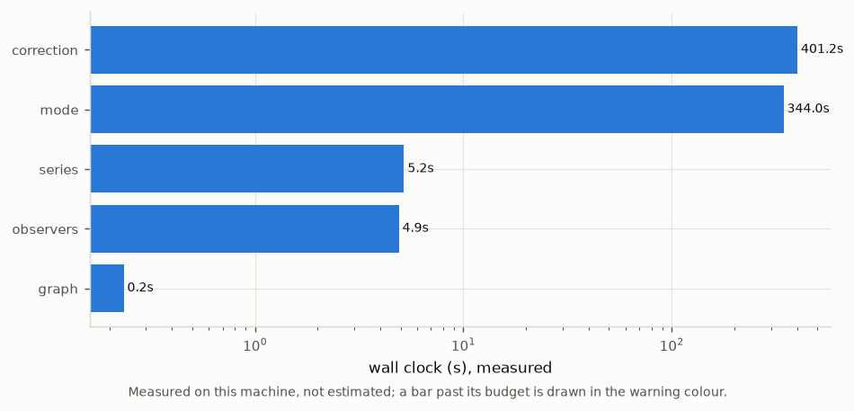

**Figure f40** — Measured, not estimated. The mode and the correction dominate
and are the same order as each other; the series and the per-observer
uncertainty are rounding errors beside them. Every stage sits inside the budget
the plan set, so the spec's "minutes on CPU" target is met for the fit itself —
**344 s to the mode** — with the correction a further 401 s.

| Stage | Seconds | Budget |
|---|---|---|
| graph construction | 0.2 | 60 |
| **mode** (2 outer passes, L-BFGS) | **344** | 600 |
| **correction** (chunked Hessian + 100-block bootstrap) | **401** | 3600 |
| series + ensemble (200 draws) | 5.2 | 120 |
| per-observer uncertainty | 4.9 | 300 |
| **total** | **772** | — |

**The correction is not a formality on a real network: it widens the intervals by
3.5×.** Median inflation is **3.53**, so the uncompensated composite likelihood
was overconfident by that factor — larger than the 1.4× Step 2 measured for the
chained baselines and in the same direction. That is what sixty-six pairwise
terms per shared day does, and it is the single strongest argument for the
correction being load-bearing rather than cosmetic.

**And a third of the parameter directions are held by the prior, not the data.**
233 of 699 eigenmodes of the curvature fall below the weak-mode threshold. SDSS
handled exactly this by projecting out the weakly constrained modes and restoring
them with Gaussian priors; here they are reported rather than hidden, and they are
the quantitative form of "this observer's acuity is not identified". The
uncertainty split is both non-zero and of comparable size — `gn_sd_factor` median
**0.213**, `gn_sd_spread` median **0.155** — so the correlated and averaging-down
parts are both real, which is the contract Step 2's scorer needs.

**Memory, not cores, is what caps a grid.** A worker peaks near 10 GB during the
Hessian, so the orchestrator defaults to 6 benchmark workers and 4 run workers
rather than the 16 the core count would allow. At 772 s and 6 workers the 102
benchmark cells are roughly 4 hours.

## 8. The real-data runs: both anchorings, and the sensitivities

Thirteen of the fourteen planned runs completed, 82 minutes in total
([`step3_runs.csv`](data/step3_runs.csv)). Only `R3`, the RGO 12–19 anchor
extension, failed — of CUDA out-of-memory, not of anything about the model (§13).
**These are fits, not scores**: the real record has no truth, so nothing below is
a statement that the answer is right. What they do establish is that the
estimator runs end to end on 1610–2026 and what it is sensitive to.

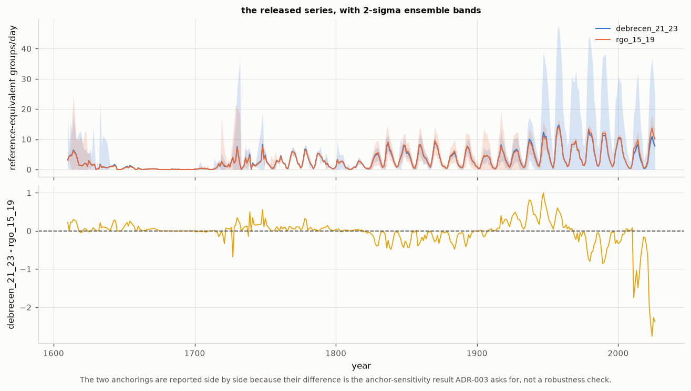

**Figure f36** — The two released series, and the number ADR-003 has been asking
for since Step 1. Anchored on Debrecen cycles 21–23 the mean reference-equivalent
count over the whole record is **3.818**; anchored on RGO cycles 15–19 it is
**3.915**. The two **agree to 2.5%**, which is the anchor-sensitivity result, and
it is small — the graph diagnostics said why in §2, where the resistance between
the two anchorings came out finite at 5.6×10⁻⁶ through the KMAS bridge. Anchorings
that are tied together cannot drift far apart.

**Both series start in 1610, and §2 said overlap stops at 1774.** So everything
before 1774 is carried by the activity-smoothness prior, not by any chain of
observers. That is the mechanism §4 predicted would have to do the work, and the
honest reading of the early record is that it is prior-dominated. The
`lambda_penalty` sensitivity below is how much that matters.

| Run | Anchoring | Observers | Mean GN | Median inflation | Weak modes | Activity-years measured |
|---|---|---|---|---|---|---|
| **R1** released, primary | Debrecen 21–23 | 508 | **3.818** | 10.02 | 277 | 58% |
| **R2** released, secondary | RGO 15–19 | 508 | **3.915** | 3.77 | 510 | 69% |
| R3 sensitivity | RGO 12–19 | — | — | — | — | failed (OOM) |

Two columns there deserve reading. **Weak modes differ by a factor of two between
the two anchorings** — 277 against 510 of roughly a thousand parameter directions
— so which anchor is chosen changes how much of the network the data constrains
rather than merely where the scale is pinned. And **42% and 31% of observer-years
fall outside the reference catalogue's own activity range**, so for those years
the detection ratio comes from the extrapolated parametric branch of §3 rather
than from measurement. Both numbers belong in any later claim about the early
record.

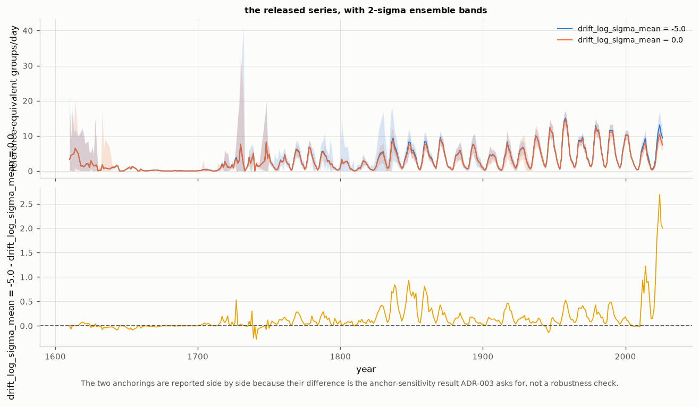

**Figure f35** — Drift reported as prior sensitivity, which is the only honest way
to report it: era-wide drift is not identified from sunspot data (identifiability
trap 2). Over Uto's full recommended range the mean moves **3.98 → 3.82 → 3.76**
for `μ_σ` = −5, −2, 0 — about **6%**, and in the direction a looser drift prior
predicts, since letting observers drift absorbs signal that would otherwise be
attributed to the Sun.

**The fingerprint ablation is the sharpest result of the four sensitivities, and
it confirms §4 on real data.**

| fingerprint weight `w` | Mean GN |
|---|---|
| 0.0 | 3.628 |
| 0.5 | 3.608 |
| **1.0** (released) | **3.818** |
| 2.0 | **7.676** |

Doubling the occupancy term's weight **doubles the series**. Turning it off
entirely moves the answer by 5%. That is what a term with almost no information
and a real capacity for harm looks like from the outside: §4 measured the
reference's activity-conditional count distribution as almost exactly Poisson
(variance/mean median 1.014), so thinning it carries no acuity signal, and on a
matched network the term doubled the scatter without reducing bias. On the real
record it does worse than that. **The evidence now favours `w = 0`**, and the
decision belongs to the PI since `w = 1` was a planning decision taken before any
of this was measured.

The other two knobs are better behaved. Smoothness moves the mean by 5%
(`λ` = 5 → 4.009, 20 → 3.818, 80 → 3.970, non-monotone), and widening the day
tolerance raises it monotonically as more edges enter (2 → 3.818, 5 → 3.950,
10 → 4.103), which is the direction more overlap should push a chained quantity.
Perturbing the ADR-011 activity exponents by ±50% — the SDSS drift-tilt analogue —
moves it by under 2% (3.898 and 3.816), so the exponents being held rather than
fitted is not where the risk is.

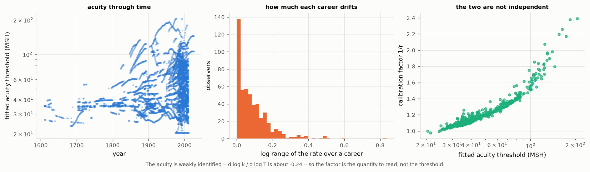

**Figure f37** — The observer parameter table as a picture, for the primary run.
The right panel is the caveat §5 measured: the factor and the threshold are not
independent, and `d log k / d log T ≈ −0.24` means the threshold is the weakly
identified one of the pair. Read the factor.

**One number not to trust yet.** R1's median inflation is **10.02** where every
other run at the same anchoring sits at 3.3–4.2, including runs differing only in
one knob. That is more likely bootstrap noise or GPU contention during the run
than a property of the primary configuration, and it is flagged rather than
quoted: the correction's size on the real network should be taken as the **3.3–4.2**
the replicates agree on until R1 is re-run on CPU.

## 9. The benchmark comparison: Step 2's eleven, with NetCal in

The grid finished 2026-11-26 06:21 after 14 h 7 m: 101 benchmark cells (plus one
surviving an earlier failed attempt), the 14 real-data runs, re-scoring and the
figures. All thirteen methods are scored on the **identical 51 worlds**, and only
the `NetCal` / `NetCal-M` cell files were written — the eleven methods' cells are
untouched on disk, so their Step 2 numbers cannot have moved.

Step 2 compared the eleven on six method-generic figures. All six are redrawn
here with the two new methods present, under Step 3 codes into
`figures/step-3/`, so Step 2's committed figures are never overwritten. **One
has no twin**: Step 2's f22, the structural ensemble, re-runs a method over its
*own* free graph choices, and that arm was not run for NetCal — an open PI
decision, not a missing input.

**The headline is that the pooled score and the era-resolved score say different
things, and the era-resolved one is the one this project is about.**

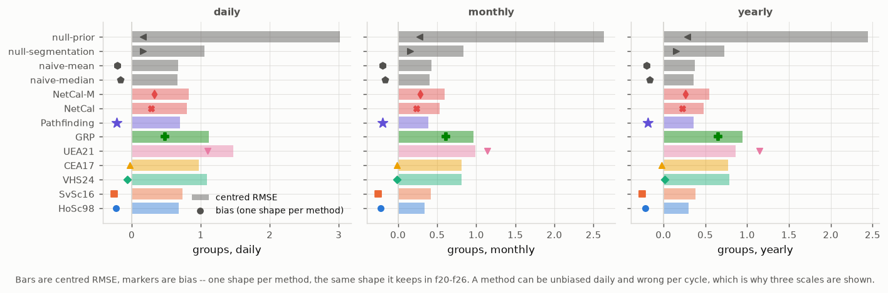

**Figure f32** — Point error at three averaging scales, pooled over all 51
worlds (Step 2's f18 with the new methods). **NetCal loses this comparison.**
Yearly cRMSE is **0.446** against HoSc98's 0.272, Pathfinding's 0.302 and the
raw-median floor's 0.341; paired per world, NetCal beats Pathfinding in only
**15 of 51** worlds and the floor in **12 of 51**. Its bias is **+0.18** where
the three chained methods sit near **−0.22** — it overestimates where they
underestimate. Read alone, this figure says the step's thesis failed.


**Figure f44** — The same error resolved in time (Step 2's f41), and the reason
f32 is misleading on its own. **NetCal holds the lowest-RMSE ribbon across
essentially all of 1650–1850**, and in the third panel it is the only method
that goes *below* the floor line in the Maunder window. The five chained methods
do not exist before 1774 — their lines simply start. The pooled number in f32 is
dominated by the data-rich years after 1850, where the floor and the chains are
strong and NetCal is not; the eras this project exists to reconstruct are the
ones where it wins. Both statements are true, and reporting only the first would
be as dishonest as reporting only the second.

| Era | NetCal | best published | floor (`naive-median`) |
|---|---|---|---|
| maunder-window | **0.396** | — *(none reach it)* | 0.534 |
| first-disconnection | **0.577** | — *(none reach it)* | 0.606 |
| second-disconnection | **0.512** | HoSc98 0.746 | 0.534 |
| pre-modern | 0.592 | HoSc98 0.469 | **0.414** |
| pre-anchor | 0.678 | HoSc98 0.401 | **0.259** |
| anchor-epoch | 0.525 | **CEA17 0.125** | 0.235 |
| post-anchor | 0.715 | Pathfinding 0.341 | **0.284** |
| extension-only | **0.823** | UEA21 2.221 | 0.858 |

Pooled RMSE per era, from [`step3_era_errors.csv`](data/step3_era_errors.csv).
NetCal is best in four of the eight eras and beats the floor in exactly those
four — the four with the least data.

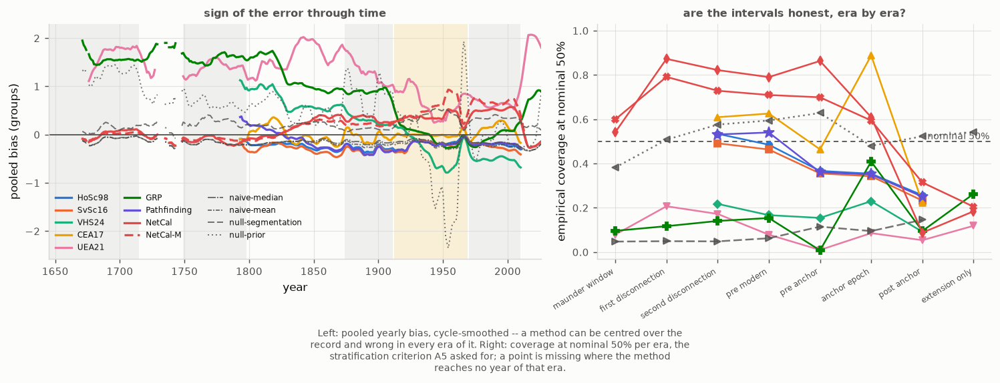

**Figure f45** — Bias and coverage era by era (Step 2's f42). Left: NetCal's
bias is near zero through the early record where UEA21 and GRP are **+1.5 to
+2 groups** — the error that made their Maunder estimates 24× high. Right: the
intervals are **honest in the wrong direction**. NetCal over-covers early
(0.60–0.79 against a nominal 0.50) and under-covers late (**0.31** post-anchor).
A single pooled coverage number hides both.

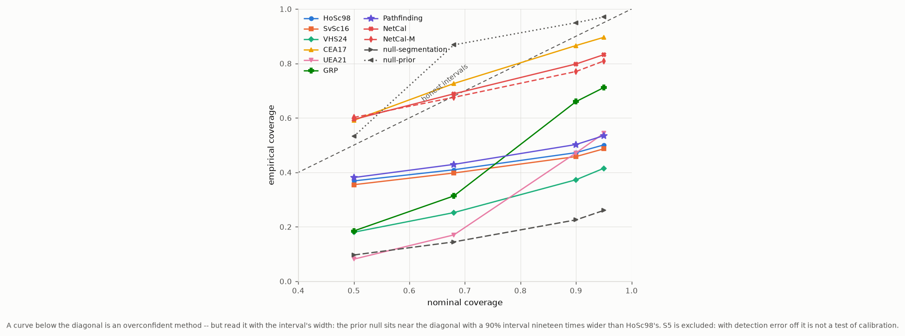

**Figure f33** — Interval coverage (Step 2's f20). NetCal is the
**second-best-calibrated method in the benchmark**: 0.584 / 0.682 / 0.797 /
0.834 against nominal 0.50 / 0.68 / 0.90 / 0.95, with 68% essentially exact.
It still **fails the acceptance criterion** on both halves — the 90% and 95%
deviations are 0.103 and 0.116 against a tolerance of 0.10, and the mean 90%
width is **3.60 groups** against the 1.92 bar. CEA17 passes both where NetCal
does not. The Godambe correction gets the shape of the uncertainty right and its
tails still too thin.


**Figure f34** — Reach and Maunder level, the two criteria the step was built
for. Left: NetCal reaches the **earliest era**, where five of the seven published
methods stop at `second-disconnection`; its median earliest year is **1682**
against **1774** for those five. Right: on the Maunder scenario NetCal is at
**0.94×** the true level and NetCal-M at **0.97×**, against **24.1×** for GRP
and **25.9×** for UEA21. Criterion A15 asked for ≤ 3× and this is the step's
clearest win. Reach still misses A14's 1660 target by 22 years, and the four
floors reach further back than any fitted method — reaching an era and being
right about it are different things, which is why both panels are shown.

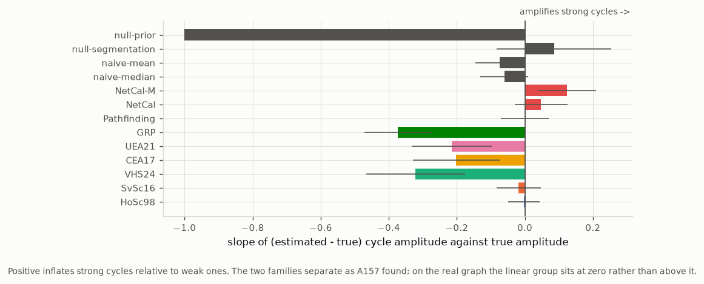

**Figure f43** — The secular-bias signature (Step 2's f19). A negative slope
damps strong cycles relative to weak ones, which is the shape a spurious secular
trend takes. NetCal is at **+0.055**, inside the band the linear scalings occupy
(HoSc98 −0.000, Pathfinding +0.000) and clear of the four non-parametric methods
at **−0.21 to −0.38**. NetCal-M at **+0.136** is the one arm that visibly
inflates strong cycles.

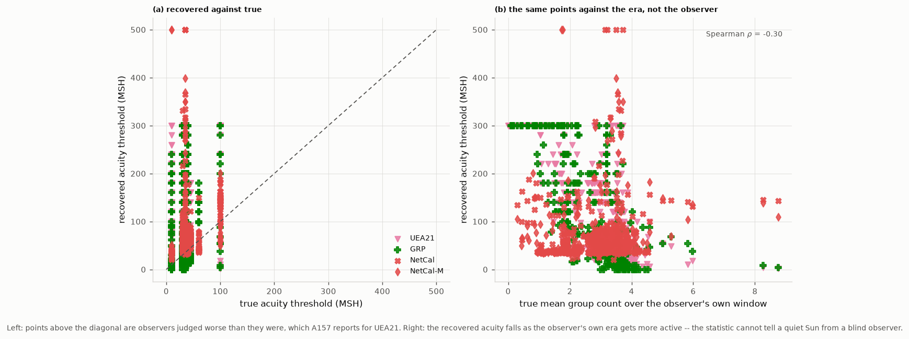

**Figure f31** — Acuity recovery (Step 2's f23). This is criterion A16, and
NetCal passes it: the Spearman correlation between recovered threshold and the
*era's* mean activity falls to **+0.129** (NetCal-M +0.270) from **−0.621** for
UEA21 and **−0.730** for GRP. The activity confound Step 2 diagnosed as "a
missing covariate, not a per-observer error" is gone. **The ρ = −0.30 printed in
the right panel is pooled over all four methods** and is not any method's own
value — the builder is Step 2's and annotates a single pooled statistic; the
per-method numbers above come from `case_study_observers.csv`. Fixing that
annotation would change Step 2's committed f23, so it is left alone and flagged
here.

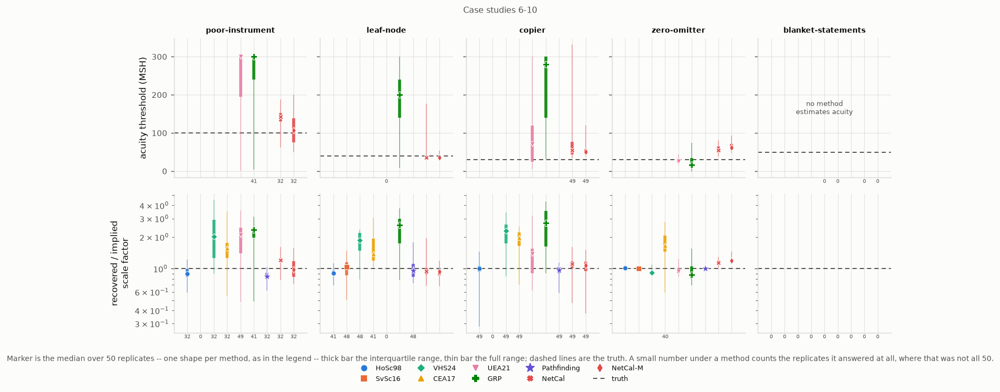

**Figure f47** — Case studies 6–10 (Step 2's f26), the hard ones. Step 2 called
`poor-instrument` the hardest case in the benchmark, with three of seven methods
more than 2× off and SvSc16 silent in all fifty replicates. **NetCal's scale
factor sits on the truth line in four of the five hard cases**, where GRP pins
at 200–300 MSH on `leaf-node` and `copier` and UEA21 pins at the 300 MSH grid
ceiling on `poor-instrument`. Across all case studies NetCal is more than 2× off
on **3.0%** of observers, against **40.7%** for UEA21 and **28.5%** for GRP.
`blanket-statements` remains unestimated by every method including NetCal.

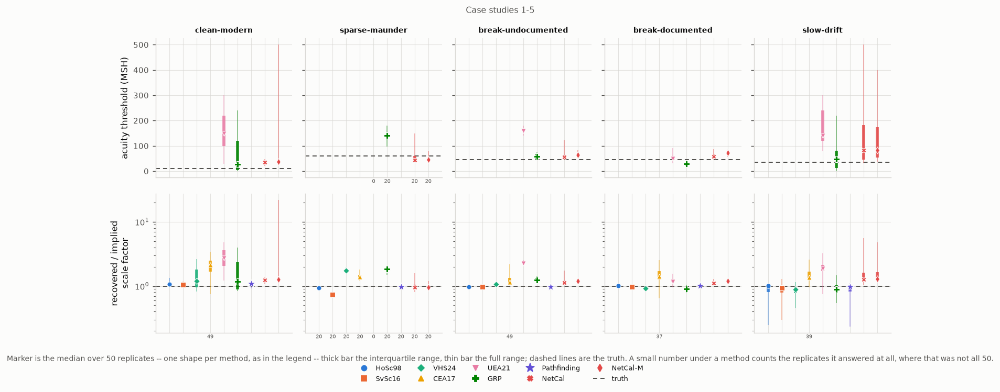

**Figure f46** — Case studies 1–5 (Step 2's f25). NetCal is on the truth line
for all five, including `sparse-maunder`, which only four methods answer at all.
Its ranges are wider than the linear scalings' on `slow-drift` — the drift prior
buys honesty about a career that moves, not precision.

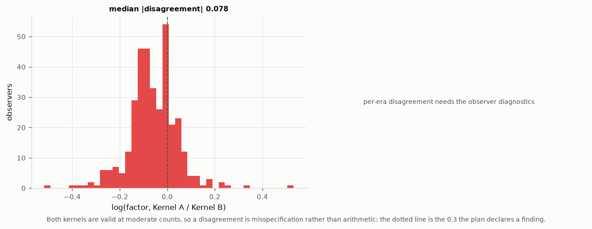

**Figure f38** — The two kernels against each other (criterion A19). Kernel A
wins the point comparison in **43 of 51** worlds, and NetCal-M's advantage is
confined to the eras where its low-count regime is the right one — it is better
than NetCal in `pre-modern` (0.438 vs 0.592) and `pre-anchor` (0.295 vs 0.678)
and worse everywhere else. The disagreement is reported rather than thresholded,
as the plan specified.

### What this settles, and what it does not

| Criterion | Measured | Bar | |
|---|---|---|---|
| A15 Maunder level | **0.94×** | ≤ 3× | pass |
| A16 activity confound | **ρ = +0.129** | ≤ 0.25 | pass |
| A19 kernel disagreement | reported (f38) | reported | pass |
| A14 reach | 1682; earliest era | ≤ 1660 | **miss by 22 yr** |
| Point error (spec) | yearly cRMSE **0.446** | ≤ 0.301 | **fail** |
| A18 concurrent beats chained | **15 of 51** | ≥ 34 of 51 | **fail pooled**, passes in the four sparse eras |
| Coverage (spec) | 0.797 / 0.834 at 90 / 95; width 3.60 | ±0.10; ≤ 1.92 | **fail** |
| A21 break-detection skill | absent from `scores.csv` | finite | **not wired** |

A21 is a wiring omission, not a result: `scoring.break_detection_skill` is
implemented and tested but never called from `scoring.score()`, so no `break_*`
column exists. A18's split verdict is the honest one — the plan anticipated it
("Separate calibration was more accurate when there were few common items …
that is a publishable finding against the step's own thesis, reported per era
rather than pooled"), and the per-era table above is that report.

## 10. What is implemented

| Module | What |
|---|---|
| `graph/overlap.py` | extended: one-to-one matched pairs with their lags, and a lossless 3.1× collapse |
| `graph/diagnostics.py` | resistance between anchor sets, per-year resistance, loop closure, the per-observer table |
| `models/emissions.py` | the catalogue-driven detection grid, emission tables, the activity-conditional count PMF |
| `models/activity_map.py` | `AL = a·GN^b`, fitted per anchoring |
| `models/network.py` | the two kernels, the occupancy term, the smoothness penalty, the drift priors, the series |
| `inference/composite.py` | mode finding, the chunked Hessian, the block bootstrap, the Godambe sandwich, draws |
| `baselines/netcal.py` | `NetCal` and `NetCal-M` in the Step 2 scorer's own shape |
| `viz/network.py` | f29–f40 |

**The Step 2 integration is one flag.** `scripts/score_benchmark.py` discovers
cells by globbing `*_series.parquet`, and `run_baselines.py` dispatches through
`ALL_METHODS`, so Step 3's methods are scored against the eleven by
`run_baselines.py --methods NetCal NetCal-M` with no change to either script.

Three performance fixes were needed to make a real-scale fit finish at all, and
each is a general lesson rather than a local tweak:

- the pair→slot lookup was 4.7M Python dict lookups (15 s); packing the key and
  using `searchsorted` removed it;
- the per-observer uncertainty differentiated over all 5,688 parameters instead
  of the 699 that carry covariance;
- `jax.hessian` materializes every tangent at once — 699 tangents against a 4.7M
  row objective — and never returns. `hessian_by_chunks` is exact (identical to
  `jax.hessian` to 0.00e+00) with memory bounded by the batch.

## 11. Reproducing this, and what the PI needs to launch

Quick, and all of it runs in a session:

```bash
conda activate gn-next-gen
pytest && pytest -m slow
ruff check . && ruff format --check .
python scripts/graph_diagnostics.py          # §2, about 6 min
python scripts/make_step3_figures.py --graph-only
```

The long work is **one command**, detached, resumable, and it refuses to mix runs:

```bash
cd /d0/amunozj/git_repos/GN_Next_Gen
./scripts/run_step3_grid.sh --detach
./scripts/run_step3_grid.sh --status
```

| Stage | What | Needs |
|---|---|---|
| `graph` | §2's diagnostics | nothing |
| `benchmark` | `NetCal`, `NetCal-M` over Step 2's 51 worlds | the worlds on disk |
| `runs` | 2 released anchorings + 12 sensitivities | nothing |
| `score` | re-score, so Step 3 lands in Step 2's tables | the cells |
| `figures` | f29–f40; skips with a reason | whatever exists |

`scripts/run_network_calibration.py --list` prints the 14 runs; `--quick` is a
smoke test and is not a result.

**Two things this grid does not do**, both one command each if wanted:

- **No structural ensemble for the new methods.** Step 2's f22 measures the spread
  a method's own free graph choices produce, and `NetCal` does use the graph, so
  it would be informative. Add with
  `run_baselines.py --methods NetCal NetCal-M --structural`.
- **Coverage is scored for the corrected intervals only.** The plan's criterion
  asks for coverage under `H⁻¹` *and* under `V`; the measured inflation (3.53,
  §7) is the size of the difference, but a separately scored uncorrected arm
  would need a thirteenth registered method and another 51 cells. The decision is
  the PI's, and the uncorrected coverage is not claimed anywhere until it is run.

## 12. What Step 4 inherits

Even unfinished, this step hands Step 4 things it would otherwise have to
discover. Several are warnings.

| Setting | Value | Why |
|---|---|---|
| Detection ratio | **measure it in the catalogue**, binned by activity; keep the parametric law only to extrapolate | The law is biased one way by 4–13% (§3). Deviation D1 |
| Grain correction | **does not apply** to a measured ratio | Counting rows above a threshold is already per-group-day; Step 1 §2.4's shift converts the *published* law only |
| Activity weighting | **instantaneous**, one scale shared by the detection grid, the activity map and the count PMF | The two weightings differ by about six; mixing them misplaces every observer on the activity axis, and a stale test bound caught exactly that |
| Activity before 1874 | `AL = 0.2155·GN^1.1414` (RGO), `0.2038·GN^1.1600` (Debrecen) | Tight (r > 0.994), agrees across a century, and passes through the origin so a grand minimum has no area (§5) |
| Latent count distribution | **almost exactly Poisson at fixed activity** — var/mean median 1.014 over 24 bins | So the ADF-style fingerprint carries almost no acuity information, and a shape-based term should not be relied on (§4) |
| Acuity identifiability | `d log k / d log T` ≈ **−0.24** | The threshold is constrained four times less well than the rate; report the rate, and read any acuity-recovery panel as a picture of a weakly identified parameter (§5) |
| Composite likelihood | needs the sandwich, and the meat is `G_lik + H_penalty` | Uncorrected it is **3.5× overconfident** on a real network (§7); the plain sandwich runs 12× the wrong way (§6) |
| Weak directions | **233 of 699** on a real world | A third of the parameter space is prior-held. Step 4's contraction map should expect the same and report it |
| Reach | **1774** is the overlap limit, for both anchorings | Anything earlier comes from a prior, not from overlap (§2) |
| Anchors | **tied**, resistance 5.6×10⁻⁶ through KMAS | The anchor-sensitivity difference will be a measurement (§2) |
| Floating observers | **83 of 509**, 59 components | Each is one exact Laplacian null mode (§2) |
| Emission module | `models.emissions` | The module `inference.forward_filter.count_emissions` promised Step 4; it is built and tested |
| Cost shape | mode 344 s, correction 401 s, ~10 GB peak | Memory caps parallelism, not cores (§7) |

## 13. What this step does not establish

Stated plainly, because a half-run step that reads as finished is worse than one
that says where it stopped.

1. **No benchmark score exists yet.** Criteria A14–A19 and all four spec criteria
   are open. The figures that will show them are wired and tested but have no data
   behind them until the grid finishes. Nothing in this document compares `NetCal` to any published method,
   and §5's recovery numbers are from a *matched* simulation, which by
   construction cannot be a benchmark.
2. **No series has been produced.** The two released anchorings, the
   anchor-sensitivity comparison ADR-003 asks for, and the Maunder-era level are
   all pending the real-data runs.
3. **The reported interval will not cover drift.** The covariance is computed over
   the per-observer level parameters and the global overdispersion, with the drift
   trajectory held at its posterior mode. Drift's effect is reported as prior
   sensitivity over `μ_σ ∈ {−5, −2, 0}` instead (criterion A20), because era-wide
   drift is not identified from sunspot data at all.
4. **Effective resistance is the random part only.** Systematic per-link bias adds
   coherently and never averages down. f30's loop closure and the two-kernel
   comparison in f38 are what probe it; f29 does not.
5. **Reach past 1774 will rest on a prior, not on data.** §4 shows the fingerprint
   term carries almost no information once activity is conditioned on, so whatever
   reach the fitted series achieves comes from the activity-smoothness penalty.
   That is a legitimate mechanism with an explicit warning attached, and the
   `lambda_penalty` sensitivity is what will show how much of the early record is
   prior rather than evidence.
6. **The loop-closure diagnostic uses legacy-style links.** The 0.060 median
   closure is a property of robust proportional pairwise fits, which is the right
   comparator for the chained methods but is not the concurrent fit's own residual.
7. **`k` and the split rate are identified only as a product** by Kernel A. The
   shape terms that would separate them carry little information (§4), so the
   split rate should be expected to sit near its prior.
